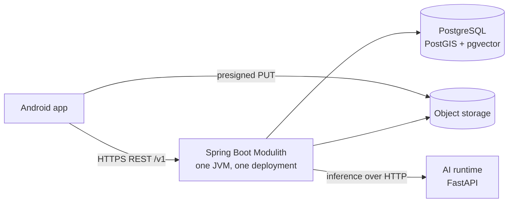

# Hanoi Lens

A privacy-aware Android app for exploring Hanoi's landmarks, heritage sites, and scenic places through photography. USTH Group Project, academic year 2025–2026.

Users sign in, preview heritages, and mark the ones they want to visit. When GPS confirms arrival, the heritage is unlocked and its explore page and visit map open. Every heritage preview offers a historical Q&A assistant (RAG); on site, users can photograph a landmark to identify it and ask about its history with cited sources. The app also lists cultural events in Hanoi. Photos and progress are saved in a private travel journal with journey stamps, a stamp collection, and destination or monthly recaps, and unlocking every marked heritage earns a Journey Stamp badge and a random gift. The app never prescribes routes, and users can stop at any time.

## Architecture

| Part | Folder | Technology | Role |
|---|---|---|---|
| Android client | [`android/`](android/) | Java, XML layouts, MVVM, ViewBinding, CameraX, Retrofit/OkHttp, Room | UI, on-device location and geofence presence, photo capture and editing |
| Backend | [`backend/`](backend/) | Java 17, Spring Boot 3.x, Spring Modulith, Spring Security (JWT), Spring Data JPA | One deployable modular monolith: REST API `/v1`, business modules, scheduled jobs, AI orchestration |
| AI runtime | [`ai-runtime/`](ai-runtime/) | Python, FastAPI | Optional inference adapter for exactly two models: landmark image classification and historical RAG. Called only by the backend |
| Database | — | PostgreSQL 16 + PostGIS + pgvector | Records, spatial geofences (SRID 4326), RAG vectors |
| Object storage | — | S3-compatible (MinIO / S3) | Original photos (immutable) and derived images |

The backend has seven in-process modules in `vn.edu.usth.hanoilens.modules.*`: `identity`, `profile`, `destination`, `event`, `visit`, `media`, `recap`. They are source-code boundaries, not separate services; each table has one owning module. Background work runs in-process (Modulith events, `@Scheduled`); there is no message broker.

Privacy rules: no continuous GPS trails, exact coordinates are discarded after the arrival check, original photos are immutable, and GPS/device EXIF is stripped from every derived or shared image.

## MVP scope

- Required sign in / sign up; JWT access tokens with rotating refresh tokens and ownership checks on private data.
- Destination browsing, a combined map of heritages and events, and a detailed pilot destination with landmarks.
- Heritage preview with the historical RAG assistant (static fallback when AI is unavailable).
- Self-marked heritages, GPS geofence arrival that unlocks the heritage, heritage explore page, and on-device visit map.
- Photo capture and hardened presigned upload; landmark classification with an `UNKNOWN` fallback, then landmark info and AI chat scoped to that landmark.
- Non-destructive photo editing (crop, straighten, brightness, contrast, filters) and Journey Stamp watermarks.
- Visit lifecycle: start, pause, resume, finish; stamp collection, then Journey Stamp badge and random gift when every marked heritage is unlocked.
- Travel journal with photos, timestamps, visited landmarks, destination recap, and photo download.
- Curated cultural event feed (deterministic parsers, admin review) and an event memory page.
- User-selectable location privacy, automated EXIF/location-leak checks, threat model and security test evidence.
- Simulator mode for location testing and demos.

Out of scope for the MVP: AR or live camera analytics, object detection with bounding boxes, large-scale scraping, public social features, photography tips.

## Team

| # | Name | Student ID | Role |
|---|---|---|---|
| 1 | Nguyễn Minh Hoàng | 2410315 | AI: Computer Vision |
| 2 | Lê Bá Ninh | 23BA14224 | Journeys, Events & Rewards |
| 3 | Lê Hiền Anh | 2410042 | Discovery, Map & Arrival |
| 4 | Nguyễn Minh Lương | 23BA14184 | AI: Historical RAG |
| 5 | Lương Quỳnh Anh | 23BA14008 | Camera, Photos, Album & Recap |
| 6 | Hà Thế Duy | 2410207 | Cyber Security & QA |
| 7 | Lê Bá Tiệp | 23BA14282 | Accounts, Profile & AI Integration |

Folder owners review pull requests for their folder ([CODEOWNERS](.github/CODEOWNERS)): `backend/` Lê Bá Tiệp (`@lebatiep`), `android/` Lương Quỳnh Anh (`@qual05`), `ai-runtime/` Nguyễn Minh Hoàng (`@NMH1203`) and Nguyễn Minh Lương (`@luongnm23ba14184-lgtm`). Everything else (docs, root files) is reviewed by `@NMH1203`.

## Documentation

- [Product brief](docs/HANOI_LENS_PRODUCT_BRIEF.md) — product behavior and privacy intent
- [Architecture](docs/ARCHITECTURE.md) — modules, data ownership, flows, ADRs
- [REST API contract](docs/API.md) — proposed `/v1` endpoints
- [Security baseline](docs/SECURITY.md) — MVP security and privacy requirements
- [User and system flows](docs/flows/) — corrected flows with diagrams in [docs/Diagram](docs/Diagram/)
- [Git workflow](docs/GIT_WORKFLOW.md) — branches, commits, pull requests
- [Project structure and naming](docs/PROJECT_STRUCTURE_AND_NAMING.md) — folder layout and naming rules
- Work plan: Google Sheet **Task** (tasks `T01`–`T45`, owners and dates)

## Status

The Android Gradle skeleton is in `android/`; its Java/XML foundation includes Navigation, the five-item bottom bar, Retrofit/OkHttp, Room destination caching, and an Explore MVVM example. Backend and AI runtime implementation remains under development. See each folder README for current setup details.
