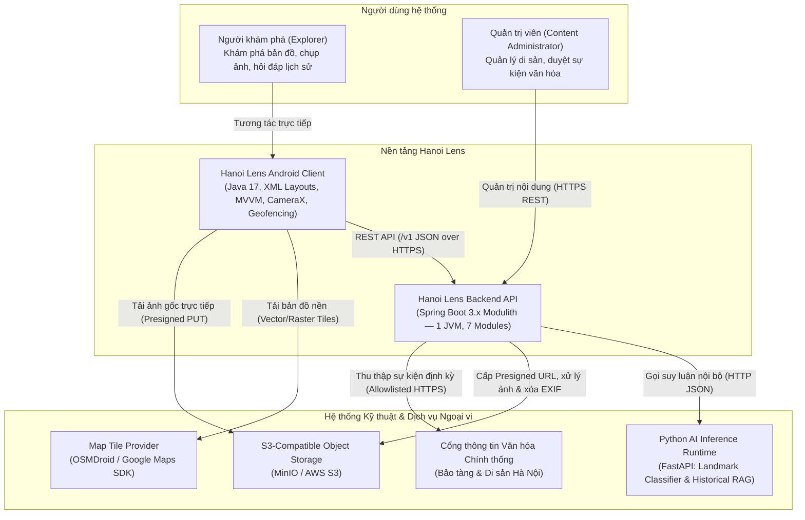
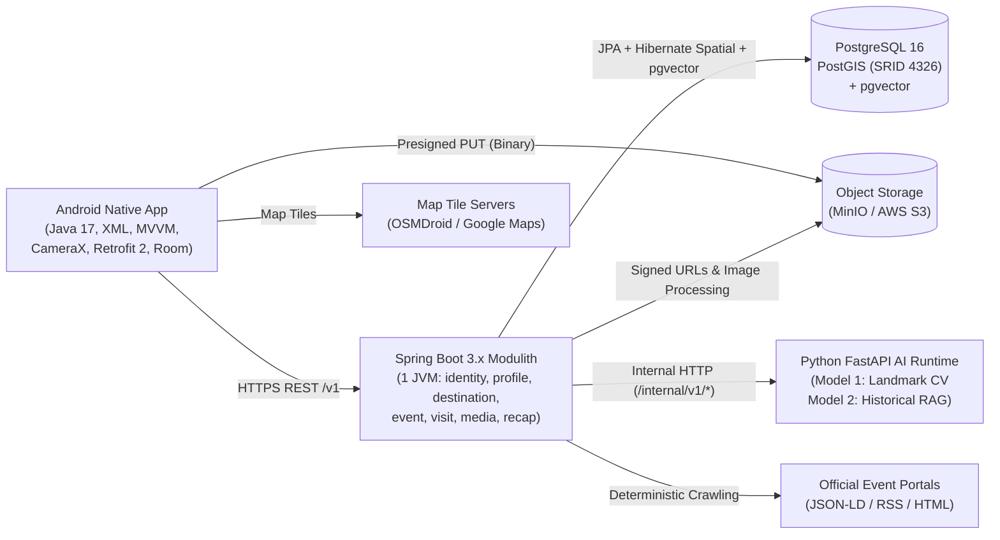

# 02. Kiến Trúc Hệ Thống — Hanoi Lens (System Architecture & Project Structure)

> **Kiến trúc mục tiêu:** Android Native Client (`Java 17 + XML Layouts`) + Single-deployment `Spring Boot 3.x Modulith` Backend (7 modules) + `PostgreSQL 16` (`PostGIS` + `pgvector`) + `S3/MinIO` + `Python FastAPI AI Runtime` (2 models).  
> **Tài liệu liên quan:** [01_OVERVIEW.md](01_OVERVIEW.md) | [03_DATA_AND_CONTRACT.md](03_DATA_AND_CONTRACT.md)

---

## 1. Kiến Trúc Tổng Thể Hệ Thống (System Context & Container Architecture)

### 1.1 Sơ đồ ngữ cảnh hệ thống (System Context Diagram)



### 1.2 Sơ đồ kiến trúc Container (Container Architecture Diagram)

Toàn bộ Backend nghiệp vụ được đóng gói và triển khai dưới dạng **một tiến trình JVM duy nhất (Single Deployable Spring Boot Modulith)**. Các module nghiệp vụ, bộ lập lịch thu thập sự kiện (`Scheduled Jobs`), trình xử lý bất đồng bộ (`In-process Async Handlers`) và tầng điều phối AI đều nằm chung trong container này.



### 1.3 Bảng phân định trách nhiệm & Công nghệ theo Container

| Thành phần (Container) | Công nghệ cốt lõi | Trách nhiệm chính |
| :--- | :--- | :--- |
| **Mobile Client** | Android Native (`Java 17`, `XML Layouts`), `MVVM`, `Jetpack ViewBinding`, `CameraX`, `Retrofit 2` + `OkHttp 3`, `Room`, `OSMDroid` / `Google Maps SDK`, `FusedLocationProviderClient`, `EncryptedSharedPreferences` | Giao diện người dùng `Material Design 3`, kiểm tra sự hiện diện GPS (`Presence-only Geofencing`), bản đồ nội khu trực tiếp trên thiết bị, chụp ảnh, chỉnh sửa ảnh không phá hủy, kết xuất khung tem `Journey Stamp` và lưu đệm ngoại tuyến. |
| **Backend API** | `Java 17/21`, `Spring Boot 3.x`, `Spring Modulith`, `Spring Security` (`JWT` + `Argon2id`), `Spring Data JPA`, `Hibernate Spatial`, `Flyway`, `Springdoc OpenAPI` | Thực thi toàn bộ logic nghiệp vụ qua **7 modules**, kiểm soát quyền sở hữu tài nguyên (`Ownership Authorization`), cấp `Presigned PUT URL`, xử lý ảnh dẫn xuất + xóa `EXIF`, cào dữ liệu sự kiện xác định và điều phối gọi AI. |
| **Database** | `PostgreSQL 16` + `PostGIS` (`SRID 4326`) + `pgvector` | Lưu trữ giao dịch quan hệ (ACID), truy vấn không gian địa lý (`ST_DWithin`, `ST_Contains` cho Geofence) và tìm kiếm tương đồng vector (`HNSW` / `IVFFlat` cosine distance `<=>` cho kho tri thức RAG). |
| **Object Storage** | `MinIO` (Local/Staging) / `AWS S3` hoặc `Cloudflare R2` (Production) | Lưu trữ bất biến ảnh gốc (`immutable original assets`), ảnh thu nhỏ (`thumbnails`), biến thể đã chỉnh sửa (`edit variants`) và ảnh xuất kèm đóng dấu (`watermarked exports`). |
| **AI Runtime** | `Python 3.11+`, `FastAPI`, `PyTorch` (`ViT` / `ResNet` / `YOLO-cls`), Embedding Model & Grounded LLM Runtime | Cung cấp **đúng 2 năng lực suy luận kỹ thuật**: (1) Phân loại địa danh từ ảnh (`Landmark Image Classification`) và (2) Sinh câu trả lời lịch sử từ ngữ cảnh đã truy xuất (`Historical RAG`). Không sở hữu dữ liệu nghiệp vụ và không mở API trực tiếp cho Android Client. |

---

## 2. Thiết Kế Mô-đun & Mẫu Kiến Trúc (Design Patterns & Modular Design)

### 2.1 Kiến trúc 7 Modules trong Spring Modulith (`backend`)
Sau khi loại bỏ module `guidance` theo **ADR 010**, Backend gồm đúng **7 application modules** độc lập về ranh giới mã nguồn và quyền sở hữu bảng dữ liệu:

| # | Module Package | Bảng dữ liệu sở hữu (Owned Tables) | Trách nhiệm nghiệp vụ cốt lõi |
| :--- | :--- | :--- | :--- |
| **1** | `modules.identity` | `users`, `refresh_tokens`, `audit_logs` | Đăng ký, đăng nhập (`Argon2id`), phát hành `Access JWT` (≤ 15 phút), xoay vòng và thu hồi `Opaque Refresh Token`, cung cấp `UserDetails` cho Spring Security. |
| **2** | `modules.profile` | `profiles` | Quản lý hồ sơ người dùng, ngôn ngữ (`locale`) và chính sách độ chính xác vị trí mặc định (`defaultLocationPrecision`: `NONE`, `DESTINATION`, `DISTRICT`, `APPROXIMATE`, `EXACT`). |
| **3** | `modules.destination` | `destinations`, `landmarks`, `arrival_checks` | Quản lý di sản, công trình kiến trúc con (`landmarks`), ranh giới địa lý `PostGIS`, truy vấn tìm kiếm lân cận (`nearby`) và kiểm tra hiện diện `Arrival Check`. |
| **4** | `modules.event` | `event_sources`, `cultural_events`, `event_imports` | Quản lý nguồn tin chính thống, lập lịch thu thập (`@Scheduled`) và bóc tách sự kiện bằng **Deterministic Event Parser**, lưu nháp `PENDING_REVIEW` chờ Admin duyệt. |
| **5** | `modules.visit` | `visits`, `visit_marked_heritages`, `visit_landmarks`, `rewards` | Quản lý vòng đời chuyến khám phá (`ACTIVE`, `PAUSED`, `ENDED`, `CANCELLED`), ràng buộc tối đa 1 chuyến đang chạy mỗi user, ghi nhận địa danh đã qua và trao thưởng `Journey Stamp Badge` + quà ngẫu nhiên. |
| **6** | `modules.media` | `upload_sessions`, `photos`, `photo_variants`, `watermark_exports`, `landmark_recognitions` | Quản lý phiên tải ảnh `Presigned PUT`, xác thực magic bytes/decoded image, xóa `EXIF`, lưu công thức chỉnh sửa ảnh, xuất ảnh đóng dấu và gọi AI nhận diện địa danh. |
| **7** | `modules.recap` | `albums`, `recaps`, `recap_photos`, `knowledge_chunks`, `qa_conversations`, `qa_messages` | Tự động tạo Album theo điểm đến, xử lý bất đồng bộ bản tổng kết (`Destination/Monthly Recaps`), quản lý kho tri thức vector `pgvector` và điều phối hỏi đáp `Historical RAG`. |

**Quy tắc ranh giới bắt buộc (Enforced by `ModularityTests`):**
- Kiểm thử tự động `ApplicationModules.of(HanoiLensApplication.class).verify()` phải vượt qua (PASS) trên mọi bản build để chặn phụ thuộc vòng (circular dependencies) và truy cập trái phép vào package nội bộ của module khác.
- Mỗi module chỉ được phép đọc/ghi trực tiếp trên các bảng do chính module đó sở hữu.
- Giao tiếp liên module chỉ được thực hiện qua **Application Service Interfaces** được công bố ở package gốc của module hoặc qua **Spring Modulith Application Events** (`@ApplicationModuleListener`) kết hợp `Idempotency` và `Event Publication Registry`.

### 2.2 Kiến trúc phân tầng nội bộ Backend (Backend Layered Architecture)
Mỗi module trong `modules/*` tuân thủ cấu trúc 5 tầng rõ ràng:

```text
[1. Controller Layer (*.controller)]  ──> Nhận HTTP Request, kiểm tra @Valid DTO, xác thực JWT Principal
              │
              ▼
[2. Service Layer (*.service)]        ──> Điều phối Transaction (@Transactional), kiểm tra Ownership (chống IDOR/BOLA), phát sự kiện
              │
              ▼
[3. Domain/Entity Layer (*.entity)]   ──> Thực thể JPA/PostGIS, trạng thái vòng đời (State Machine), quy tắc nghiệp vụ cốt lõi
              │
              ▼
[4. Repository Layer (*.repository)]  ──> Giao diện Spring Data JPA, truy vấn không gian PostGIS & truy vấn vector pgvector
              │
              ▼
[5. Adapter Layer (*.adapter)]        ──> Tích hợp ngoại vi: S3 Storage Adapter, Deterministic Event Parser Adapter, AI Inference Client Adapter
```

### 2.3 Kiến trúc MVVM trên Android Client (`android-client`)
Ứng dụng Android được xây dựng bằng **Java 17** và **XML Layouts** theo mô hình **MVVM (Model-View-ViewModel)**:
- **View Layer (`ui/*`, `res/layout/*.xml`):** Các `Activities` và `Fragments` sử dụng **Jetpack ViewBinding** để gắn kết giao diện an toàn kiểu dữ liệu (type-safe), chỉ quan sát (`observe`) `LiveData` từ `ViewModel` và không chứa logic nghiệp vụ hay gọi mạng trực tiếp.
- **ViewModel Layer (`viewmodel/*`):** Quản lý trạng thái giao diện (`UiState`), sống sót qua thay đổi cấu hình (xoay màn hình) và điều phối các luồng bất đồng bộ thông qua `Repository`.
- **Data & Repository Layer (`data/repository/*`, `data/api/*`, `data/local/*`):** Kết hợp dữ liệu từ REST API (`Retrofit 2 + OkHttp 3` kèm `AuthInterceptor` & `TokenAuthenticator`) với bộ nhớ đệm cục bộ (`Room Database` cho danh sách di sản/chuyến đi và `EncryptedSharedPreferences` cho Refresh Token).
- **Hardware & Utility Modules (`location/*`, `camera/*`, `util/*`):**
  - `GeofenceManager` & `LocationSimulator`: Lấy vị trí từ `FusedLocationProviderClient` (hoặc tọa độ giả lập khi bật Simulator Mode) chỉ để thực hiện kiểm tra đến nơi và hiển thị trên `Visit Map` nội bộ, không lưu tọa độ thô xuống bộ nhớ không an toàn.
  - `CameraController` & `ImageEditorProcessor`: Chụp ảnh bằng `CameraX` và áp dụng bộ lọc/cắt xoay ảnh không phá hủy bản gốc.
  - `JourneyStampRenderer` & `ExifPrivacySanitizer`: Vẽ khung tem hành trình (`Canvas/Bitmap`) và kiểm tra loại bỏ siêu dữ liệu nhạy cảm phía client trước khi chia sẻ.

### 2.4 Cơ chế Deterministic Event Parsing & Luồng Vision-to-RAG
- **Deterministic Event Parsing (Không dùng AI):** Một tiến trình lập lịch (`@Scheduled`) trong module `event` định kỳ truy cập các cổng thông tin văn hóa trong danh sách cho phép (`allowlist`), bóc tách dữ liệu qua bộ phân tích xác định (`JSON-LD` -> `RSS` -> `CSS Selectors` + bộ quy tắc chuẩn hóa ngày giờ tiếng Việt), khử trùng lặp bằng mã băm (`canonical URL + title/time/venue fingerprint`) và lưu ở trạng thái `PENDING_REVIEW` để Admin phê duyệt.
- **Vision-to-RAG Handoff:**
  - *Trước chuyến đi (`Heritage Preview`):* Người dùng hỏi đáp trực tiếp với **Model 2 (Historical RAG)** chỉ với `destinationId`.
  - *Tại điểm di sản (`On-site Visit`):* Từ `Visit Map`, người dùng chụp ảnh công trình và gửi tới **Model 1 (Landmark Classifier)**. Nếu kết quả là `RECOGNIZED` (độ tin cậy đạt ngưỡng), ứng dụng mở trang `Landmark Info` và cho phép chat với **Model 2 (Historical RAG)** được lọc chính xác theo `landmarkId` đó. Nếu kết quả là `UNKNOWN`, ứng dụng thông báo rõ ràng và đưa người dùng quay lại `Visit Map`, tuyệt đối không tự ý gán bừa một địa danh.

---

## 3. Tóm Tắt 10 Quyết Định Kiến Trúc (Architecture Decision Records — ADRs)

| Mã ADR | Quyết định kiến trúc (Decision) | Lý do cốt lõi (Rationale) & Hệ quả kỹ thuật (Consequences) |
| :--- | :--- | :--- |
| **ADR 001** | **Sử dụng Spring Modulith (Modular Monolith) cho MVP** | Các luồng nghiệp vụ có tính giao dịch cao; triển khai 1 tiến trình JVM giúp nhóm phát triển, gỡ lỗi và kiểm thử nhanh chóng mà không tốn chi phí vận hành microservices. Ranh giới module được khóa chặt bằng `ApplicationModules.verify()`. |
| **ADR 002** | **Sử dụng PostgreSQL kèm PostGIS** | Hợp nhất dữ liệu giao dịch quan hệ và dữ liệu không gian địa lý (`SRID 4326`), tận dụng chỉ mục không gian (`GIST`) cho truy vấn `ST_DWithin` và `ST_Contains`. |
| **ADR 003** | **Lưu trữ file ảnh trên S3-Compatible Object Storage** | Tách biệt file nhị phân dung lượng lớn khỏi cơ sở dữ liệu; hỗ trợ tải lên trực tiếp từ Android qua `Presigned PUT URL` và quản lý các biến thể ảnh hiệu quả. |
| **ADR 004** | **Xử lý bất đồng bộ cho Media, Crawler và Recap** | Đẩy các tác vụ nặng (tạo ảnh thu nhỏ, đóng dấu watermark, cào sự kiện, gọi LLM tạo Recap) ra khỏi luồng HTTP đồng bộ bằng `@Async` và `Spring Modulith Events` có lưu trạng thái bền vững (`PENDING/PROCESSING/READY/FAILED`). |
| **ADR 005** | **Áp dụng chính sách độ chính xác vị trí tại tầng Backend Domain** | Bảo vệ quyền riêng tư của người dùng không thể chỉ phụ thuộc vào giao diện Client; mọi DTO trả về và ảnh xuất bản đều bị kiểm duyệt bởi `LocationPrecision` ngay tại Server. |
| **ADR 006** | **Xây dựng Mobile Client bằng Android Native (Java 17 + XML Layouts)** | Kiểm soát tối đa phần cứng thiết bị (`CameraX`, `FusedLocationProviderClient`, xử lý `Bitmap/Canvas` cho tem hành trình) với kiến trúc `MVVM` chuẩn mực, ổn định. |
| **ADR 007** | **Hợp nhất cơ sở dữ liệu Không gian và Vector (`PostGIS` + `pgvector`)** | Dùng chung một cụm `PostgreSQL 16` cho cả `PostGIS` và `pgvector`, loại bỏ độ phức tạp khi phải đồng bộ thêm một Vector DB riêng lẻ (như Milvus/Pinecone) và cho phép truy vấn lai (lọc vector theo `destination_id` và `landmark_id`). |
| **ADR 008** | **Giới hạn phạm vi AI đúng 2 Model: Landmark Vision & Historical RAG** | Chỉ triển khai **Model 1 (Landmark Image Classification)** và **Model 2 (Domain-grounded Historical RAG)**. Thu thập sự kiện dùng bộ phân tích xác định (`Deterministic Parser`); loại bỏ phân tích camera thời gian thực. |
| **ADR 009** | **Đưa Bảo mật & Quyền riêng tư thành hạng mục bắt buộc của MVP** | Bắt buộc hoàn thành `Threat Model` cho 5 luồng chính, chống `IDOR/BOLA`, khóa chặt `Presigned Upload URL`, và kiểm thử tự động xác nhận xóa sạch `GPS/Device EXIF` trước khi nghiệm thu. |
| **ADR 010** | **Loại bỏ tính năng Photography Tips và xóa module `guidance`** | Tập trung nguồn lực vào khám phá di sản, mở khóa GPS, nhận diện địa danh, hỏi đáp RAG và lưu giữ nhật ký ảnh. Backend được tinh gọn còn đúng **7 modules** (`identity`, `profile`, `destination`, `event`, `visit`, `media`, `recap`). |

---

## 4. Sơ Đồ Cây Thư Mục Toàn Dự Án (Standardized Project Directory Tree)

Cấu trúc thư mục dưới đây là chuẩn tham chiếu duy nhất cho toàn bộ mã nguồn của dự án tại `/home/minhluong/Documents/HanoiLens`:

```text
HanoiLens/
├── README.md
├── TODO.md
├── .gitignore
├── .env.example
├── docker-compose.yml
├── docs/
│   ├── INDEX.md
│   ├── 01_OVERVIEW.md -> 08_ENVIRONMENT_SETUP.md
│   └── Diagram/
├── backend/
│   ├── pom.xml
│   └── src/
│       ├── main/java/vn/edu/usth/hanoilens/
│       │   ├── HanoiLensApplication.java
│       │   ├── shared/ (ApiResponse, ErrorResponse, GlobalExceptionHandler, SecurityConfig, OpenApiConfig)
│       │   └── modules/
│       │       ├── identity/ (controller, service, entity, repository)
│       │       ├── profile/ (controller, service, entity, repository)
│       │       ├── destination/ (controller, service, entity, repository)
│       │       ├── event/ (controller, service, adapter, entity, repository)
│       │       ├── visit/ (controller, service, entity, repository)
│       │       ├── media/ (controller, service, adapter, entity, repository)
│       │       └── recap/ (controller, service, adapter, entity, repository)
│       ├── main/resources/ (application.yml, db/migration/V1..V5__*.sql tách theo thứ tự khóa ngoại)
│       └── test/java/vn/edu/usth/hanoilens/ (ModularityTests.java, security/SecurityBaselineTests.java)
├── android-client/
│   ├── build.gradle
│   └── app/src/main/
│       ├── AndroidManifest.xml
│       ├── java/vn/edu/usth/hanoilens/
│       │   ├── data/ (api, local, model, repository)
│       │   ├── location/ (GeofenceManager, LocationSimulator)
│       │   ├── camera/ (CameraController, ImageEditorProcessor)
│       │   ├── util/ (JourneyStampRenderer, ExifPrivacySanitizer)
│       │   ├── ui/ (auth, explore, map, visit, events, ai, camera, journal)
│       │   └── viewmodel/ (ExploreViewModel, VisitViewModel, JournalViewModel, AiChatViewModel)
│       └── res/ (layout, values, menu, drawable)
└── ai-service/
    ├── requirements.txt
    ├── app/
    │   ├── main.py
    │   ├── api/ (routes_vision.py, routes_rag.py)
    │   ├── vision/ (classifier.py, preprocess.py)
    │   └── rag/ (retriever.py, generator.py, ingest_corpus.py)
    └── tests/ (test_inference_contracts.py)
```
