# 03. Thiết Kế Cơ Sở Dữ Liệu & Hợp Đồng Giao Tiếp API (Data Architecture & API Contracts)

> **Cơ sở dữ liệu:** `PostgreSQL 16` + `PostGIS (SRID 4326)` + `pgvector`  
> **Chuẩn giao tiếp:** Public REST API `/v1` (Android Client <-> Spring Boot Modulith) & Internal Inference Contract `/internal/v1` (Spring Boot Modulith <-> Python FastAPI AI Service).  
> **Sơ đồ ERD trực quan:** Xem chi tiết tại [hanoi-lens-db.png](Diagram/hanoi-lens-db.png)  
> **Tài liệu liên quan:** [01_OVERVIEW.md](01_OVERVIEW.md) | [02_ARCHITECTURE.md](02_ARCHITECTURE.md)

---

## 1. Thiết Kế Cơ Sở Dữ Liệu (Database Architecture & ERD)

### 1.1 Sơ đồ Quan hệ Thực thể (Entity-Relationship Diagram — Mermaid)

```mermaid
erDiagram
    USERS ||--|| PROFILES : "1:1 owns"
    USERS ||--o{ VISITS : "1:N starts"
    USERS ||--o{ PHOTOS : "1:N captures"
    USERS ||--o{ REWARDS : "1:N earns"
    USERS ||--o{ RECAPS : "1:N receives"
    USERS ||--o{ QA_CONVERSATIONS : "1:N asks"

    DESTINATIONS ||--o{ LANDMARKS : "1:N contains"
    DESTINATIONS ||--o{ CULTURAL_EVENTS : "1:N hosts (optional)"
    DESTINATIONS ||--o{ VISITS : "1:N target of"
    DESTINATIONS ||--o{ KNOWLEDGE_CHUNKS : "1:N grounds"

    LANDMARKS ||--o{ VISIT_LANDMARKS : "1:N visited in"
    LANDMARKS ||--o{ KNOWLEDGE_CHUNKS : "1:N grounds (specific)"
    LANDMARKS ||--o{ LANDMARK_RECOGNITIONS : "1:N classified as"

    VISITS ||--o{ VISIT_LANDMARKS : "1:N tracks"
    VISITS ||--o{ PHOTOS : "1:N includes"
    VISITS ||--o| REWARDS : "1:0..1 unlocks"
    VISITS ||--o| RECAPS : "1:0..1 summarizes"

    PHOTOS ||--o{ LANDMARK_RECOGNITIONS : "1:N analyzed by"
    RECAPS ||--o{ RECAP_PHOTOS : "1:N curates"
    PHOTOS ||--o{ RECAP_PHOTOS : "1:N referenced in"

    QA_CONVERSATIONS ||--o{ QA_MESSAGES : "1:N contains"

    USERS {
        uuid id PK
        varchar email UK
        varchar password_hash
        varchar role "USER | ADMIN"
        varchar status "ACTIVE | SUSPENDED"
        timestamptz created_at
    }

    PROFILES {
        uuid user_id PK, FK
        varchar display_name
        varchar locale "vi-VN | en-US"
        varchar default_location_precision "NONE | DESTINATION | DISTRICT | APPROXIMATE | EXACT"
        timestamptz updated_at
    }

    DESTINATIONS {
        uuid id PK
        varchar slug UK
        varchar name
        varchar area "CENTRAL | WEST | NORTH | OUTSKIRTS"
        varchar district
        text summary
        text cultural_description
        geometry boundary "PostGIS Polygon/Circle SRID 4326"
        varchar status "DRAFT | PUBLISHED"
        boolean is_featured
    }

    LANDMARKS {
        uuid id PK
        uuid destination_id FK
        varchar recognition_label UK "Model 1 class label"
        varchar name
        geometry position "PostGIS Point SRID 4326"
        text historical_content
    }

    CULTURAL_EVENTS {
        uuid id PK
        uuid destination_id FK "Nullable for standalone events"
        varchar title
        text summary
        varchar venue_name
        varchar district
        geometry venue_position "PostGIS Point SRID 4326"
        timestamptz starts_at
        timestamptz ends_at
        varchar source_url UK
        varchar fingerprint_hash UK
        varchar status "PENDING_REVIEW | PUBLISHED | REJECTED"
        timestamptz last_verified_at
    }

    VISITS {
        uuid id PK
        uuid user_id FK
        uuid destination_id FK
        varchar status "ACTIVE | PAUSED | ENDED | CANCELLED"
        varchar location_precision
        Jsonb marked_heritages "List of marked destinationIds"
        timestamptz started_at
        timestamptz paused_at
        timestamptz ended_at
    }

    VISIT_LANDMARKS {
        uuid visit_id PK, FK
        uuid landmark_id PK, FK
        timestamptz visited_at
    }

    REWARDS {
        uuid id PK
        uuid user_id FK
        uuid visit_id FK
        uuid destination_id FK
        varchar badge_code "Journey Stamp Badge ID"
        varchar gift_description "Random heritage gift"
        timestamptz awarded_at
    }

    PHOTOS {
        uuid id PK
        uuid user_id FK
        uuid visit_id FK
        uuid destination_id FK
        uuid event_id FK "Nullable (for Event Memory Page)"
        varchar original_object_key UK "Server-generated S3 key"
        varchar processing_status "PENDING | PROCESSING | READY | FAILED"
        varchar location_precision
        jsonb edit_recipe "Non-destructive adjustments"
        jsonb watermark_config "Applied Journey Stamp config"
        timestamptz captured_at
    }

    LANDMARK_RECOGNITIONS {
        uuid id PK
        uuid photo_id FK
        uuid recognized_landmark_id FK "Nullable when UNKNOWN"
        float4 confidence
        varchar result_status "RECOGNIZED | UNKNOWN"
        timestamptz detected_at
    }

    RECAPS {
        uuid id PK
        uuid user_id FK
        uuid visit_id FK "Nullable for MONTHLY recap"
        uuid destination_id FK
        varchar recap_type "DESTINATION | MONTHLY"
        varchar status "PENDING | PROCESSING | READY | FAILED"
        text summary_text
        timestamptz period_start
        timestamptz period_end
        timestamptz generated_at
    }

    RECAP_PHOTOS {
        uuid recap_id PK, FK
        uuid photo_id PK, FK
        int4 position
    }

    KNOWLEDGE_CHUNKS {
        uuid id PK
        uuid destination_id FK
        uuid landmark_id FK "Nullable for general heritage chunks"
        text content
        vector embedding "pgvector(768 or 1024)"
        varchar source_title
        varchar source_url
    }

    QA_CONVERSATIONS {
        uuid id PK
        uuid user_id FK
        uuid visit_id FK "Nullable on Heritage Preview"
        uuid destination_id FK
        uuid landmark_id FK "Nullable on Heritage Preview"
        timestamptz created_at
    }

    QA_MESSAGES {
        uuid id PK
        uuid conversation_id FK
        varchar role "USER | ASSISTANT"
        text content
        jsonb cited_chunk_ids
        timestamptz created_at
    }
```



### 1.2 Quy tắc thiết kế Cơ sở dữ liệu & Chỉ mục (Database Rules & Indexing)

1. **Khóa chính & Định danh (`UUID` / `UUIDv7`):** Mọi bảng sử dụng khóa chính `UUID` sinh bởi phía Server; các ID trả ra ngoài API là chuỗi định danh mờ (`opaque strings`).
2. **Chuẩn thời gian (`UTC timestamptz`):** Mọi cột thời gian lưu dưới dạng `TIMESTAMP WITH TIME ZONE` ở múi giờ `UTC`; việc định dạng theo múi giờ địa phương (`Asia/Ho_Chi_Minh`) chỉ thực hiện ở tầng hiển thị.
3. **Không gian địa lý (`PostGIS SRID 4326`):**
   - Cột `destinations.boundary` (`GEOMETRY(Geometry, 4326)`) và `landmarks.position` (`GEOMETRY(Point, 4326)`) bắt buộc đánh chỉ mục không gian `GIST`.
   - Truy vấn kiểm tra đến nơi (`Arrival Check`) sử dụng `ST_DWithin` / `ST_Contains` trực tiếp trên tham số tọa độ truyền vào bộ nhớ và **không lưu tọa độ GPS thô của người dùng** vào lịch sử hành trình.
4. **Tìm kiếm Vector cho Historical RAG (`pgvector`):**
   - Bảng `knowledge_chunks` lưu vector nhúng trong cột `embedding vector(768)` (hoặc `1024` tùy model nhúng) kèm chỉ mục `HNSW` (`vector_cosine_ops`) để truy vấn khoảng cách cosine (`<=>`) kết hợp bộ lọc `WHERE destination_id = :destId AND (:landmarkId IS NULL OR landmark_id = :landmarkId)`.
5. **Ràng buộc tối đa 1 chuyến đi đang hoạt động mỗi người dùng (Partial Unique Index):**
   ```sql
   CREATE UNIQUE INDEX idx_visits_one_active_per_user
   ON visits (user_id)
   WHERE status IN ('ACTIVE', 'PAUSED');
   ```

---

## 2. Quy Ước Hợp Đồng Giao Tiếp REST API (`/v1` Conventions)

### 2.1 Base URL, Định dạng & Headers bắt buộc
- **Base Path:** `/v1` (Ví dụ: `http://localhost:8080/v1` ở môi trường Local hoặc `https://api.hanoilens.example/v1`).
- **Quy ước đặt tên JSON:** Tên trường dùng `camelCase`, giá trị liệt kê (`enum`) dùng `UPPER_SNAKE_CASE`, thời gian dùng chuẩn `ISO 8601 UTC` (`2026-10-10T08:30:00Z`).
- **Headers tiêu chuẩn:**
  ```http
  Accept: application/json
  Content-Type: application/json
  Authorization: Bearer <access-jwt>
  X-Request-Id: <client-correlation-uuid>
  Idempotency-Key: <unique-command-uuid>
  ```
- **Quy tắc `Idempotency-Key`:** Bắt buộc trên các API khởi tạo/thay đổi trạng thái quan trọng (`POST /v1/visits`, `POST /v1/visits/{id}/pause|resume|end|cancel`, `POST /v1/media/uploads`, `POST /v1/media/uploads/{id}/complete`, `POST /v1/photos/{id}/edits`, `POST /v1/photos/{id}/exports`, `POST /v1/recaps/{id}/regenerate`).
  - Trùng key + cùng payload: trả lại kết quả ban đầu.
  - Trùng key + khác payload: trả lỗi `422 IDEMPOTENCY_KEY_REUSED`.
  - Trùng key khi request đầu đang xử lý: trả lỗi `409 REQUEST_IN_PROGRESS` kèm `Retry-After`.

### 2.2 Cấu trúc gói tin trả về (Success & Error Envelopes)

**1. Thành công — Đơn tài nguyên (Single Resource):**
```json
{
  "data": {
    "id": "dst_van_mieu",
    "name": "Văn Miếu - Quốc Tử Giám"
  }
}
```

**2. Thành công — Danh sách phân trang con trỏ (Cursor-Paginated Collection):**
```json
{
  "data": [],
  "pagination": {
    "nextCursor": "eyJpZCI6ImRzdF8wMiJ9",
    "hasMore": true
  }
}
```

**3. Gói tin lỗi chuẩn hóa (Structured Error Envelope):**
```json
{
  "error": {
    "code": "VALIDATION_ERROR",
    "message": "The request contains invalid fields.",
    "details": [
      {
        "field": "latitude",
        "reason": "Must be between -90 and 90."
      }
    ],
    "requestId": "req_01J9XYZ..."
  }
}
```

### 2.3 Nhóm giới hạn tần suất (Rate-Limit Groups)
| Nhóm (Group) | Các Endpoint áp dụng | Chính sách tương đối |
| :--- | :--- | :--- |
| **Public Discovery** | `GET /v1/destinations*`, `GET /v1/events*` | Cao (High) |
| **Location & Geofence** | `GET */nearby`, `POST /v1/destinations/{id}/arrival-checks` | Trung bình theo User & Thiết bị |
| **Media & Exports** | `POST /v1/media/uploads*`, `POST /v1/photos/{id}/edits|exports` | Thấp hơn, kiểm soát dung lượng lưu trữ |
| **AI Inference** | `POST /v1/ai/recognize-landmark`, `POST /v1/ai/qa` | Thấp, kiểm soát chi phí GPU/LLM |
| **Authentication** | `POST /v1/auth/login|register|refresh` | Nghiêm ngặt theo tài khoản và địa chỉ IP |
| **Administration** | `/v1/admin/**` | Nghiêm ngặt kèm ghi nhận `Audit Log` |

---

## 3. Bảng Tổng Hợp Toàn Bộ REST API Endpoints (8 Nhóm Nghiệp Vụ)

### 3.1 Nhóm 1: Xác thực & Hồ sơ cá nhân (Auth & Profile — Modules `identity`, `profile`)

| Method | Path (`/v1/...`) | Auth | Idempotency | Mô tả chức năng |
| :--- | :--- | :---: | :---: | :--- |
| `POST` | `/auth/register` | Public | Không | Đăng ký tài khoản `USER` mới (mật khẩu băm `Argon2id`). |
| `POST` | `/auth/login` | Public | Không | Đăng nhập, trả về `accessToken` (≤ 15 phút) và `refreshToken` xoay vòng. |
| `POST` | `/auth/refresh` | Public | Không | Đổi `refreshToken` hiện tại lấy cặp token mới; phát hiện dùng lại (`replay detection`) sẽ thu hồi toàn bộ chuỗi token. |
| `POST` | `/auth/logout` | Bearer | Không | Thu hồi chuỗi `refreshToken` hiện tại của thiết bị. |
| `GET` | `/me` | Bearer | Không | Lấy thông tin tài khoản và cấu hình quyền riêng tư (`defaultLocationPrecision`). |
| `PATCH` | `/me` | Bearer | Không | Cập nhật `displayName`, `locale` hoặc `defaultLocationPrecision`. |

### 3.2 Nhóm 2: Điểm đến, Địa danh & Kiểm tra đến nơi (Destinations & Arrival Checks — Module `destination`)

| Method | Path (`/v1/...`) | Auth | Idempotency | Mô tả chức năng |
| :--- | :--- | :---: | :---: | :--- |
| `GET` | `/destinations` | Public/Bearer | Không | Danh sách di sản có phân trang con trỏ (`area`, `district`, `isFeatured`, `search`, `sort`). |
| `GET` | `/destinations/nearby` | Public/Bearer | Không | Tìm di sản gần tọa độ `(latitude, longitude, radiusMeters)`; không lưu lại tọa độ truy vấn. |
| `GET` | `/destinations/{destinationId}` | Public/Bearer | Không | Chi tiết di sản (`Heritage Preview` & `Heritage Explore Page`), thông tin ranh giới `geofence` và cờ `aiFeatures`. |
| `GET` | `/destinations/{destinationId}/landmarks` | Public/Bearer | Không | Danh sách các công trình/địa danh con thuộc di sản (thứ tự biên tập, không ép lộ trình). |
| `GET` | `/landmarks/{landmarkId}` | Public/Bearer | Không | Chi tiết lịch sử của một công trình con (màn hình `Landmark Info` sau khi AI nhận diện ảnh). |
| `POST` | `/destinations/{destinationId}/arrival-checks` | Bearer | Không | Kiểm tra tọa độ thiết bị có nằm trong vùng Geofence (`INSIDE`, `NEARBY`, `OUTSIDE`, `INDETERMINATE`) để mở khóa di sản. |

**Mẫu Request/Response — `POST /v1/destinations/{destinationId}/arrival-checks`:**
```json
// Request
{
  "position": { "latitude": 21.028511, "longitude": 105.835536 },
  "accuracyMeters": 15,
  "observedAt": "2026-10-10T08:30:00Z"
}

// Response (200 OK)
{
  "data": {
    "id": "arr_01J9...",
    "destinationId": "dst_van_mieu",
    "status": "INSIDE",
    "distanceMeters": 0,
    "accuracyMeters": 15,
    "canStartVisit": true,
    "checkedAt": "2026-10-10T08:30:01Z"
  }
}
```

### 3.3 Nhóm 3: Sự kiện văn hóa (Cultural Events — Module `event`)

| Method | Path (`/v1/...`) | Auth | Idempotency | Mô tả chức năng |
| :--- | :--- | :---: | :---: | :--- |
| `GET` | `/events` | Public/Bearer | Không | Danh sách sự kiện văn hóa đã duyệt (`from`, `to`, `status`: `ONGOING|UPCOMING|ENDED`, `district`, `destinationId`). |
| `GET` | `/events/nearby` | Public/Bearer | Không | Danh sách sự kiện văn hóa gần vị trí hiện tại để hiển thị chung trên bản đồ. |
| `GET` | `/events/{eventId}` | Public/Bearer | Không | Chi tiết sự kiện kèm đường dẫn nguồn gốc (`sourceUrl`), thời gian xác thực (`lastVerifiedAt`) và liên kết `destinationId` (nếu có). |

### 3.4 Nhóm 4: Hành trình tham quan & Phần thưởng (Visits & Rewards — Module `visit`)

| Method | Path (`/v1/...`) | Auth | Idempotency | Mô tả chức năng |
| :--- | :--- | :---: | :---: | :--- |
| `POST` | `/visits` | Bearer | **Bắt buộc** | Bắt đầu phiên khám phá mới sau khi `arrivalCheckId` xác nhận `INSIDE`. |
| `GET` | `/visits/active` | Bearer | Không | Lấy chuyến khám phá đang ở trạng thái `ACTIVE` hoặc `PAUSED` của người dùng hiện tại. |
| `GET` | `/visits` | Bearer | Không | Lịch sử các chuyến khám phá của người dùng (phục vụ `Travel Journal`). |
| `GET` | `/visits/{visitId}` | Bearer | Không | Chi tiết chuyến đi kèm danh sách địa danh đã ghé, ảnh đã chụp và phần thưởng (nếu đã mở khóa đủ). |
| `POST` | `/visits/{visitId}/pause` | Bearer | **Bắt buộc** | Tạm dừng chuyến đi (`ACTIVE` -> `PAUSED`), quay về trang chủ `Explore Hanoi`. |
| `POST` | `/visits/{visitId}/resume` | Bearer | **Bắt buộc** | Tiếp tục chuyến đi đã tạm dừng (`PAUSED` -> `ACTIVE`), mở lại `Heritage Explore Page`. |
| `POST` | `/visits/{visitId}/end` | Bearer | **Bắt buộc** | Kết thúc chuyến đi (`ENDED`), kiểm tra trao huy hiệu `Journey Stamp Badge` + quà tặng và kích hoạt tạo `Recap` (`202 Accepted`). |
| `POST` | `/visits/{visitId}/cancel` | Bearer | **Bắt buộc** | Hủy chuyến đi (`CANCELLED`). |
| `PUT` | `/visits/{visitId}/landmarks/{landmarkId}` | Bearer | Idempotent PUT | Đánh dấu một công trình con (`landmark`) đã được ghé thăm trong chuyến đi. |

### 3.5 Nhóm 5: Tải ảnh, Quản lý ảnh & Chỉnh sửa không phá hủy (Media & Photos — Module `media`)

| Method | Path (`/v1/...`) | Auth | Idempotency | Mô tả chức năng |
| :--- | :--- | :---: | :---: | :--- |
| `POST` | `/media/uploads` | Bearer | **Bắt buộc** | Khởi tạo phiên tải ảnh (`image/jpeg`, `image/png`, tối đa 25MB), trả về `uploadId` và `Presigned PUT URL` sống trong 5–10 phút. |
| `POST` | `/media/uploads/{uploadId}/complete` | Bearer | **Bắt buộc** | Xác nhận đã tải file lên S3; Server kiểm tra magic bytes/decoded image, xóa `EXIF` trên bản dẫn xuất và chuyển trạng thái sang `PROCESSING` (`202 Accepted`). |
| `GET` | `/photos/{photoId}` | Bearer | Không | Lấy siêu dữ liệu ảnh, vị trí đã lọc theo `locationPrecision` và URL xem ảnh ngắn hạn (kiểm tra chặt quyền sở hữu). |
| `GET` | `/visits/{visitId}/photos` | Bearer | Không | Danh sách ảnh chụp trong một chuyến khám phá theo thứ tự thời gian. |
| `PATCH` | `/photos/{photoId}` | Bearer | Không | Cập nhật chú thích (`caption`), gắn `landmarkId` hoặc đổi mức `locationPrecision` của bức ảnh. |
| `POST` | `/photos/{photoId}/edits` | Bearer | **Bắt buộc** | Lưu công thức chỉnh sửa ảnh không phá hủy (`crop`, `rotationDegrees`, `exposure`, `highlights`, `shadows`, `temperature`, `recipe`). |
| `DELETE` | `/photos/{photoId}` | Bearer | Idempotent | Xóa bức ảnh thuộc quyền sở hữu của người dùng (`204 No Content`). |

### 3.6 Nhóm 6: Nhật ký Album & Tổng kết hành trình (Albums & Recaps — Module `recap`)

| Method | Path (`/v1/...`) | Auth | Idempotency | Mô tả chức năng |
| :--- | :--- | :---: | :---: | :--- |
| `GET` | `/albums` | Bearer | Không | Danh sách các Album hành trình được gom tự động theo điểm đến của người dùng. |
| `GET` | `/albums/{albumId}` | Bearer | Không | Chi tiết Album, các chuyến ghé thăm và bộ sưu tập ảnh trong Album. |
| `GET` | `/recaps` | Bearer | Không | Danh sách các bản tổng kết theo điểm đến (`DESTINATION`) hoặc theo tháng (`MONTHLY`). |
| `GET` | `/recaps/{recapId}` | Bearer | Không | Chi tiết bản tổng kết (`PENDING | PROCESSING | READY | FAILED`), đoạn văn kể chuyện và danh sách ảnh tiêu biểu. |
| `POST` | `/recaps/{recapId}/regenerate` | Bearer | **Bắt buộc** | Yêu cầu tạo lại bản tổng kết bị lỗi hoặc đã cũ (`202 Accepted`). |
| `PATCH` | `/recaps/{recapId}` | Bearer | Không | Chỉnh sửa tiêu đề, ghi chú cá nhân hoặc thứ tự ảnh trong bản tổng kết. |

### 3.7 Nhóm 7: Xuất ảnh đóng dấu hành trình (Watermark Exports — Module `media`)

| Method | Path (`/v1/...`) | Auth | Idempotency | Mô tả chức năng |
| :--- | :--- | :---: | :---: | :--- |
| `POST` | `/photos/{photoId}/exports` | Bearer | **Bắt buộc** | Tạo tác vụ kết xuất ảnh kèm đóng dấu `Journey Stamp` (`MINIMALIST`, `POSTCARD`, `FILM_BORDER`, `HERITAGE_MONOGRAM`, `MAP_STAMP`), tuân thủ nghiêm ngặt giới hạn `locationPrecision` và xóa sạch `EXIF`. |
| `GET` | `/exports/{exportId}` | Bearer | Không | Kiểm tra trạng thái xuất ảnh (`READY` trả về đường dẫn tải ảnh ngắn hạn). |

### 3.8 Nhóm 8: Trí tuệ nhân tạo & Quản trị hệ thống (AI Capabilities & Admin)

| Method | Path (`/v1/...`) | Auth | Idempotency | Mô tả chức năng |
| :--- | :--- | :---: | :---: | :--- |
| `POST` | `/ai/recognize-landmark` | Bearer | Không | Gọi **Model 1 (Landmark Classifier)** phân loại công trình kiến trúc từ `photoId` của người dùng; trả về `RECOGNIZED` (`landmarkId`, `confidence`) hoặc `UNKNOWN`. |
| `POST` | `/ai/qa` | Bearer | Không | Gọi **Model 2 (Historical RAG)** trả lời câu hỏi lịch sử kèm trích dẫn nguồn (`sources`), hỗ trợ ngữ cảnh `destinationId` (trên `Heritage Preview`) hoặc `destinationId + landmarkId` (tại chỗ sau khi nhận diện ảnh). |
| `POST` | `/admin/destinations` | Admin | Không | Tạo bản nháp điểm đến di sản mới. |
| `PATCH` | `/admin/destinations/{id}` | Admin | Không | Cập nhật nội dung văn hóa hoặc vùng ranh giới `PostGIS` của di sản. |
| `POST` | `/admin/destinations/{id}/publish` | Admin | Không | Xuất bản di sản sau khi kiểm tra đầy đủ dữ liệu. |
| `POST` | `/admin/event-sources` | Admin | Không | Đăng ký cổng thông tin văn hóa chính thống vào danh sách `allowlist`. |
| `POST` | `/admin/event-sources/{id}/imports` | Admin | Không | Kích hoạt tác vụ thu thập và bóc tách sự kiện (`Deterministic Event Parser`). |
| `GET` | `/admin/event-imports/{id}` | Admin | Không | Kiểm tra kết quả chạy parser và danh sách lỗi xác thực. |
| `PATCH` | `/admin/events/{id}` | Admin | Không | Hiệu đính thông tin sự kiện đang ở trạng thái `PENDING_REVIEW`. |
| `POST` | `/admin/events/{id}/publish` | Admin | Không | Phê duyệt và xuất bản sự kiện văn hóa lên bản đồ chung. |

---

## 4. Hợp Đồng Giao Tiếp Nội Bộ: Spring Boot <-> Python FastAPI (`Internal AI Contract`)

Để nhóm AI (**TV1 — Landmark Vision** và **TV4 — Historical RAG**) và nhóm Backend/Android (**TV2, TV3, TV5**) có thể phát triển, viết unit test và mock hoàn toàn độc lập, mọi giao tiếp giữa `Spring Boot Modulith` (thông qua `AiInferenceClientAdapter`) và `Python FastAPI Service` (`ai-service`) phải tuân thủ tuyệt đối 2 hợp đồng HTTP nội bộ sau.

> **Lưu ý kiến trúc:** `ai-service` chỉ lắng nghe trên mạng nội bộ (`Internal Docker Network / Localhost`), tuyệt đối không phơi bày cổng trực tiếp ra ngoài cho Android Client.

### 4.1 Hợp đồng Model 1 — Nhận diện địa danh (`POST /internal/v1/vision/classify`)
- **Phụ trách phía AI:** TV1 (`ai-service/app/api/routes_vision.py` & `vision/classifier.py`).
- **Phụ trách phía Backend:** `modules/media/adapter/AiVisionClientAdapter.java`.
- **Cơ chế hoạt động:** Backend kiểm tra quyền sở hữu `photoId`, tạo đường dẫn đọc tạm thời (`short-lived presigned GET URL`) hoặc gửi luồng ảnh đã xác thực sang `ai-service` kèm `destinationId` để thu hẹp không gian phân lớp (nếu đang trong chuyến đi). Nếu xác suất dự đoán cao nhất thấp hơn ngưỡng `confidenceThreshold` (mặc định `0.75`), `ai-service` bắt buộc trả về `result: "UNKNOWN"` và `landmarkId: null`.

**Request (`Spring Boot` -> `FastAPI`):**
```json
{
  "requestId": "req_vis_01J9...",
  "photoId": "pht_01J9...",
  "destinationId": "dst_van_mieu",
  "imageSource": {
    "type": "PRESIGNED_URL",
    "url": "http://minio:9000/hanoilens-media/originals/2026/10/pht_01J9.jpg?X-Amz-Signature=..."
  },
  "confidenceThreshold": 0.75
}
```

**Response `200 OK` (`FastAPI` -> `Spring Boot`):**
```json
{
  "requestId": "req_vis_01J9...",
  "result": "RECOGNIZED",
  "landmarkId": "lmk_khue_van_cac",
  "recognitionLabel": "van_mieu_khue_van_cac",
  "confidence": 0.94,
  "modelVersion": "hanoilens-vit-base-v1.0",
  "latencyMs": 142
}
```
*(Trường hợp dưới ngưỡng tin cậy: `"result": "UNKNOWN", "landmarkId": null, "recognitionLabel": null, "confidence": 0.41`)*

### 4.2 Hợp đồng Model 2 — Hỏi đáp lịch sử có trích dẫn (`POST /internal/v1/rag/answer`)
- **Phụ trách phía AI:** TV4 (`ai-service/app/api/routes_rag.py`, `rag/retriever.py`, `rag/generator.py`).
- **Phụ trách phía Backend:** `modules/recap/adapter/AiRagClientAdapter.java`.
- **Cơ chế hoạt động:** Backend truyền câu hỏi của người dùng, ngôn ngữ (`locale`), `destinationId` (bắt buộc), `landmarkId` (tùy chọn — có mặt khi hỏi tại chỗ từ `Landmark Info`, hoặc `null` khi hỏi từ `Heritage Preview`) và danh sách các đoạn tư liệu lịch sử (`retrievedChunks`) đã được truy vấn từ `pgvector` (hoặc để `ai-service` truy xuất trực tiếp qua chỉ mục vector đọc-chỉ-định). Bộ sinh câu trả lời (`Generator`) chỉ được phép tổng hợp thông tin từ các đoạn tư liệu được cung cấp và bắt buộc đính kèm danh sách `citations`.

**Request (`Spring Boot` -> `FastAPI`):**
```json
{
  "requestId": "req_rag_01J9...",
  "destinationId": "dst_van_mieu",
  "landmarkId": "lmk_khue_van_cac",
  "question": "Vì sao Khuê Văn Các được chọn làm biểu tượng của Thủ đô Hà Nội?",
  "locale": "vi-VN",
  "retrievedChunks": [
    {
      "chunkId": "chk_vm_01",
      "content": "Khuê Văn Các (Gác vẻ đẹp của sao Khuê) được xây dựng năm 1805 dưới triều vua Gia Long tại Văn Miếu - Quốc Tử Giám, biểu trưng cho truyền thống hiếu học và văn hiến Thăng Long - Hà Nội.",
      "sourceTitle": "Hồ sơ Di tích Quốc gia Đặc biệt Văn Miếu - Quốc Tử Giám",
      "sourceUrl": "https://vanmieu.gov.vn/lich-su-khue-van-cac",
      "similarityScore": 0.91
    }
  ]
}
```

**Response `200 OK` (`FastAPI` -> `Spring Boot`):**
```json
{
  "requestId": "req_rag_01J9...",
  "answer": "Khuê Văn Các được xây dựng vào năm 1805 dưới triều vua Gia Long. Công trình mang hình tượng sao Khuê — ngôi sao chủ về văn chương và tri thức, đại diện cho truyền thống hiếu học, trọng hiền tài và chiều sâu văn hiến của Thăng Long – Hà Nội.",
  "citations": [
    {
      "chunkId": "chk_vm_01",
      "title": "Hồ sơ Di tích Quốc gia Đặc biệt Văn Miếu - Quốc Tử Giám",
      "url": "https://vanmieu.gov.vn/lich-su-khue-van-cac"
    }
  ],
  "grounded": true,
  "modelVersion": "hanoilens-rag-qwen2.5-7b-v1.0",
  "latencyMs": 860
}
```

### 4.3 Quy tắc Fallback & Xử lý lỗi tại biên Adapter (`Resilience Contract`)
- **Timeout:** `AiVisionClientAdapter` đặt timeout đọc tối đa `3000 ms`; `AiRagClientAdapter` đặt timeout đọc tối đa `8000 ms`.
- **Graceful Degradation:** Khi `ai-service` trả lỗi `5xx` hoặc quá thời gian chờ (`Timeout`), Backend không làm sập luồng khám phá của người dùng:
  - Với nhận diện ảnh (`/v1/ai/recognize-landmark`): Trả mã lỗi có cấu trúc `503 AI_VISION_UNAVAILABLE` để ứng dụng Android hiển thị thông báo thân thiện và giữ người dùng ở lại `Visit Map`.
  - Với hỏi đáp lịch sử (`/v1/ai/qa`): Trả về nội dung lịch sử tĩnh đã biên tập của `Destination`/`Landmark` kèm cờ `"isAiGenerated": false` để người dùng vẫn đọc được thông tin di sản ngay tại điểm đến.
