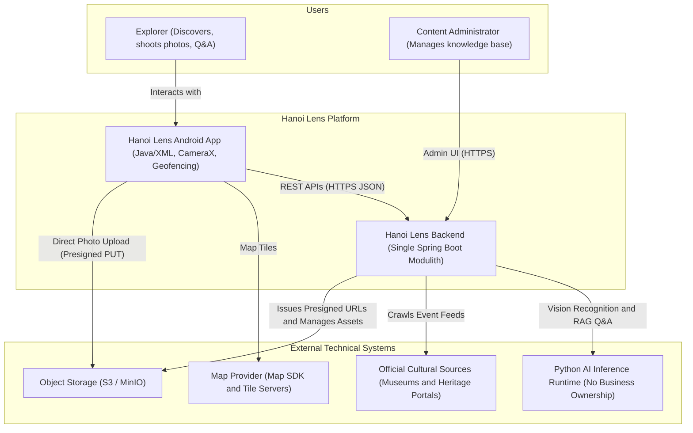
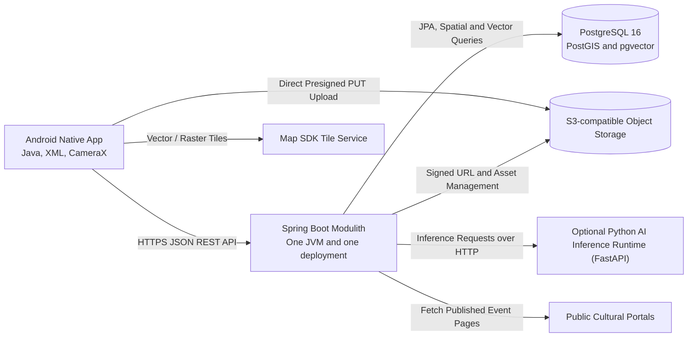
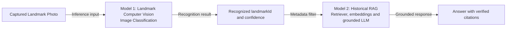
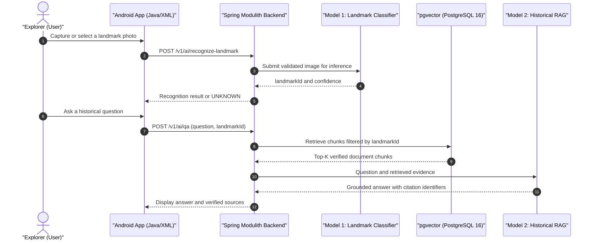
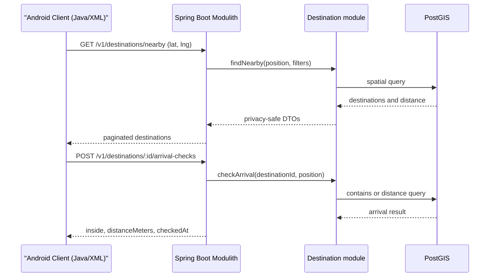
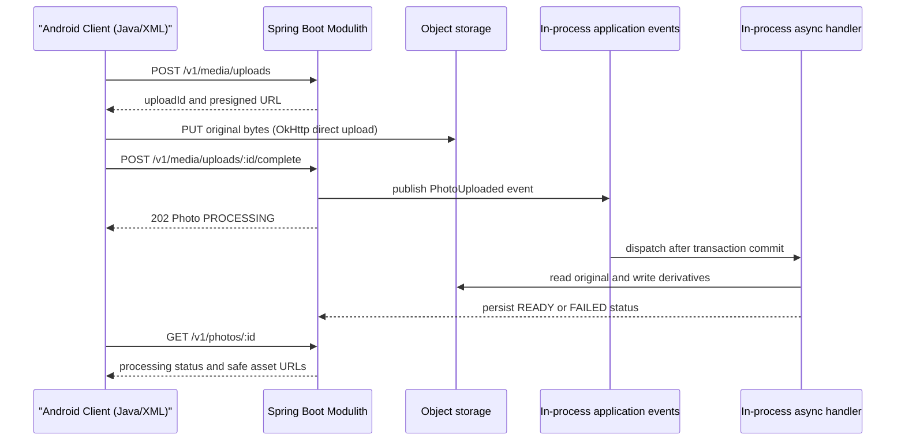

# Hanoi Lens System Architecture

## 1. Purpose

This document defines the implementation architecture for Hanoi Lens. It connects the product brief to a buildable system, records the main technical boundaries, and provides rules for adding features without coupling the mobile interface to storage, geospatial, event, media, or AI implementations.

The target architecture is an **Android Native mobile application (Java + XML layouts)** communicating with a **single-deployment Spring Boot Modulith backend**. The backend is organized into business modules with explicit boundaries but runs as one JVM process and is released as one deployable unit. PostgreSQL with PostGIS and pgvector provides shared transactional, geospatial, and vector storage; S3-compatible object storage holds photo assets. An optional Python inference runtime hosts exactly two AI capabilities: landmark computer vision and domain-grounded historical RAG. Cultural events are extracted by deterministic, source-specific parsers inside the Spring Boot application rather than by an NLP model.

## 2. Target technology stack

Hanoi Lens is designed as a native mobile-first experience:

- **Mobile Client (Frontend):** Android Native using **Java** and **XML layouts** (Android SDK, MVVM architecture, Android Jetpack ViewBinding, CameraX, Retrofit 2, and Google Play Services Location / OSMDroid).
- **Backend API:** **Java Spring Boot 3.x modular monolith** using Spring Modulith (Spring Web MVC, Spring Security with JWT, Spring Data JPA, Hibernate Spatial, Spring Validation, and Spring Modulith events/tests).
- **Geospatial & Database:** **PostgreSQL** with **PostGIS** extension for spatial queries and geofence boundary checks.
- **Media & Object Storage:** S3-compatible object storage (e.g., MinIO or AWS S3) for original images, watermark variants, and journey recaps.
- **Background & Async Processing:** In-process Spring Task Execution (`@Async`, `ThreadPoolTaskScheduler`) and Spring Modulith application events. A message broker is not required for the MVP.
- **AI Subsystem:** An optional Python FastAPI inference process, accessed through one backend adapter, hosts two models: landmark image recognition and historical RAG. It does not own business data or expose APIs directly to the mobile client.
- **Event Ingestion:** Spring scheduled jobs fetch approved official sources and use source-specific JSON-LD, RSS, CSS-selector, and date-parsing rules. Imported records remain `PENDING_REVIEW` until validated and published.

## 3. Architecture goals

- Support destination discovery, geofence arrival, free-form visits, photos, events, albums, and recaps.
- Keep precise location and original photos private by default.
- Allow the Android client and Spring Boot backend to evolve through explicit, versioned REST contracts.
- Keep the first deployment operationally lean and maintainable for a university group project.
- Deploy all backend business capabilities as one Spring Boot application; do not split domain modules into independently deployed services for the MVP.
- Move slow work such as image processing, event crawling/parsing, and recap generation out of synchronous request threads.
- Decouple AI capabilities behind module-owned ports and adapters so model implementations can change without introducing business microservices.
- Provide comprehensive logging and observability across mobile network calls, API transactions, and asynchronous background jobs.

## 4. System context



## 5. Container architecture

At the container level, the entire Spring backend is **one deployable container**. Controllers, domain modules, event handlers, scheduled jobs, and AI orchestration are components inside that container, not separate services.



### Container responsibilities

| Container | Responsibility | Recommended technology |
| --- | --- | --- |
| **Android Client** | Native UI, Material design XML layouts, MVVM architecture, GPS presence detection, photo capture, and local photo editing | Java (JDK 17), Android SDK, XML Layouts, CameraX, Retrofit 2, OkHttp, Room, Glide |
| **Spring Boot Modulith** | One deployable backend containing authentication, business modules, REST APIs, scheduled work, domain events, AI orchestration, and signed URL generation | Java 17/21, Spring Boot 3.x, Spring Modulith, Spring Web, Spring Security, Spring Data JPA |
| **Spatial Database** | Relational application records, user accounts, and spatial indexes for destination boundaries/geofences | PostgreSQL 16 with PostGIS extension (SRID 4326) |
| **Object Storage** | Durable storage for high-resolution original images, derived thumbnails, watermark stamped photos, and recap collages | S3-compatible storage (MinIO, AWS S3, or Cloudflare R2) |
| **AI Inference Runtime** | Optional technical runtime for the landmark vision model and historical RAG model; owns no users, visits, media metadata, events, or recaps | Python FastAPI, PyTorch/ViT or YOLO classification, embedding model, and an LLM runtime |

The Spring Boot backend is a modular monolith: modules are independent at source-code and domain-boundary level, but they share one JVM, one release lifecycle, and one PostgreSQL database.

## 6. Spring Modulith module boundaries

The backend is developed as one Spring Boot application, structured by business domain packages (`vn.edu.usth.hanoilens.modules.*`). Each top-level package is a Spring Modulith application module, not a separately deployed service.

```text
vn.edu.usth.hanoilens
├── HanoiLensApplication.java       // The only Spring Boot entry point
├── shared/                         // Small, stable technical primitives only
└── modules/
    ├── identity/
    ├── profile/
    ├── destination/
    ├── event/
    ├── visit/
    ├── media/
    ├── recap/
    └── guidance/
```

Module boundary rules:

- There is exactly one Spring Boot application, one backend artifact, and one backend deployment.
- A module exposes supported operations through its root API package or application-service interfaces; internal packages are not imported by other modules.
- A module may read or write only the tables it owns. Cross-module changes go through an exposed application service or a Spring Modulith application event.
- Controllers call application services; they never access another module's repository directly.
- Events are in-process for the MVP. Durable publication records may be enabled for retryable asynchronous handlers without introducing a message broker.
- `ApplicationModules.of(HanoiLensApplication.class).verify()` must pass in architecture tests to detect cycles and illegal module access.

### Identity (`modules.identity`)

- Owns users, credentials, JWT authentication, and user account status.
- Exposes authenticated principal (`UserDetails`) to other modules via Spring Security.
- Does not own profile privacy settings.

### Profiles and privacy (`modules.profile`)

- Owns user preferences and default location precision settings.
- Applies privacy filters when returning photos, visits, recaps, or exports.
- Exact coordinates must never be exposed if lower precision was configured.

### Destinations (`modules.destination`)

- Owns destinations, landmarks, PostGIS geofences, cultural narratives, recommended shooting windows, and photography prompts.
- Supplies every destination page with editorial tips for angle, composition, lighting, and suitable shooting time, plus an always-visible entry point to the historical RAG assistant.
- Executes geospatial queries via Hibernate Spatial for nearby discovery and boundary arrival checks.
- Publishes stable destination identifiers used across journeys.

### Events (`modules.event`)

- Owns cultural events, venues, ingestion sources, and publication status.
- Coordinates scheduled fetching and source-specific event parsers.
- Extracts JSON-LD/RSS fields or applies deterministic CSS-selector and date-parsing rules, then stores normalized records as `PENDING_REVIEW` for administrator approval.

### Visits (`modules.visit`)

- Owns the exploration lifecycle (`ACTIVE`, `PAUSED`, `ENDED`).
- Tracks visited landmarks and elapsed journey duration.
- Enforces the business rule: maximum one active visit per user at any time.

### Media (`modules.media`)

- Owns photo metadata, upload sessions, derived thumbnails, and watermark stamp export jobs.
- Directs binary photo streams directly to S3-compatible object storage via presigned PUT URLs.
- Treats original assets as immutable.

### Albums and recaps (`modules.recap`)

- Owns destination albums, monthly recaps, and AI-assisted storytelling summaries.
- Asynchronously compiles journey recap stories upon visit completion.

### Guidance (`modules.guidance`)

- Supplies static, editorial photography tips associated with destinations.
- Does not analyze live camera frames or provide real-time composition guidance.

## 7. Backend internal layers

Each Spring Modulith application module adheres to a standard internal layered architecture:

```text
@RestController (Transport Layer: HTTP DTOs, Validation, JWT Auth)
       ↓
@Service (Application / Use Case Layer: Transactions, Orchestration)
       ↓
Domain Models & Business Rules (Entities, Value Objects, Domain Policies)
       ↓
@Repository (Spring Data JPA / Hibernate Spatial Repositories)
       ↓
Infrastructure Adapters (S3 Client, Event Source Client, AI Inference Client)
```

- **Transport layer (`*.controller`):** Handles incoming HTTP requests, binds parameters, validates constraints (`jakarta.validation`), and maps results to response DTOs.
- **Application layer (`*.service`):** Coordinates business transactions (`@Transactional`), security checks, and interactions through published module interfaces or application events.
- **Domain layer (`*.entity`):** Contains persistent JPA entities, domain rules, and lifecycle states.
- **Infrastructure layer (`*.adapter` / `*.client`):** Implements external integrations: S3 clients, allowlisted event-source clients, and the Python vision/RAG inference client.

## 8. Mobile client architecture (Android Native: Java & XML)

The client is built as an Android Native application using **Java** and **XML layouts**, structured according to the Google recommended **MVVM (Model-View-ViewModel)** architectural pattern:

```text
app/src/main/
├── AndroidManifest.xml
├── java/vn/edu/usth/hanoilens/
│   ├── data/
│   │   ├── api/             // Retrofit 2 REST interfaces (DestinationApi, VisitApi, EventApi, MediaApi)
│   │   ├── model/           // DTOs & POJOs with Gson annotations
│   │   ├── repository/      // Repositories coordinating remote API and local cache
│   │   └── local/           // Room Database (offline cache) & EncryptedSharedPreferences (auth token)
│   ├── ui/                  // UI Presentation Layer (Activities, Fragments, ViewHolders)
│   │   ├── explore/         // Destination list, landmark cards, thematic filters
│   │   ├── map/             // Interactive Map (Google Maps SDK / OSMDroid) with Geofence overlays
│   │   ├── camera/          // CameraX preview and photo capture
│   │   ├── events/          // Feed of cultural events aggregated automatically
│   │   ├── album/           // Journey albums, photo viewer, watermark stamp canvas editor
│   │   └── recap/           // Visual recap display and storytelling summary card
│   ├── viewmodel/           // Android ViewModel classes exposing LiveData to XML Views
│   ├── camera/              // CameraX lifecycle and capture coordination
│   ├── location/            // GeofenceManager & FusedLocationProviderClient presence handler
│   └── util/                // Bitmap stamp watermarking, date helpers, coordinate formatters
└── res/
    ├── layout/              // XML layout files (activity_main.xml, fragment_camera.xml, item_destination.xml)
    ├── drawable/            // Vector drawables, custom borders, watermark frames
    ├── values/              // colors.xml, strings.xml, styles.xml (Material Design 3)
    └── menu/                // Bottom navigation menu XML
```

### Mobile client state & networking rules

- **Networking:** Built with **Retrofit 2** and **OkHttp 3**, utilizing interceptors for JWT token injection and automatic token refresh.
- **View Binding:** All XML layouts are bound using Android Jetpack **ViewBinding**, eliminating `findViewById` boilerplate and preventing NullPointerExceptions.
- **Asynchronous Execution:** Background data calls and Room operations are handled via Java `ExecutorService` / `CompletableFuture` or Android `LiveData`.
- **Camera Pipeline:** Utilizes **CameraX** `Preview` and `ImageCapture` for ordinary photo capture. Real-time composition analysis is outside the project scope.
- **Privacy Enforcement:** Raw location coordinates from `FusedLocationProviderClient` are kept in memory only during arrival verification and are never persisted to insecure device storage.

## 9. AI architecture and event extraction

Hanoi Lens implements exactly **two AI models/capabilities** in the optional Python inference runtime. CameraX is used for ordinary photo capture and does not perform live composition analysis. Cultural event extraction is deterministic parsing inside the Spring Boot modulith and is explicitly not a third AI model.

### 9.1 The two AI models



- **Model 1 — Landmark Computer Vision:** The MVP uses image classification because one submitted photo is expected to have one primary landmark. Object detection may be evaluated later only if bounding boxes or multiple artifacts per image become a requirement.
- **Model 2 — Historical RAG:** Embeds the user's question, retrieves verified chunks filtered by `landmarkId`, and asks the LLM to answer only from retrieved evidence with citations. Fine-tuning the generator is optional; retrieval quality and grounding are required.

### 9.2 Vision-to-RAG flow



The vision result supplies context to RAG, but RAG must also work when the user reaches or manually selects a known destination. A low-confidence vision result is returned as `UNKNOWN` and must not silently select a landmark.

### 9.3 Deterministic cultural event parsing (non-AI)


Event ingestion rules:

- Start with one or two approved official sources and one parser adapter per source.
- Prefer JSON-LD or RSS; use CSS selectors and deterministic Vietnamese date parsing as fallbacks.
- Normalize title, start/end time, venue, source URL, and optional `destinationId`.
- Deduplicate by canonical source URL and a fingerprint of normalized title, start time, and venue.
- Store new records as `PENDING_REVIEW`; parsing never publishes an event automatically.
- Use an allowlist, HTTPS, response-size limits, timeouts, and private-address blocking when fetching external pages.
- Event records are not automatically embedded into the historical RAG corpus. Only reviewed historical sources belong in that corpus.

## 10. Data architecture

### Main entities

| Entity | Important fields | Ownership |
| --- | --- | --- |
| User | id, email, status, createdAt | Identity |
| Profile | userId, locale, defaultLocationPrecision | Profiles and privacy |
| Destination | id, slug, name, summary, district, boundary, status | Destinations |
| Landmark | id, destinationId, name, position, content | Destinations |
| PhotoPrompt | id, destinationId or landmarkId, technique, text | Guidance |
| CulturalEvent | id, venueId, title, startsAt, endsAt, sourceUrl, status | Events |
| Visit | id, userId, destinationId, status, startedAt, endedAt | Visits |
| VisitLandmark | visitId, landmarkId, visitedAt | Visits |
| Photo | id, userId, visitId, objectKey, capturedAt, locationPrecision | Media |
| RecapPhoto | recapId, photoId, position | Albums and recaps |
| KnowledgeChunk | id, destinationId, landmarkId, content, embedding (vector), sourceCitation | Cultural Knowledge |
| QAConversation | id, userId, visitId, destinationId, landmarkId, title, createdAt | Cultural Knowledge |
| QAMessage | id, conversationId, role (USER, ASSISTANT), content, citedChunkIds, createdAt | Cultural Knowledge |
| LandmarkRecognition | id, photoId, recognizedLandmarkId, confidence, boundingBox, detectedAt | Media & AI |

### Database rules

- Use UUID or UUIDv7 identifiers generated by the server.
- Store timestamps as UTC `timestamptz`; localize only at presentation boundaries.
- Store geographic points and destination boundaries in PostGIS with SRID 4326.
- Store 768/1024-dimensional document embeddings in `pgvector` (`vector` data type) with an HNSW or IVFFlat index for sub-second cosine distance searches (`<=>`).
- Add a spatial index to destination boundaries and landmark positions.
- Enforce one active visit per user with a partial unique index.
- Use foreign keys inside the modular monolith but restrict table writes to the owning module.
- Use soft deletion only where audit or recovery is required; otherwise use explicit lifecycle status.

## 11. Critical flows

### 11.1 Destination discovery and arrival



An arrival check confirms presence for starting a visit. Raw samples should be discarded after the check unless the user has explicitly permitted storage.

### 11.2 Photo upload and processing



`Spring Boot Modulith`, `in-process application events`, and `in-process async handler` in this sequence are logical participants inside the same JVM. No network queue or independently deployed worker is involved.

### 11.3 End visit and generate recap

Ending a visit is a transaction. Recap generation is asynchronous:

1. Validate that the visit belongs to the authenticated user and is active or paused.
2. Set `endedAt` and status to `ENDED`.
3. Create a recap record with status `PENDING`.
4. Commit the transaction.
5. Publish a Spring Modulith application event for the in-process recap handler after the transaction commits.
6. Gather photos, visited landmarks, and active cultural events; call the RAG and fine-tuned LLM (Model 2) for the story narrative.
7. Mark the recap `READY` or `FAILED` without altering the completed visit.

## 12. API and integration style

- Public contract: REST over HTTPS with JSON and `/v1` path versioning.
- Formal source of truth: OpenAPI generated via Springdoc-OpenAPI / Swagger.
- Field names: `camelCase`; enum values: `UPPER_SNAKE_CASE`.
- List resources: cursor pagination for feeds and timelines; page pagination only for small administrative lists.
- Errors: one structured error envelope with a stable machine-readable code.
- Mutating create or command endpoints accept and honor `Idempotency-Key`.
- Internal asynchronous work uses Spring Modulith application events and Spring TaskExecutor inside the same backend process.
- Domain modules are not addressable as network services and do not expose private module APIs over HTTP.
- Third-party event and AI responses are always validated, normalized, and sanitized at the adapter boundary.

The endpoint contract is defined in [API.md](API.md).

Detailed operational diagrams are available in [the user flow](flows/user-flow.md) and [the system flow](flows/system-flow.md).

## 13. Security and privacy

The required MVP controls, five-flow threat model, test matrix, and Cyber Security deliverables are defined in [SECURITY.md](SECURITY.md).

- Hash passwords with Argon2id (bcrypt cost 12+ fallback), issue access JWTs for at most 15 minutes, and use hashed rotating opaque refresh tokens with replay detection and revocation.
- Enforce resource-level ownership and role authorization in application services/repository queries; `@PreAuthorize` alone is not sufficient protection against IDOR/BOLA.
- Generate object keys on the server. Presigned upload URLs allow one `PUT` to one key, expire within 5–10 minutes, and are completed only after ownership, state, metadata, and content validation.
- Validate allowed type, byte size, pixel dimensions, magic bytes, and decoded image content before marking an upload safe.
- Keep original photos private and immutable. Strip GPS and device EXIF from every thumbnail, preview, recap asset, watermarked image, and shared export.
- Use exact coordinates only for presence calculation, do not persist raw samples as journey history, and enforce display precision in backend DTO/export policies.
- Encrypt traffic in transit (HTTPS / TLS 1.3) and managed storage at rest.
- Never log access tokens, exact user coordinates, signed URLs, or raw image bytes.
- Rate-limit authentication, arrival checks, uploads, and export generation.
- Record administrative content changes and access to sensitive operations in an audit log.

## 14. Reliability and resilience

- Use timeouts on storage, map, event crawler, and AI inference calls.
- Retry only idempotent operations with exponential backoff and jitter (`@Retryable`).
- Use Spring Modulith's event publication registry and durable job-status tables so committed visit or photo states cannot lose asynchronous work.
- Keep core destination and album features available when external AI or event scrapers are temporarily offline.
- Return processing status rather than holding HTTP connections for long-running work.

## 15. Observability

- Propagate a correlation ID (`X-Request-Id`) from the Android client through the Spring Boot request and its in-process event handlers.
- Emit structured JSON logs via SLF4J / Logback with module, operation, result, latency, and safe identifiers.
- Measure request rate, error rate, latency, upload completion rate, and event freshness using Spring Boot Actuator and Micrometer.
- Trace database, storage, in-process event-handler, and external AI calls with OpenTelemetry / Zipkin without treating modules as separate network services.
- Alert on sustained API errors, stale event ingestion, and recap generation failures.

## 16. Testing strategy

| Test level | Focus | Tools |
| --- | --- | --- |
| Unit | Domain transitions, privacy rounding, edit recipes, event normalization | JUnit 5, Mockito, AssertJ |
| Module architecture | Module discovery, allowed dependencies, absence of cycles, published events | Spring Modulith `ApplicationModules.verify()` and module integration tests |
| API / Integration | Controller contracts, Spring Data JPA / PostGIS queries, S3 adapter | Spring Boot `@SpringBootTest`, Testcontainers (PostgreSQL/PostGIS) |
| Android Client Unit | ViewModels, LiveData transformations, Repositories with mocked Retrofit APIs | JUnit 4/5, Mockito, Robolectric |
| Android UI / Instrumented | Activity/Fragment navigation, XML layout rendering, CameraX lifecycle | Espresso, AndroidX TestRunner |
| End-to-end | Discover destination, confirm arrival, start visit, upload photo, end visit, view recap | Test orchestration scripts / Mock GPS provider |
| Security | Token rotation/replay, IDOR/BOLA, upload validation, signed URL expiry/key binding, location/EXIF leakage | Spring Security Test, Testcontainers/MinIO, EXIF inspection, OWASP ZAP |

Use deterministic coordinates and clocks in tests. Never call live third-party providers from the standard test suite.

## 17. Deployment topology

### MVP

- **Android Client:** Native APK / AAB installed on test devices or distributed via Firebase App Distribution.
- **Backend Application:** One containerized Spring Boot Modulith JAR running on a Linux host or PaaS. REST controllers, domain modules, scheduled jobs, asynchronous handlers, and AI orchestration run in this same process.
- **Database:** Managed PostgreSQL 16 with PostGIS extension.
- **Object Storage:** S3-compatible object storage bucket (AWS S3, MinIO, or Cloudflare R2).
- **AI Inference Runtime:** Optional Python FastAPI container that executes models requested by the Spring Boot AI adapter. It is a replaceable technical dependency, not a business microservice, and it has no direct access to the application database.
- **Environments:** Distinct staging and production configurations with separate credentials.

### Scale path

Scale the complete Spring Boot application horizontally first and tune its API and worker thread pools independently. Extract a module into a service only after production evidence shows a clear need for independent scaling, ownership, availability, or release cadence. Extraction is not part of the MVP architecture.

## 18. Configuration and environments

- Validate all configuration properties at startup using Spring `@ConfigurationProperties`.
- Keep credentials and API keys in environment variables or a secret manager.
- Use distinct object-storage buckets and databases per environment (`application-dev.yml`, `application-prod.yml`).
- Control unfinished integrations with server-side feature flags.
- Store destination and event source configuration in the database, not in client APK bundles.

## 19. Architecture decisions

### ADR 001 Use Spring Modulith as a modular monolith for the MVP

**Decision:** Deploy one Spring Boot application with domain packages verified as Spring Modulith application modules. All business modules share one JVM, one release lifecycle, and one PostgreSQL database while retaining explicit APIs and table ownership.

**Reason:** The domain workflows are strongly transactional and the team can deliver, debug, and test them faster without network calls, distributed transactions, service discovery, or duplicated operational infrastructure.

**Consequences:** Module boundaries must be enforced with Spring Modulith verification tests. Cross-module collaboration uses published interfaces or application events. The optional Python AI runtime remains an external adapter and may not own business state. A future service extraction requires a new ADR backed by measured operational need.

### ADR 002 Use PostgreSQL with PostGIS

**Decision:** Keep relational, transactional, and geospatial data in one unified database.

**Reason:** Destination boundaries, nearby search, visit integrity, and recap relationships benefit from native SQL constraints and PostGIS spatial indexes (`ST_DWithin`, `ST_Contains`).

### ADR 003 Store photos outside the database

**Decision:** Save media bytes in S3-compatible object storage and store metadata in PostgreSQL.

**Reason:** Object storage supports large files, direct presigned PUT uploads from Android, lifecycle policies, and derived variants efficiently.

### ADR 004 Asynchronous media, crawler, and recap processing

**Decision:** Use in-process Spring Modulith application events and Spring async task executors with durable database status records.

**Reason:** Image resizing, web crawling, and Generative AI calls are slow and failure-prone; processing them asynchronously keeps mobile API response times fast and predictable.

### ADR 005 Make location precision a domain policy

**Decision:** Apply precision rules in backend response and export policies, not only in client UI code.

**Reason:** User privacy cannot depend on the client behaving correctly.

### ADR 006 Use Android Native (Java + XML Layouts) for client

**Decision:** Implement the mobile client as a native Android app in Java with XML layouts and MVVM architecture.

**Reason:** Full control over hardware capabilities (CameraX photo capture, background GPS presence, local bitmap rendering for journey watermarks) without cross-platform overhead.

### ADR 007 Unified Spatial and Vector Database (PostgreSQL with PostGIS & pgvector)

**Decision:** Use a single PostgreSQL 16 cluster equipped with both `PostGIS` (geospatial indexing for geofences) and `pgvector` (vector similarity search for RAG).

**Reason:** Eliminates the operational complexity, consistency bugs, and synchronization overhead of running a separate vector database (like Milvus or Pinecone), while enabling powerful hybrid SQL queries that filter historical embeddings by physical landmark IDs and geospatial bounds.

### ADR 008 Limit the AI scope to Landmark Vision and Historical RAG

**Decision:** Implement exactly two AI capabilities: landmark image classification and domain-grounded historical RAG. The destination page always exposes the historical RAG entry point and editorial photography tips. Event extraction uses deterministic source-specific parsers, and real-time camera guidance is outside the project scope.

**Reason:** Vision-to-RAG directly supports contextual cultural learning while remaining feasible for the project schedule. Deterministic event parsing is easier to verify than NLP extraction, and removing live camera analysis avoids device-performance work that does not serve the core objective.

**Consequences:** The vision MVP uses classification and returns `UNKNOWN` below its confidence threshold. RAG must cite retrieved evidence and work without a vision result. Static photography tips remain available when AI inference is down and are not a third model. Event parsers produce reviewable drafts and are not counted as AI models.

### ADR 009 Make security and privacy a required MVP workstream

**Decision:** Include threat modeling for five critical flows, authentication/authorization, photo-upload and presigned-URL hardening, and location/EXIF leakage verification in the MVP definition of done.

**Reason:** Hanoi Lens handles private photos, location signals, credentials, and AI inputs. A functionally complete demo that permits cross-user access, unsafe uploads, reusable signed URLs, or hidden GPS leakage does not satisfy the product's privacy promise.

**Consequences:** The Cyber Security member owns adversarial requirements and evidence, while backend and Android members implement the controls. The MVP cannot be signed off with unresolved `CRITICAL`/`HIGH` findings in these four areas. Detailed acceptance criteria live in [SECURITY.md](SECURITY.md).

## 20. Implementation sequence

1. Establish the Spring Boot + Spring Modulith project skeleton, module-boundary verification tests, OpenAPI configuration, database migrations (Flyway/Liquibase), and CI checks.
2. Complete the five-flow threat model and implement the JWT/refresh-token foundation plus the first ownership-denial tests.
3. Implement destination and landmark endpoints with PostGIS nearby spatial queries.
4. Build the Android mobile skeleton (Navigation, BottomNav XML, Retrofit networking, Room cache, and Keystore-backed token storage).
5. Implement arrival checks and the visit lifecycle with raw-coordinate non-retention and cross-user authorization tests.
6. Integrate CameraX photo capture and hardened S3 presigned uploads, including malicious-file, expiry, wrong-key, and ownership tests.
7. Build scheduled ingestion and a deterministic parser for the first approved event source; validate, deduplicate, and queue drafts for administrator review.
8. Implement always-visible editorial photography tips, landmark image classification (Model 1), historical RAG with citations (Model 2), and their Vision-to-RAG handoff.
9. Add customizable photo watermarks (Journey Stamps) and verify that derived/shared files contain no disallowed EXIF or location data.
10. Conduct end-to-end, privacy, authorization, and security testing with simulated GPS routes; resolve all `CRITICAL`/`HIGH` findings before submission.

## 21. Architecture governance

- Every public endpoint change updates the OpenAPI contract and contract tests in the same change.
- Each database table has one owning module.
- Cross-module writes occur through application service interfaces or domain events.
- No domain module may introduce its own network endpoint, deployment unit, or database connection without a superseding ADR.
- New external providers require an adapter interface and response validation.
- New sensitive fields require a privacy and logging review.
- Architecture decisions that alter module boundaries, data ownership, or deployment topology require an ADR update in this document.

