# Hanoi Lens - Thiết Kế Cơ Sở Dữ Liệu (Database Specification)

> **Nguồn chuyển đổi:** `docs/Hanoi_Lens_Database.mdj` (StarUML ERD Data Model)  
> **Hệ quản trị cơ sở dữ liệu:** PostgreSQL 16 kết hợp tiện ích mở rộng **PostGIS** (không gian địa lý) & **pgvector** (vector similarity)  
> **Số lượng bảng:** 21 bảng thực thể (Entities) chia làm 5 nhóm chức năng chính (Zones)  

---

## 1. Kiến Trúc Tổng Quan & Sơ Đồ Thực Thể (ERD)

Cơ sở dữ liệu của Hanoi Lens được tổ chức xoay quanh 5 phân vùng miền nghiệp vụ:
1. **Places & Content (Địa điểm & Nội dung di sản):** `DESTINATIONS`, `LANDMARKS`, `PHOTO_TIPS`, `CULTURAL_EVENTS`, `ARTIFACTS`, `REFERENCE_IMAGES`
2. **Users & Journeys (Người dùng & Hành trình thực địa):** `USERS`, `JOURNEYS`, `JOURNEY_LANDMARK_VISITS` *(Bảng trung tâm: `JOURNEYS`)*
3. **Photos, Recognition & Recaps (Ảnh chụp, Nhận diện AI & Tổng kết kỷ niệm):** `PHOTOS`, `PHOTO_EXPORTS`, `RECAPS`, `RECAP_PHOTOS`, `RECOGNITION_RESULTS`
4. **Stamps & Rewards (Sổ sưu tập tem & Phần thưởng kích cầu):** `STAMPS`, `USER_STAMPS`, `REWARDS`, `USER_REWARDS`
5. **Historical RAG (Tri thức lịch sử & Hỏi đáp AI):** `KNOWLEDGE_CHUNKS`, `QA_CONVERSATIONS`, `QA_MESSAGES`

### Sơ đồ quan hệ thực thể (Mermaid Diagram)

```mermaid
erDiagram
    DESTINATIONS ||--o{ LANDMARKS : "chứa các điểm mốc"
    DESTINATIONS ||--o{ PHOTO_TIPS : "hướng dẫn góc chụp"
    DESTINATIONS |o--o{ CULTURAL_EVENTS : "tổ chức sự kiện"
    DESTINATIONS ||--o{ ARTIFACTS : "trưng bày hiện vật"
    DESTINATIONS |o--o{ REFERENCE_IMAGES : "ảnh tham chiếu"
    DESTINATIONS ||--o| STAMPS : "phát hành tem"
    DESTINATIONS ||--o{ JOURNEYS : "điểm đến hành trình"
    DESTINATIONS ||--o{ PHOTOS : "nơi chụp ảnh"
    DESTINATIONS ||--o{ RECOGNITION_RESULTS : "địa điểm nhận diện"

    LANDMARKS |o--o{ PHOTO_TIPS : "mẹo cho điểm mốc"
    LANDMARKS ||--o{ JOURNEY_LANDMARK_VISITS : "check-in điểm mốc"
    LANDMARKS |o--o{ PHOTOS : "ảnh tại điểm mốc"

    ARTIFACTS |o--o{ REFERENCE_IMAGES : "ảnh mẫu hiện vật"
    ARTIFACTS |o--o{ RECOGNITION_RESULTS : "kết quả nhận diện"

    USERS ||--o{ JOURNEYS : "thực hiện hành trình"
    USERS ||--o{ PHOTOS : "sở hữu ảnh"
    USERS ||--o{ RECAPS : "sở hữu kỷ niệm"
    USERS ||--o{ RECOGNITION_RESULTS : "quét ảnh camera"
    USERS ||--o{ USER_STAMPS : "tích lũy tem"
    USERS ||--o{ USER_REWARDS : "nhận thưởng"

    JOURNEYS ||--o{ JOURNEY_LANDMARK_VISITS : "ghi nhận các trạm"
    JOURNEYS ||--o{ PHOTOS : "ảnh trong chuyến đi"
    JOURNEYS |o--o{ RECAPS : "tổng kết hành trình"
    JOURNEYS ||--o{ USER_STAMPS : "mở khóa tem"

    PHOTOS ||--o{ PHOTO_EXPORTS : "xuất ảnh thành phẩm"
    PHOTOS ||--o{ RECAP_PHOTOS : "đưa vào album recap"
    PHOTOS |o--o{ RECOGNITION_RESULTS : "phân tích nhận diện"

    RECAPS ||--o{ RECAP_PHOTOS : "chứa danh sách ảnh"

    STAMPS ||--o{ USER_STAMPS : "được trao cho user"
    REWARDS ||--o{ USER_REWARDS : "cấp cho user"

    DESTINATIONS ||--o{ KNOWLEDGE_CHUNKS : "tư liệu lịch sử"
    LANDMARKS |o--o{ KNOWLEDGE_CHUNKS : "tư liệu điểm mốc"
    USERS ||--o{ QA_CONVERSATIONS : "hỏi đáp AI"
    DESTINATIONS ||--o{ QA_CONVERSATIONS : "phạm vi điểm đến"
    LANDMARKS |o--o{ QA_CONVERSATIONS : "phạm vi điểm mốc"
    JOURNEYS |o--o{ QA_CONVERSATIONS : "hỏi tại chỗ"
    QA_CONVERSATIONS ||--o{ QA_MESSAGES : "chứa tin nhắn"
```

---

## 2. Chi Tiết Danh Sách Bảng Dữ Liệu (21 Bảng)

### Nhóm: Places & Content (Địa điểm & Nội dung văn hóa)

#### Bảng `DESTINATIONS`
*Bảng trung tâm lưu trữ thông tin các điểm đến du lịch/di sản văn hóa Hà Nội (lịch sử, kiến trúc, ranh giới Geofence PostGIS, giờ mở cửa).*

| Tên cột | Kiểu dữ liệu | Ràng buộc | Tham chiếu (Khóa ngoại) | Mô tả chi tiết |
|:---|:---|:---|:---|:---|
| `id` | `UUID` | **PK**, NOT NULL | - | Khóa chính UUID của điểm đến |
| `slug` | `VARCHAR(160)` | UNIQUE, NOT NULL | - | Đường dẫn URL thân thiện định danh điểm đến (ví dụ: 'van-mieu-quoc-tu-giam') |
| `name` | `VARCHAR(200)` | NOT NULL | - | Tên chính thức của địa điểm (ví dụ: 'Văn Miếu - Quốc Tử Giám') |
| `district` | `VARCHAR(100)` | NOT NULL | - | Tên quận/huyện trực thuộc (ví dụ: 'Đống Đa') |
| `history_text` | `TEXT` | NULL | - | Tài liệu tóm lược lịch sử hình thành và phát triển |
| `architecture_text` | `TEXT` | NULL | - | Đặc điểm kiến trúc, quy cách xây dựng tiêu biểu |
| `significance_text` | `TEXT` | NULL | - | Ý nghĩa văn hóa, giá trị tâm linh và xã hội |
| `geofence_type` | `VARCHAR(10)` | NOT NULL | - | Kiểu vùng địa lý phát hiện vị trí: CIRCLE (tròn) hoặc POLYGON (đa giác) |
| `center_lat` | `DECIMAL(9,6)` | NULL | - | Vĩ độ tâm điểm đến (WGS 84) |
| `center_lng` | `DECIMAL(9,6)` | NULL | - | Kinh độ tâm điểm đến (WGS 84) |
| `radius_m` | `INTEGER` | NULL | - | Bán kính ranh giới Geofence tính theo mét (nếu là dạng tròn CIRCLE) |
| `boundary_geom` | `GEOMETRY` | NULL | - | Đối tượng hình học không gian PostGIS (SRID 4326) xác định ranh giới điểm đến |
| `opening_hours` | `JSONB` | NULL | - | Dữ liệu JSONB lưu khung giờ mở cửa các ngày trong tuần |
| `visiting_windows` | `JSONB` | NULL | - | Dữ liệu JSONB gợi ý khoảng thời gian lý tưởng trong ngày để tham quan |

#### Bảng `LANDMARKS`
*Các điểm mốc hoặc hạng mục chi tiết thuộc một điểm đến (dùng để định vị check-in hoặc hướng dẫn chi tiết).*

| Tên cột | Kiểu dữ liệu | Ràng buộc | Tham chiếu (Khóa ngoại) | Mô tả chi tiết |
|:---|:---|:---|:---|:---|
| `id` | `UUID` | **PK**, NOT NULL | - | Khóa chính UUID điểm mốc |
| `destination_id` | `UUID` | **FK**, NOT NULL | `DESTINATIONS.id` | Khóa ngoại tham chiếu đến điểm đến `DESTINATIONS.id` |
| `name` | `VARCHAR(160)` | NOT NULL | - | Tên điểm mốc (ví dụ: 'Khuê Văn Các', 'Giếng Thiên Quang', 'Bia Tiến Sĩ') |
| `description` | `TEXT` | NULL | - | Mô tả chi tiết và thuyết minh về điểm mốc |
| `is_checkpoint` | `BOOLEAN` | NOT NULL | - | Cờ đánh dấu điểm này có bắt buộc check-in để hoàn thành hành trình hay không |

#### Bảng `PHOTO_TIPS`
*Kho mẹo chụp ảnh (góc máy, thời điểm ánh sáng đẹp, bố cục) gợi ý cho người dùng tại từng điểm đến hoặc điểm mốc.*

| Tên cột | Kiểu dữ liệu | Ràng buộc | Tham chiếu (Khóa ngoại) | Mô tả chi tiết |
|:---|:---|:---|:---|:---|
| `id` | `UUID` | **PK**, NOT NULL | - | Khóa chính UUID của mẹo chụp ảnh |
| `destination_id` | `UUID` | **FK**, NOT NULL | `DESTINATIONS.id` | Khóa ngoại gắn với điểm đến `DESTINATIONS.id` |
| `landmark_id` | `UUID` | **FK**, NULL | `LANDMARKS.id` | Khóa ngoại tùy chọn gắn với landmark cụ thể `LANDMARKS.id` |
| `category` | `VARCHAR(32)` | NOT NULL | - | Phân loại mẹo: ANGLE (góc máy), LIGHTING (ánh sáng), COMPOSITION (bố cục) |
| `hint_text` | `TEXT` | NOT NULL | - | Nội dung hướng dẫn chi tiết cách canh góc và bắt trọn vẻ đẹp |
| `recommended_time` | `VARCHAR(80)` | NULL | - | Khung giờ khuyến nghị chụp đẹp nhất (ví dụ: '16:30 - 17:30') |

#### Bảng `CULTURAL_EVENTS`
*Thông tin sự kiện văn hóa, lễ hội theo mùa hoặc triển lãm được cập nhật/cào tự động từ các nguồn tin.*

| Tên cột | Kiểu dữ liệu | Ràng buộc | Tham chiếu (Khóa ngoại) | Mô tả chi tiết |
|:---|:---|:---|:---|:---|
| `id` | `UUID` | **PK**, NOT NULL | - | Khóa chính UUID của sự kiện văn hóa |
| `destination_id` | `UUID` | **FK**, NULL | `DESTINATIONS.id` | Khóa ngoại tùy chọn gắn với điểm đến `DESTINATIONS.id` |
| `title` | `VARCHAR(240)` | NOT NULL | - | Tiêu đề sự kiện hoặc triển lãm văn hóa |
| `description` | `TEXT` | NULL | - | Nội dung chi tiết về chương trình sự kiện |
| `starts_at` | `TIMESTAMPTZ` | NOT NULL | - | Thời gian bắt đầu sự kiện (TIMESTAMPTZ UTC) |
| `ends_at` | `TIMESTAMPTZ` | NOT NULL | - | Thời gian kết thúc sự kiện (TIMESTAMPTZ UTC) |
| `venue_name` | `VARCHAR(200)` | NOT NULL | - | Tên khán phòng, địa điểm tổ chức cụ thể |
| `source_url` | `TEXT` | NOT NULL | - | Đường dẫn nguồn tin được cào (crawler source URL) |
| `extracted_at` | `TIMESTAMPTZ` | NOT NULL | - | Thời điểm bot trích xuất dữ liệu |
| `status` | `VARCHAR(16)` | NOT NULL | - | Trạng thái kiểm duyệt: PENDING_REVIEW, APPROVED, REJECTED, EXPIRED |

#### Bảng `ARTIFACTS`
*Lưu trữ thông tin các cổ vật, hiện vật lịch sử hoặc họa tiết kiến trúc tiêu biểu cần nhận diện thị giác máy tính.*

| Tên cột | Kiểu dữ liệu | Ràng buộc | Tham chiếu (Khóa ngoại) | Mô tả chi tiết |
|:---|:---|:---|:---|:---|
| `id` | `UUID` | **PK**, NOT NULL | - | Khóa chính UUID hiện vật |
| `destination_id` | `UUID` | **FK**, NOT NULL | `DESTINATIONS.id` | Khóa ngoại điểm đến `DESTINATIONS.id` |
| `name` | `VARCHAR(180)` | NOT NULL | - | Tên hiện vật hoặc chi tiết kiến trúc (ví dụ: 'Rùa đội bia', 'Hạc ngự long quy') |
| `description` | `TEXT` | NULL | - | Ý nghĩa biểu tượng văn hóa và tư liệu giải thích |
| `recognition_label` | `VARCHAR(120)` | UNIQUE, NOT NULL | - | Mã nhãn duy nhất dùng cho model AI Vision phân loại (ví dụ: 'vn_turtle_stele') |
| `source_url` | `TEXT` | NULL | - | Đường dẫn tài liệu viện bảo tàng hoặc di sản tham chiếu |

#### Bảng `REFERENCE_IMAGES`
*Bộ ảnh mẫu/ảnh tham chiếu của hiện vật hoặc điểm đến, phục vụ huấn luyện hoặc đối chiếu thị giác máy tính (Computer Vision/ML).*

| Tên cột | Kiểu dữ liệu | Ràng buộc | Tham chiếu (Khóa ngoại) | Mô tả chi tiết |
|:---|:---|:---|:---|:---|
| `id` | `UUID` | **PK**, NOT NULL | - | Khóa chính UUID ảnh tham chiếu |
| `destination_id` | `UUID` | **FK**, NULL | `DESTINATIONS.id` | Khóa ngoại tùy chọn gắn với `DESTINATIONS.id` |
| `artifact_id` | `UUID` | **FK**, NULL | `ARTIFACTS.id` | Khóa ngoại tùy chọn gắn với `ARTIFACTS.id` |
| `asset_url` | `TEXT` | NOT NULL | - | Đường dẫn URL ảnh mẫu chất lượng cao |
| `caption` | `TEXT` | NULL | - | Chú thích góc chụp tham khảo của hiện vật |
| `image_role` | `VARCHAR(24)` | NOT NULL | - | Vai trò ảnh: TRAINING (huấn luyện AI), REFERENCE (mẫu đối chiếu), COVER (ảnh bìa) |

---

### Nhóm: Users & Journeys (Người dùng & Hành trình)

#### Bảng `USERS`
*Lưu trữ hồ sơ tài khoản người dùng và cấu hình hiển thị quyền riêng tư vị trí mặc định.*

| Tên cột | Kiểu dữ liệu | Ràng buộc | Tham chiếu (Khóa ngoại) | Mô tả chi tiết |
|:---|:---|:---|:---|:---|
| `id` | `UUID` | **PK**, NOT NULL | - | Khóa chính UUID người dùng (đồng bộ với hệ thống auth) |
| `display_name` | `VARCHAR(120)` | NOT NULL | - | Tên hiển thị công khai của người dùng |
| `default_location_display` | `VARCHAR(16)` | NOT NULL | - | Chính sách vị trí mặc định: EXACT (chính xác), DISTRICT (quận), HIDDEN (ẩn) |
| `created_at` | `TIMESTAMPTZ` | NOT NULL | - | Thời điểm tạo tài khoản |

#### Bảng `JOURNEYS`
*Bảng trung tâm theo dõi các phiên trải nghiệm/hành trình thực tế của người dùng tại một điểm đến (Bắt đầu, Tạm dừng, Kết thúc).*

| Tên cột | Kiểu dữ liệu | Ràng buộc | Tham chiếu (Khóa ngoại) | Mô tả chi tiết |
|:---|:---|:---|:---|:---|
| `id` | `UUID` | **PK**, NOT NULL | - | Khóa chính UUID phiên hành trình khám phá |
| `user_id` | `UUID` | **FK**, NOT NULL | `USERS.id` | Khóa ngoại tham chiếu người dùng `USERS.id` |
| `destination_id` | `UUID` | **FK**, NOT NULL | `DESTINATIONS.id` | Khóa ngoại tham chiếu điểm đến `DESTINATIONS.id` |
| `status` | `VARCHAR(16)` | NOT NULL | - | Trạng thái phiên: ACTIVE (đang đi), PAUSED (tạm dừng), ENDED (hoàn tất) |
| `started_at` | `TIMESTAMPTZ` | NOT NULL | - | Thời điểm người dùng bắt đầu mở hành trình |
| `paused_at` | `TIMESTAMPTZ` | NULL | - | Thời điểm tạm dừng hành trình (nếu có) |
| `ended_at` | `TIMESTAMPTZ` | NULL | - | Thời điểm kết thúc và đóng hành trình |

#### Bảng `JOURNEY_LANDMARK_VISITS`
*Bảng liên kết ghi nhận các điểm mốc (landmark checkpoints) mà người dùng đã hoàn thành trong chuyến đi.*

| Tên cột | Kiểu dữ liệu | Ràng buộc | Tham chiếu (Khóa ngoại) | Mô tả chi tiết |
|:---|:---|:---|:---|:---|
| `journey_id` | `UUID` | **PK**, **FK**, NOT NULL | `JOURNEYS.id` | Khóa ngoại cấu thành PK tham chiếu hành trình `JOURNEYS.id` |
| `landmark_id` | `UUID` | **PK**, **FK**, NOT NULL | `LANDMARKS.id` | Khóa ngoại cấu thành PK tham chiếu điểm mốc `LANDMARKS.id` |
| `visited_at` | `TIMESTAMPTZ` | NOT NULL | - | Thời điểm định vị ghi nhận người dùng đã check-in điểm mốc |

---

### Nhóm: Photos, Recognition & Recaps (Ảnh chụp, Nhận diện AI & Kỷ niệm)

#### Bảng `PHOTOS`
*Lưu metadata của ảnh chụp nguyên bản (original asset) trong chuyến đi (vị trí, EXIF, thiết bị, công thức chỉnh sửa). Ảnh lưu trên S3/MinIO.*

| Tên cột | Kiểu dữ liệu | Ràng buộc | Tham chiếu (Khóa ngoại) | Mô tả chi tiết |
|:---|:---|:---|:---|:---|
| `id` | `UUID` | **PK**, NOT NULL | - | Khóa chính UUID bức ảnh |
| `user_id` | `UUID` | **FK**, NOT NULL | `USERS.id` | Khóa ngoại người chụp `USERS.id` |
| `journey_id` | `UUID` | **FK**, NOT NULL | `JOURNEYS.id` | Khóa ngoại thuộc hành trình `JOURNEYS.id` |
| `destination_id` | `UUID` | **FK**, NOT NULL | `DESTINATIONS.id` | Khóa ngoại chụp tại điểm đến `DESTINATIONS.id` |
| `landmark_id` | `UUID` | **FK**, NULL | `LANDMARKS.id` | Khóa ngoại tùy chọn chụp tại điểm mốc `LANDMARKS.id` |
| `original_asset_url` | `TEXT` | NOT NULL | - | Đường dẫn URL lưu file ảnh gốc bất biến trên Object Storage S3 |
| `captured_at` | `TIMESTAMPTZ` | NOT NULL | - | Thời điểm chụp thực tế trích xuất từ EXIF |
| `device_metadata` | `JSONB` | NULL | - | Dữ liệu JSONB lưu metadata thiết bị (Camera model, focal length, ISO, shutter speed) |
| `location_precision` | `VARCHAR(16)` | NOT NULL | - | Quyền riêng tư vị trí bức ảnh: EXACT, DISTRICT, HIDDEN |
| `edit_recipe` | `JSONB` | NULL | - | Dữ liệu JSONB công thức blend màu / áp filter màu hoài niệm Hà Nội |

#### Bảng `PHOTO_EXPORTS`
*Lưu vết các phiên bản ảnh đã qua xử lý xuất khẩu (ảnh gắn watermark con dấu di sản, thời tiết, nhãn địa danh).*

| Tên cột | Kiểu dữ liệu | Ràng buộc | Tham chiếu (Khóa ngoại) | Mô tả chi tiết |
|:---|:---|:---|:---|:---|
| `id` | `UUID` | **PK**, NOT NULL | - | Khóa chính UUID file ảnh thành phẩm |
| `photo_id` | `UUID` | **FK**, NOT NULL | `PHOTOS.id` | Khóa ngoại tham chiếu ảnh gốc `PHOTOS.id` |
| `exported_asset_url` | `TEXT` | NOT NULL | - | Đường dẫn URL ảnh đã render gắn con dấu trên Cloudflare R2 / S3 |
| `stamp_style` | `VARCHAR(32)` | NOT NULL | - | Kiểu mẫu tem áp dụng: VINTAGE, MODERN, MINIMAL, HERITAGE |
| `weather_text` | `VARCHAR(80)` | NULL | - | Nhãn thời tiết lúc chụp ảnh (ví dụ: 'Nắng nhẹ · 26°C') |
| `custom_label` | `VARCHAR(120)` | NULL | - | Nhãn ghi chú hoặc cảm nghĩ riêng của người dùng |
| `location_display` | `VARCHAR(16)` | NOT NULL | - | Chuỗi vị trí hiển thị trên ảnh xuất (ví dụ: 'Hoàn Kiếm, Hà Nội') |
| `exported_at` | `TIMESTAMPTZ` | NOT NULL | - | Thời điểm render và xuất file |

#### Bảng `RECAPS`
*Tổng kết hành trình theo từng chuyến đi (Journey Recap) hoặc theo tháng (Monthly Journal) do hệ thống AI tổng hợp.*

| Tên cột | Kiểu dữ liệu | Ràng buộc | Tham chiếu (Khóa ngoại) | Mô tả chi tiết |
|:---|:---|:---|:---|:---|
| `id` | `UUID` | **PK**, NOT NULL | - | Khóa chính UUID bản tổng kết |
| `user_id` | `UUID` | **FK**, NOT NULL | `USERS.id` | Khóa ngoại chủ sở hữu `USERS.id` |
| `journey_id` | `UUID` | **FK**, NULL | `JOURNEYS.id` | Khóa ngoại tham chiếu hành trình `JOURNEYS.id` (NULL nếu là recap tháng) |
| `recap_type` | `VARCHAR(16)` | NOT NULL | - | Phân loại tổng kết: JOURNEY (theo chuyến đi), MONTHLY (theo tháng) |
| `monthly_period` | `DATE` | NULL | - | Kỳ tháng được tổng kết (định dạng YYYY-MM-01, NULL nếu là recap chuyến) |
| `summary_text` | `TEXT` | NULL | - | Đoạn văn văn phong giàu cảm xúc do LLM tạo tóm tắt nhật ký hành trình |
| `generated_at` | `TIMESTAMPTZ` | NOT NULL | - | Thời điểm tạo bản recap |

#### Bảng `RECAP_PHOTOS`
*Bảng liên kết lưu danh sách và thứ tự các bức ảnh được chọn vào album recap.*

| Tên cột | Kiểu dữ liệu | Ràng buộc | Tham chiếu (Khóa ngoại) | Mô tả chi tiết |
|:---|:---|:---|:---|:---|
| `recap_id` | `UUID` | **PK**, **FK**, NOT NULL | `RECAPS.id` | Khóa ngoại cấu thành PK tham chiếu `RECAPS.id` |
| `photo_id` | `UUID` | **PK**, **FK**, NOT NULL | `PHOTOS.id` | Khóa ngoại cấu thành PK tham chiếu `PHOTOS.id` |
| `sort_order` | `INTEGER` | NOT NULL | - | Thứ tự sắp xếp hiển thị ảnh trong album câu chuyện |

#### Bảng `RECOGNITION_RESULTS`
*Lưu vết kết quả nhận diện hiện vật qua camera/ảnh chụp người dùng (độ chính xác confidence, trạng thái xác nhận có mặt).*

| Tên cột | Kiểu dữ liệu | Ràng buộc | Tham chiếu (Khóa ngoại) | Mô tả chi tiết |
|:---|:---|:---|:---|:---|
| `id` | `UUID` | **PK**, NOT NULL | - | Khóa chính UUID kết quả nhận diện |
| `user_id` | `UUID` | **FK**, NOT NULL | `USERS.id` | Khóa ngoại người thực hiện `USERS.id` |
| `destination_id` | `UUID` | **FK**, NOT NULL | `DESTINATIONS.id` | Khóa ngoại điểm đến `DESTINATIONS.id` |
| `artifact_id` | `UUID` | **FK**, NULL | `ARTIFACTS.id` | Khóa ngoại hiện vật nhận diện được `ARTIFACTS.id` (NULL nếu không khớp) |
| `photo_id` | `UUID` | **FK**, NULL | `PHOTOS.id` | Khóa ngoại tùy chọn liên kết bức ảnh chụp `PHOTOS.id` |
| `confidence` | `DECIMAL(5,4)` | NULL | - | Chỉ số độ tin cậy của thuật toán AI (từ 0.0000 đến 1.0000) |
| `presence_confirmed` | `BOOLEAN` | NOT NULL | - | Cờ xác thực người dùng thực tế có mặt và phát hiện chuẩn xác |
| `result_status` | `VARCHAR(20)` | NOT NULL | - | Trạng thái: MATCHED, UNKNOWN, LOW_CONFIDENCE, FAILED |
| `recognized_at` | `TIMESTAMPTZ` | NOT NULL | - | Thời điểm thực hiện suy luận nhận diện |

---

### Nhóm: Stamps & Rewards (Sổ tem số & Phần thưởng)

#### Bảng `STAMPS`
*Bộ sưu tập tem số hóa (Digital Cultural Stamps) biểu trưng cho từng điểm đến di sản.*

| Tên cột | Kiểu dữ liệu | Ràng buộc | Tham chiếu (Khóa ngoại) | Mô tả chi tiết |
|:---|:---|:---|:---|:---|
| `id` | `UUID` | **PK**, NOT NULL | - | Khóa chính UUID con tem |
| `destination_id` | `UUID` | **FK**, UNIQUE, NOT NULL | `DESTINATIONS.id` | Khóa ngoại điểm đến `DESTINATIONS.id` (quan hệ 1-1 duy nhất) |
| `title` | `VARCHAR(160)` | NOT NULL | - | Tên con tem số hóa (ví dụ: 'Tem Dấu Văn Miếu') |
| `icon_asset_url` | `TEXT` | NULL | - | Đường dẫn file đồ họa SVG/PNG con tem nghệ thuật |
| `is_active` | `BOOLEAN` | NOT NULL | - | Trạng thái tem đang phát hành (TRUE) hay tạm đóng (FALSE) |

#### Bảng `USER_STAMPS`
*Ghi nhận con tem số mà người dùng đã mở khóa/được trao sau khi hoàn thành hành trình tại điểm đến.*

| Tên cột | Kiểu dữ liệu | Ràng buộc | Tham chiếu (Khóa ngoại) | Mô tả chi tiết |
|:---|:---|:---|:---|:---|
| `user_id` | `UUID` | **PK**, **FK**, NOT NULL | `USERS.id` | Khóa ngoại cấu thành PK tham chiếu người dùng `USERS.id` |
| `stamp_id` | `UUID` | **PK**, **FK**, NOT NULL | `STAMPS.id` | Khóa ngoại cấu thành PK tham chiếu con tem `STAMPS.id` |
| `journey_id` | `UUID` | **FK**, NOT NULL | `JOURNEYS.id` | Khóa ngoại tham chiếu hành trình `JOURNEYS.id` đạt được tem |
| `awarded_at` | `TIMESTAMPTZ` | NOT NULL | - | Thời điểm trao tem vào sổ sưu tập số |

#### Bảng `REWARDS`
*Danh mục phần thưởng, huy hiệu hoặc ưu đãi đạt được dựa trên số lượng tem tích lũy được.*

| Tên cột | Kiểu dữ liệu | Ràng buộc | Tham chiếu (Khóa ngoại) | Mô tả chi tiết |
|:---|:---|:---|:---|:---|
| `id` | `UUID` | **PK**, NOT NULL | - | Khóa chính UUID phần thưởng |
| `title` | `VARCHAR(160)` | NOT NULL | - | Tên phần thưởng / danh hiệu (ví dụ: 'Nhà Thám Hiểm Phố Cổ') |
| `required_stamp_count` | `INTEGER` | NOT NULL | - | Số lượng tem tối thiểu cần tích lũy để mở khóa |
| `rule_config` | `JSONB` | NULL | - | Dữ liệu JSONB cấu hình quy tắc mở khóa đặc biệt (nếu có) |
| `description` | `TEXT` | NULL | - | Mô tả chi tiết quyền lợi hoặc huy hiệu |
| `is_active` | `BOOLEAN` | NOT NULL | - | Cờ kích hoạt chương trình đổi thưởng |

#### Bảng `USER_REWARDS`
*Ghi nhận trạng thái phần thưởng của người dùng (Đã mở khóa, Đã đổi thưởng, Hạn sử dụng).*

| Tên cột | Kiểu dữ liệu | Ràng buộc | Tham chiếu (Khóa ngoại) | Mô tả chi tiết |
|:---|:---|:---|:---|:---|
| `user_id` | `UUID` | **PK**, **FK**, NOT NULL | `USERS.id` | Khóa ngoại cấu thành PK tham chiếu người dùng `USERS.id` |
| `reward_id` | `UUID` | **PK**, **FK**, NOT NULL | `REWARDS.id` | Khóa ngoại cấu thành PK tham chiếu phần thưởng `REWARDS.id` |
| `status` | `VARCHAR(16)` | NOT NULL | - | Trạng thái phần thưởng: UNLOCKED (đã mở), REDEEMED (đã đổi), EXPIRED (hết hạn) |
| `unlocked_at` | `TIMESTAMPTZ` | NOT NULL | - | Thời điểm đạt điều kiện mở khóa |
| `redeemed_at` | `TIMESTAMPTZ` | NULL | - | Thời điểm người dùng thực tế đổi/sử dụng quà |

---

### Nhóm: Historical RAG (Tri thức lịch sử & Hỏi đáp AI)

Backend lưu và truy xuất tư liệu trong `pgvector`; AI runtime chỉ nhận câu hỏi kèm các đoạn tư liệu đã truy xuất và trả lời có trích dẫn, không truy cập cơ sở dữ liệu (ARCHITECTURE §9.2). Có 2 điểm vào: **Heritage preview** (chỉ có `destination_id`) và **Landmark info** sau khi nhận diện thành công (có `landmark_id`).

#### Bảng `KNOWLEDGE_CHUNKS`
*Các đoạn tư liệu lịch sử đã kiểm chứng, kèm vector nhúng để tìm kiếm ngữ nghĩa.*

| Tên cột | Kiểu dữ liệu | Ràng buộc | Tham chiếu (Khóa ngoại) | Mô tả chi tiết |
|:---|:---|:---|:---|:---|
| `id` | `UUID` | **PK**, NOT NULL | - | Khóa chính UUID của đoạn tư liệu |
| `destination_id` | `UUID` | **FK**, NOT NULL | `DESTINATIONS.id` | Điểm đến mà đoạn tư liệu thuộc về (bộ lọc khi hỏi từ Heritage preview) |
| `landmark_id` | `UUID` | **FK**, NULL | `LANDMARKS.id` | Điểm mốc cụ thể (bộ lọc khi hỏi tại chỗ); NULL nếu là tư liệu chung của điểm đến |
| `content` | `TEXT` | NOT NULL | - | Nội dung đoạn tư liệu đã làm sạch |
| `embedding` | `VECTOR(768)` | NOT NULL | - | Vector nhúng của `content` (768 hoặc 1024 chiều tùy model nhúng); chỉ mục HNSW `vector_cosine_ops` |
| `source_title` | `VARCHAR(240)` | NOT NULL | - | Tên nguồn tư liệu dùng để trích dẫn |
| `source_url` | `TEXT` | NULL | - | Đường dẫn nguồn tư liệu |
| `created_at` | `TIMESTAMPTZ` | NOT NULL | - | Thời điểm nạp đoạn tư liệu |

#### Bảng `QA_CONVERSATIONS`
*Một phiên hỏi đáp của người dùng với trợ lý lịch sử, gắn với phạm vi điểm đến hoặc điểm mốc.*

| Tên cột | Kiểu dữ liệu | Ràng buộc | Tham chiếu (Khóa ngoại) | Mô tả chi tiết |
|:---|:---|:---|:---|:---|
| `id` | `UUID` | **PK**, NOT NULL | - | Khóa chính UUID phiên hỏi đáp |
| `user_id` | `UUID` | **FK**, NOT NULL | `USERS.id` | Người dùng sở hữu phiên hỏi đáp |
| `journey_id` | `UUID` | **FK**, NULL | `JOURNEYS.id` | Hành trình đang diễn ra khi hỏi tại chỗ; NULL khi hỏi từ Heritage preview |
| `destination_id` | `UUID` | **FK**, NOT NULL | `DESTINATIONS.id` | Điểm đến làm phạm vi truy xuất tư liệu |
| `landmark_id` | `UUID` | **FK**, NULL | `LANDMARKS.id` | Điểm mốc đã nhận diện (`RECOGNIZED`) khi hỏi từ Landmark info; NULL khi hỏi từ Heritage preview |
| `title` | `VARCHAR(200)` | NULL | - | Tiêu đề ngắn của phiên hỏi đáp |
| `created_at` | `TIMESTAMPTZ` | NOT NULL | - | Thời điểm mở phiên |

#### Bảng `QA_MESSAGES`
*Các tin nhắn trong một phiên hỏi đáp, kèm danh sách đoạn tư liệu được trích dẫn.*

| Tên cột | Kiểu dữ liệu | Ràng buộc | Tham chiếu (Khóa ngoại) | Mô tả chi tiết |
|:---|:---|:---|:---|:---|
| `id` | `UUID` | **PK**, NOT NULL | - | Khóa chính UUID tin nhắn |
| `conversation_id` | `UUID` | **FK**, NOT NULL | `QA_CONVERSATIONS.id` | Phiên hỏi đáp chứa tin nhắn |
| `role` | `VARCHAR(16)` | NOT NULL | - | Người gửi: USER (người dùng) hoặc ASSISTANT (trợ lý AI) |
| `content` | `TEXT` | NOT NULL | - | Nội dung câu hỏi hoặc câu trả lời |
| `cited_chunk_ids` | `JSONB` | NULL | - | Danh sách `KNOWLEDGE_CHUNKS.id` được trích dẫn trong câu trả lời (NULL với tin nhắn USER) |
| `created_at` | `TIMESTAMPTZ` | NOT NULL | - | Thời điểm gửi tin nhắn |

---

## 3. Tổng Hợp Các Mối Quan Hệ (Foreign Keys & Cardinality)

| Bảng nguồn (Source) | Quan hệ | Bảng đích (Target) | Khóa ngoại (FK Column) | Ý nghĩa nghiệp vụ |
|:---|:---:|:---|:---|:---|
| `LANDMARKS` | N : 1 | `DESTINATIONS` | `LANDMARKS.destination_id` -> `DESTINATIONS.id` | Một điểm đến có nhiều điểm mốc/hạng mục con. |
| `PHOTO_TIPS` | N : 1 | `DESTINATIONS` | `PHOTO_TIPS.destination_id` -> `DESTINATIONS.id` | Mẹo chụp ảnh được tạo cho điểm đến. |
| `PHOTO_TIPS` | N : 1 (0..1) | `LANDMARKS` | `PHOTO_TIPS.landmark_id` -> `LANDMARKS.id` | Mẹo chụp có thể gán tùy chọn cho một điểm mốc cụ thể. |
| `CULTURAL_EVENTS` | N : 1 (0..1) | `DESTINATIONS` | `CULTURAL_EVENTS.destination_id` -> `DESTINATIONS.id` | Sự kiện văn hóa diễn ra tại điểm đến (hoặc toàn thành phố nếu null). |
| `JOURNEYS` | N : 1 | `USERS` | `JOURNEYS.user_id` -> `USERS.id` | Người dùng khởi tạo hành trình khám phá. |
| `JOURNEYS` | N : 1 | `DESTINATIONS` | `JOURNEYS.destination_id` -> `DESTINATIONS.id` | Hành trình diễn ra tại một điểm đến cụ thể. |
| `JOURNEY_LANDMARK_VISITS` | N : 1 | `JOURNEYS` | `JOURNEY_LANDMARK_VISITS.journey_id` -> `JOURNEYS.id` | Ghi nhận trong khuôn khổ phiên hành trình. |
| `JOURNEY_LANDMARK_VISITS` | N : 1 | `LANDMARKS` | `JOURNEY_LANDMARK_VISITS.landmark_id` -> `LANDMARKS.id` | Điểm mốc đã được người dùng đến check-in. |
| `PHOTOS` | N : 1 | `USERS` | `PHOTOS.user_id` -> `USERS.id` | Người dùng chụp bức ảnh. |
| `PHOTOS` | N : 1 | `JOURNEYS` | `PHOTOS.journey_id` -> `JOURNEYS.id` | Bức ảnh chụp trong chuyến đi nào. |
| `PHOTOS` | N : 1 | `DESTINATIONS` | `PHOTOS.destination_id` -> `DESTINATIONS.id` | Bức ảnh thuộc điểm đến nào. |
| `PHOTOS` | N : 1 (0..1) | `LANDMARKS` | `PHOTOS.landmark_id` -> `LANDMARKS.id` | Bức ảnh định vị tại trạm/điểm mốc nào (nếu xác định). |
| `PHOTO_EXPORTS` | N : 1 | `PHOTOS` | `PHOTO_EXPORTS.photo_id` -> `PHOTOS.id` | Ảnh thành phẩm đã gắn tem được render từ ảnh gốc. |
| `RECAPS` | N : 1 | `USERS` | `RECAPS.user_id` -> `USERS.id` | Chủ sở hữu của bản tổng kết kỷ niệm. |
| `RECAPS` | N : 1 (0..1) | `JOURNEYS` | `RECAPS.journey_id` -> `JOURNEYS.id` | Gắn với hành trình cụ thể (NULL nếu là recap tổng kết tháng). |
| `RECAP_PHOTOS` | N : 1 | `RECAPS` | `RECAP_PHOTOS.recap_id` -> `RECAPS.id` | Thuộc về bản tổng kết nào. |
| `RECAP_PHOTOS` | N : 1 | `PHOTOS` | `RECAP_PHOTOS.photo_id` -> `PHOTOS.id` | Bức ảnh được đưa vào album tổng kết. |
| `ARTIFACTS` | N : 1 | `DESTINATIONS` | `ARTIFACTS.destination_id` -> `DESTINATIONS.id` | Hiện vật văn hóa nằm trong điểm đến. |
| `REFERENCE_IMAGES` | N : 1 (0..1) | `DESTINATIONS` | `REFERENCE_IMAGES.destination_id` -> `DESTINATIONS.id` | Ảnh mẫu phục vụ đối chiếu điểm đến. |
| `REFERENCE_IMAGES` | N : 1 (0..1) | `ARTIFACTS` | `REFERENCE_IMAGES.artifact_id` -> `ARTIFACTS.id` | Ảnh mẫu phục vụ mô hình Computer Vision nhận diện hiện vật. |
| `RECOGNITION_RESULTS` | N : 1 | `USERS` | `RECOGNITION_RESULTS.user_id` -> `USERS.id` | Người dùng thực hiện quét nhận diện hiện vật. |
| `RECOGNITION_RESULTS` | N : 1 | `DESTINATIONS` | `RECOGNITION_RESULTS.destination_id` -> `DESTINATIONS.id` | Điểm đến đang thực hiện nhận diện. |
| `RECOGNITION_RESULTS` | N : 1 (0..1) | `ARTIFACTS` | `RECOGNITION_RESULTS.artifact_id` -> `ARTIFACTS.id` | Hiện vật đã được nhận diện (nếu AI match thành công). |
| `RECOGNITION_RESULTS` | N : 1 (0..1) | `PHOTOS` | `RECOGNITION_RESULTS.photo_id` -> `PHOTOS.id` | Bức ảnh camera được dùng làm đầu vào nhận diện. |
| `STAMPS` | 0..1 : 1 | `DESTINATIONS` | `STAMPS.destination_id` -> `DESTINATIONS.id` (UNIQUE) | Mỗi điểm đến phát hành duy nhất một con tem số. |
| `USER_STAMPS` | N : 1 | `USERS` | `USER_STAMPS.user_id` -> `USERS.id` | Người dùng sở hữu con tem sưu tập. |
| `USER_STAMPS` | N : 1 | `STAMPS` | `USER_STAMPS.stamp_id` -> `STAMPS.id` | Con tem được mở khóa. |
| `USER_STAMPS` | N : 1 | `JOURNEYS` | `USER_STAMPS.journey_id` -> `JOURNEYS.id` | Hành trình thực địa làm điều kiện mở khóa tem. |
| `USER_REWARDS` | N : 1 | `USERS` | `USER_REWARDS.user_id` -> `USERS.id` | Người dùng nhận phần thưởng. |
| `USER_REWARDS` | N : 1 | `REWARDS` | `USER_REWARDS.reward_id` -> `REWARDS.id` | Phần thưởng được mở khóa hoặc quy đổi. |
| `KNOWLEDGE_CHUNKS` | N : 1 | `DESTINATIONS` | `KNOWLEDGE_CHUNKS.destination_id` -> `DESTINATIONS.id` | Tư liệu lịch sử của điểm đến. |
| `KNOWLEDGE_CHUNKS` | N : 1 (0..1) | `LANDMARKS` | `KNOWLEDGE_CHUNKS.landmark_id` -> `LANDMARKS.id` | Tư liệu riêng của một điểm mốc (nếu có). |
| `QA_CONVERSATIONS` | N : 1 | `USERS` | `QA_CONVERSATIONS.user_id` -> `USERS.id` | Người dùng đặt câu hỏi. |
| `QA_CONVERSATIONS` | N : 1 | `DESTINATIONS` | `QA_CONVERSATIONS.destination_id` -> `DESTINATIONS.id` | Phạm vi điểm đến của phiên hỏi đáp. |
| `QA_CONVERSATIONS` | N : 1 (0..1) | `LANDMARKS` | `QA_CONVERSATIONS.landmark_id` -> `LANDMARKS.id` | Phạm vi điểm mốc khi hỏi sau nhận diện. |
| `QA_CONVERSATIONS` | N : 1 (0..1) | `JOURNEYS` | `QA_CONVERSATIONS.journey_id` -> `JOURNEYS.id` | Hành trình đang diễn ra khi hỏi tại chỗ. |
| `QA_MESSAGES` | N : 1 | `QA_CONVERSATIONS` | `QA_MESSAGES.conversation_id` -> `QA_CONVERSATIONS.id` | Tin nhắn thuộc phiên hỏi đáp. |

---

## 4. Các Lưu Ý Kiến Trúc & Tối Ưu Hóa (Architectural Notes)

1. **Định danh UUIDv7 / UUID:**
   - Mọi bảng đều sử dụng khóa chính kiểu `UUID`. Khuyến nghị tạo bằng **UUIDv7** trên application backend (Spring Boot) để đảm bảo tính tuần tự theo thời gian (time-ordered), giảm phân mảnh B-tree index trên đĩa so với UUIDv4 ngẫu nhiên.

2. **Xử lý Không gian Địa lý (PostGIS - SRID 4326):**
   - Cột `boundary_geom` trong bảng `DESTINATIONS` lưu đa giác ranh giới Geofence.
   - Cần đánh chỉ mục không gian **GIST Index** trên `DESTINATIONS.boundary_geom` để truy vấn điểm nằm trong vùng (`ST_Contains`, `ST_DWithin`) đạt tốc độ mili-giây.

3. **Lưu trữ Media & Tách biệt Dữ liệu (ADR 003):**
   - Không lưu binary ảnh trực tiếp vào cơ sở dữ liệu. Bảng `PHOTOS`, `PHOTO_EXPORTS`, `REFERENCE_IMAGES` chỉ lưu đường dẫn URL (`original_asset_url`, `exported_asset_url`, `asset_url`) trỏ tới S3-compatible Object Storage (MinIO / Cloudflare R2 / AWS S3).

4. **Dữ liệu linh hoạt JSONB:**
   - Các trường `opening_hours`, `visiting_windows`, `device_metadata`, `edit_recipe`, `rule_config` sử dụng kiểu `JSONB` của PostgreSQL để lưu trữ cấu trúc động, hỗ trợ đánh chỉ mục **GIN Index** khi cần truy vấn sâu vào các trường con.

5. **Quản lý múi giờ UTC:**
   - Mọi cột thời gian đều sử dụng kiểu `TIMESTAMPTZ` (Timestamp with Time Zone), chuẩn hóa lưu trữ theo giờ quốc tế **UTC** và chỉ chuyển đổi sang múi giờ `Asia/Ho_Chi_Minh` (GMT+7) tại tầng hiển thị cho người dùng.
