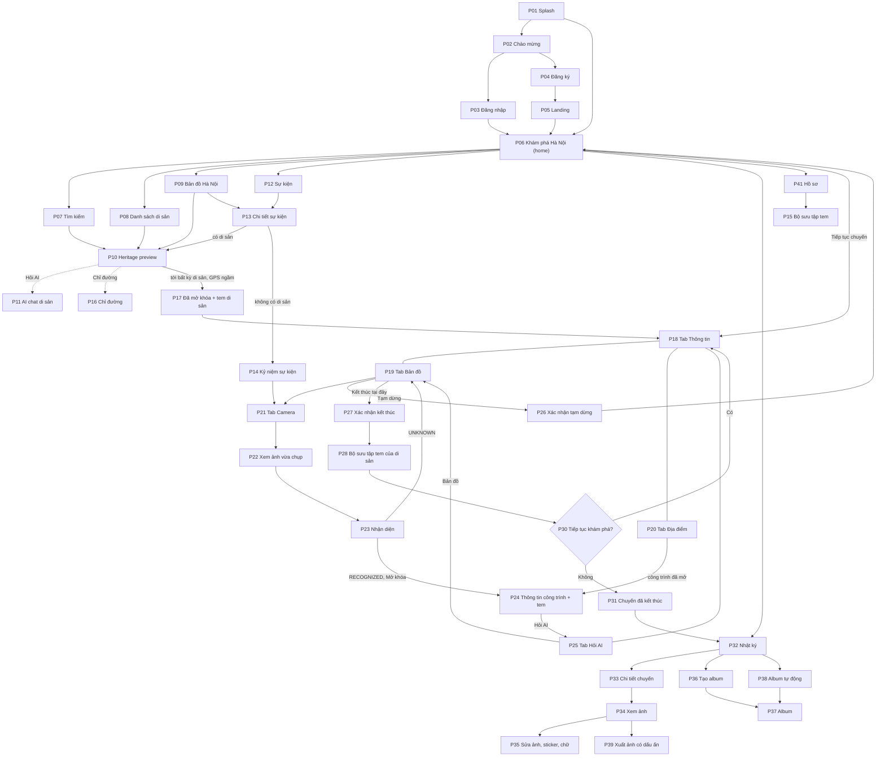

# Hanoi Lens — Hệ thống thiết kế giao diện (UI Design System)

Bản mới (2026-11-06), làm lại từ đầu, không dựa vào màu/chữ/component đang có trong Figma. Đây là nguồn chuẩn cho mọi màn mới và màn sửa. Kiểm kê Figma cũ, prompt sửa luồng và nhật ký áp dụng nằm ở [UI_FIGMA_AUDIT.md](UI_FIGMA_AUDIT.md).

- Nền tảng: Android Native (Java + XML, Material Components 3), khung thiết kế 393×852 dp.
- Luồng và hành vi: [flows/user-flow.md](flows/user-flow.md), [HANOI_LENS_PRODUCT_BRIEF.md](HANOI_LENS_PRODUCT_BRIEF.md) §5–§8. Mã lỗi và trạng thái bất đồng bộ: [API.md](API.md) §2, §7–§14 (API là đề xuất, chưa triển khai).
- Ràng buộc nhóm: không có tính năng gợi ý chụp ảnh (ADR 010); AI chỉ nhận diện landmark và hỏi đáp lịch sử có trích dẫn; không gợi ý lộ trình; kiểm tra khu vực chạy ngầm, không hiện trạng thái trong/ngoài (2026-11-06).

## Mục lục

1. Phong cách thiết kế · 2. Màu sắc · 3. Chữ · 4. Kích thước, khoảng cách, bo góc, bóng, chuyển động, icon, illustration · 5. Thư viện component · 6. Mẫu trang · 7. Màn trạng thái (loading, rỗng, lỗi, ngoại tuyến, lỗi API) · 8. Đưa token vào Figma và Android · 9. Kế hoạch thực hiện · 10. Quyết định đã chốt · 11. Danh sách trang chi tiết (trang, phần dùng chung, lỗi theo trang) · 12. Bản Figma v3

## 1. Phong cách thiết kế

**Tên định hướng: "Hà Nội sơn mài — ấm, tĩnh, ảnh là chính".**

- **Cảm hứng**: sơn mài đỏ son (màu chính), mặt hồ Hoàn Kiếm xanh ngọc (riêng tư, đã mở khóa, an toàn), hoàng thổ / mái ngói (điểm nhấn, tem), giấy dó kem (nền), mực tàu nâu đen (chữ). Không dùng họa tiết rồng phượng dày đặc; chỉ một vài nét line-art mảnh (mái đình, hoa sen, Khuê Văn Các) cho illustration trạng thái.
- **Nguyên tắc**:
  1. **Ảnh là chính**: chrome giao diện trung tính, ảnh di sản và ảnh của người dùng chiếm diện tích lớn.
  2. **Riêng tư nhìn thấy được**: mọi chỗ dùng vị trí hoặc chia sẻ ảnh đều có banner/nhãn riêng tư màu xanh ngọc, nói rõ điều app *không* làm (không lưu lộ trình, đã xóa GPS).
  3. **Bình tĩnh khi lỗi**: lỗi luôn nói chuyện gì xảy ra + bạn làm gì tiếp; không đổ lỗi, không hiện mã kỹ thuật (chỉ `requestId` trong "Chi tiết" để báo lỗi).
  4. **Dùng được khi mạng yếu**: nội dung đã tải (Room cache) vẫn xem được; ảnh chụp offline vào hàng đợi tải lên.
  5. **Dễ tiếp cận**: tương phản WCAG AA, vùng chạm ≥ 48 dp, hỗ trợ font scale 200 %, TalkBack.
  6. **Không gợi ý chụp ảnh, không gợi ý lộ trình** (ADR 010, BRIEF): không có component nào cho tip, lưới bố cục kèm lời khuyên, đường đi nhiều điểm.
- **Hình khối**: bo góc mềm (card 16 dp, sheet 28 dp), nút pill, bóng đổ rất nhẹ; phân tầng chủ yếu bằng màu nền (tonal surface) như Material 3.
- **Giọng văn (copy)**: tiếng Việt, xưng "bạn", câu ngắn, động từ ở nút ("Đánh dấu", "Thử lại", "Về bản đồ tham quan"). Tiêu đề lỗi ≤ 6 từ, thân ≤ 2 câu.

## 2. Màu sắc

Màu chia 3 lớp: **Primitive** (bảng màu gốc) → **Semantic** (vai trò Material 3 + trạng thái) → **Domain** (di sản, sự kiện, AI, danh mục). Component chỉ được dùng Semantic/Domain, không dùng hex trực tiếp. Tỉ lệ tương phản bên dưới đã tính theo công thức WCAG 2.x.

### 2.1 Vai trò chính (Light)

| Token | Hex | Dùng cho | Tương phản |
|---|---|---|---|
| `primary` (Son) | `#A63A2A` | Nút chính, tab đang chọn, link, FAB "Chụp ảnh" | chữ trắng 6.44 : 1; làm chữ trên nền 6.12 : 1 |
| `onPrimary` | `#FFFFFF` | Chữ/icon trên primary | — |
| `primaryContainer` | `#FFDAD2` | Nút tonal, chip đang chọn nhẹ | `onPrimaryContainer` 13.19 : 1 |
| `onPrimaryContainer` | `#3D0700` | | |
| `secondary` (Hồ Gươm) | `#2D6A5C` | Riêng tư, trạng thái đã mở khóa, thành công nhẹ | chữ trắng 6.31 : 1 |
| `onSecondary` | `#FFFFFF` | | |
| `secondaryContainer` | `#B5EEDD` | Banner riêng tư, thẻ "Đã mở khóa" | `onSecondaryContainer` 13.29 : 1 |
| `onSecondaryContainer` | `#00201A` | | |
| `tertiary` (Hoàng thổ) | `#7D5700` | Tem, bộ sưu tập tem, điểm nhấn | chữ trắng 6.49 : 1 |
| `onTertiary` | `#FFFFFF` | | |
| `tertiaryContainer` | `#FFDEA6` | Nền tem, ô tem trong bộ sưu tập | `onTertiaryContainer` 13.31 : 1 |
| `onTertiaryContainer` | `#281800` | | |
| `background` / `surface` (Giấy dó) | `#FFF8F1` | Nền màn | `onSurface` 16.25 : 1 |
| `surfaceContainerLowest` | `#FFFFFF` | Card trên nền kem | |
| `surfaceContainerLow` | `#FBF2EA` | Vùng phụ, bottom nav | |
| `surfaceContainer` | `#F4ECE3` | Ô nhập liệu, chip chưa chọn | `onSurfaceVariant` 7.94 : 1 |
| `surfaceContainerHigh` | `#EEE6DD` | Bottom sheet, dialog | |
| `surfaceContainerHighest` | `#E8E0D8` | Skeleton, thanh tiến độ nền | |
| `onSurface` (Mực) | `#1F1B17` | Chữ chính | |
| `onSurfaceVariant` | `#51453A` | Chữ phụ, icon inactive | 8.82 : 1 |
| `outline` | `#837468` | Viền ô nhập, divider đậm (UI không phải chữ) | 4.28 : 1 (≥ 3 : 1 cho UI) |
| `outlineVariant` | `#D6C3B6` | Divider, viền card | trang trí |
| `inverseSurface` / `inverseOnSurface` | `#352F2B` / `#F9EFE7` | Snackbar | |
| `scrim` | `#000000` @ 32 % | Nền mờ dưới sheet/dialog; 40 % trên ảnh bị khóa | |
| `on-scrim` / `on-category` | `#FFFFFF` ở cả Light và Dark | Chữ/icon trên scrim, trên ảnh, trên nhãn danh mục và băng công trình đang khóa (màu nền không đổi theo chế độ) | |

### 2.2 Trạng thái (Light)

| Token | Màu / Container / On-container | Dùng cho |
|---|---|---|
| `error` | `#B3261E` / `#F9DEDC` / `#410E0B` | Lỗi chặn, viền ô nhập sai, ảnh tải lên thất bại (chữ trắng 6.54 : 1) |
| `success` | `#2E7D32` / `#CDEBCB` / `#0B2E10` | Đã lưu, đã xuất, tải lên xong (5.13 : 1) |
| `warning` | `#8A4F00` / `#FFDDBA` / `#2D1600` | Ngoại tuyến, giới hạn tốc độ, độ tin cậy thấp (6.56 : 1) |
| `info` | `#245F96` / `#D2E4FF` / `#001D35` | Thông tin trung tính, đang xử lý, vị trí hiện tại trên bản đồ (6.66 : 1) |
| `privacy` | = `secondary` / `secondaryContainer` | Banner riêng tư, icon khiên |

Quy tắc: không chỉ dùng màu để truyền trạng thái; luôn kèm icon + chữ (ví dụ lỗi = icon `error` + câu chữ).

### 2.3 Màu theo nghiệp vụ (Domain)

| Token | Hex | Ý nghĩa |
|---|---|---|
| `heritageUnlocked` | `secondary` | Di sản / landmark đã mở khóa (pin, viền thẻ, nhãn) |
| `stampNew` | `tertiary` + viền sáng | Tem vừa nhận (hiệu ứng đóng dấu) |
| `heritageLocked` | `#6E6259` | Landmark chưa mở khóa: ảnh grayscale + scrim 40 % + icon khóa (chữ trắng 5.91 : 1) |
| `event` | `#5B4A9E`, container `#E6DEFF` | Sự kiện văn hóa (pin, chip, nhãn ngày) — 7.20 : 1 |
| `ai` | `info` + nhãn "AI" | Tin nhắn AI, nhãn "Do AI tạo", chip nguồn trích dẫn |
| `stamp` | `tertiary` / `tertiaryContainer` | Tem di sản, tem công trình, bộ sưu tập tem |
| `mapGeofence` | `secondary` @ 16 % fill, viền 2 dp `secondary` | Vùng di sản trên bản đồ |
| `mapUserLocation` | `info` + quầng 20 % | Chấm vị trí (chỉ trên máy) |

Danh mục di sản (badge chữ trắng, đều ≥ 6 : 1):

| Danh mục | Hex | | Danh mục | Hex |
|---|---|---|---|---|
| Đình / Chùa / Đền (Temple) | `#7A2E3A` | | Phố cổ (Street) | `#8A4B1F` |
| Hồ (Lake) | `#1F6A8A` | | Cầu (Bridge) | `#4A5A6A` |
| Bảo tàng (Museum) | `#5A4B8A` | | Vườn / Công viên (Garden) | `#3F6B2A` |

### 2.4 Chế độ tối (Dark)

**Dark mode nằm trong MVP** (quyết định 2026-11-06): mọi màn vẽ và kiểm thử ở cả Light và Dark, token đặt trong `values-night` để component không phải sửa. Camera, nhận diện, xem ảnh và trình chỉnh ảnh theo chế độ của máy như mọi màn khác (đổi 2026-11-07, trước đây luôn nền tối); chữ và nút nằm trên ảnh camera dùng `on-scrim` trên nền `scrim` để đọc được ở cả Light và Dark.

| Token | Hex | Ghi chú |
|---|---|---|
| `primary` / `onPrimary` | `#FF7A61` / `#3D0700` | 6.68 : 1; trên `surface` 7.22 : 1, trên nền đen camera 8.21 : 1. Màu nhấn duy nhất của Dark (chốt 2026-11-07, thay `#FFB4A3` nhạt khó nhìn): nút chính, chữ nút, tab đang chọn, link |
| `primaryContainer` / `onPrimaryContainer` | `#85230F` / `#FFDAD2` | 7.22 : 1 |
| `secondary` / `onSecondary` | `#99D1C1` / `#00382E` | |
| `secondaryContainer` / `onSecondaryContainer` | `#145145` / `#B5EEDD` | |
| `tertiary` / `onTertiary` | `#F5BD48` / `#422C00` | |
| `surface` / `onSurface` | `#17130F` / `#ECE0D8` | 14.27 : 1 |
| `onSurfaceVariant` | `#D6C3B6` | 10.86 : 1 |
| `surfaceContainer` … `Highest` | `#241F1B` · `#2F2925` · `#3A3430` | |
| `outline` / `outlineVariant` | `#9F8D81` / `#51453A` | |
| `error` / `onError` | `#FFB4AB` / `#690005` | 7.72 : 1 |

## 3. Chữ (Typography)

- **Font UI**: **Be Vietnam Pro** (Google Fonts, giấy phép OFL, thiết kế cho dấu tiếng Việt). Weight dùng: 400, 500, 600, 700.
- **Font kể chuyện**: **Noto Serif** 400/600 (đã chốt 2026-11-06; bản Figma không có kiểu nghiêng nên `Quote` dùng Regular) — chỉ cho tên di sản lớn ở hero, trích dẫn lịch sử, chữ trên tem. Mọi chỗ khác dùng Be Vietnam Pro.
- Đơn vị `sp`, line-height ≥ 1.33 lần cỡ chữ để dấu chồng (ặ, ỗ, ữ) không bị cắt. Không viết hoa toàn bộ tiếng Việt dài (khó đọc dấu); chỉ nhãn ≤ 2 từ.

| Token | Font / weight | Size / line-height (sp) | Letter spacing | Dùng cho |
|---|---|---|---|---|
| `displayL` | Noto Serif 600 | 34 / 44 | 0 | Tên di sản ở hero, màn mở khóa |
| `displayS` | Be Vietnam Pro 700 | 28 / 36 | 0 | Số liệu lớn (2/3 đã mở khóa), tiêu đề màn ăn mừng |
| `headlineM` | Be Vietnam Pro 700 | 24 / 32 | 0 | Tiêu đề trang gốc (Khám phá Hà Nội, Nhật ký) |
| `headlineS` | Be Vietnam Pro 600 | 20 / 28 | 0 | Tiêu đề section lớn, tiêu đề dialog |
| `titleL` | Be Vietnam Pro 600 | 18 / 26 | 0 | Top app bar, tên card lớn |
| `titleM` | Be Vietnam Pro 600 | 16 / 24 | 0.1 | Tên card, tiêu đề list item |
| `titleS` | Be Vietnam Pro 600 | 14 / 20 | 0.1 | Tiêu đề nhỏ, tab |
| `bodyL` | Be Vietnam Pro 400 | 16 / 24 | 0.15 | Nội dung đọc dài (lịch sử, câu trả lời AI) |
| `bodyM` | Be Vietnam Pro 400 | 14 / 20 | 0.15 | Nội dung mặc định |
| `bodyS` | Be Vietnam Pro 400 | 12 / 16 | 0.2 | Chú thích, nguồn trích dẫn, thời gian |
| `labelL` | Be Vietnam Pro 600 | 14 / 20 | 0.1 | Chữ trên nút |
| `labelM` | Be Vietnam Pro 500 | 12 / 16 | 0.3 | Chip, nhãn bottom nav |
| `labelS` | Be Vietnam Pro 600 | 11 / 16 | 0.4 | Badge danh mục, nhãn "AI" (chỉ ≤ 2 từ) |
| `quote` | Noto Serif 400 | 16 / 26 | 0 | Trích dẫn lịch sử, câu trên tem |

## 4. Kích thước, khoảng cách, bo góc, bóng, chuyển động

**Spacing** (lưới 4 dp): `space0 = 0`, `space1 = 2`, `space2 = 4`, `space3 = 8`, `space4 = 12`, `space5 = 16`, `space6 = 20`, `space7 = 24`, `space8 = 32`, `space9 = 40`, `space10 = 48`, `space11 = 64`.

| Quy ước | Giá trị |
|---|---|
| Lề màn hình | 16 dp |
| Khoảng giữa các section | 24 dp (32 dp trên trang kể chuyện) |
| Padding card | 16 dp (card ảnh: 12 dp) |
| Khoảng cách giữa card trong list / lưới | 12 dp / 8 dp |
| Vùng chạm tối thiểu | 48 × 48 dp |
| Chiều cao: nút L / M / S | 56 / 48 / 40 dp |
| Top app bar / bottom nav / tab bar di sản | 64 / 80 / 72 dp |
| Lưới ảnh | 3 cột, gutter 2 dp (Nhật ký); 2 cột, gutter 8 dp (Địa điểm) |
| Tỉ lệ ảnh | Hero 16:9 (hoặc 4:3 khi có title chồng), card 4:3, ô lưới 1:1, ảnh preview giữ tỉ lệ gốc |

**Bo góc**: `radiusXs = 4` (badge), `radiusSm = 8` (ảnh nhỏ, tooltip), `radiusMd = 12` (ô nhập, ảnh trong card, snackbar), `radiusLg = 16` (card), `radiusXl = 28` (bottom sheet cạnh trên, dialog), `radiusFull = 999` (nút, chip, FAB, avatar). Tem có viền răng cưa riêng (asset), không dùng token bo góc.

**Viền**: 1 dp `outlineVariant` (card, divider), 1 dp `outline` (ô nhập), 2 dp `primary` (ô nhập focus, ảnh được chọn), 2 dp `error` (ô nhập lỗi).

**Độ nổi (elevation)**, theo Material 3, ưu tiên đổi màu surface hơn đổ bóng:

| Mức | dp | Dùng cho |
|---|---|---|
| `elev0` | 0 | Nền, card phẳng có viền |
| `elev1` | 1 | Card ảnh, search bar |
| `elev2` | 3 | Bottom nav, top bar khi cuộn |
| `elev3` | 6 | FAB, bottom sheet, nút nổi trên bản đồ |
| `elev4` | 8 | Snackbar, menu |
| `elev5` | 12 | Dialog |

**Chuyển động**:

| Token | Thời gian | Easing | Dùng cho |
|---|---|---|---|
| `motionShort` | 100–150 ms | standard | Pressed, ripple, đổi icon |
| `motionMedium` | 250–300 ms | emphasized decelerate (vào) / accelerate (ra) | Sheet, dialog, chuyển tab, snackbar |
| `motionLong` | 400–500 ms | emphasized | Chuyển màn có ảnh chung (shared element) |
| `motionCelebrate` | 600–900 ms | spring nhẹ | Đóng tem, mở khóa di sản, mở khóa công trình |
| `motionShimmer` | 1 200 ms lặp | linear | Skeleton |

Khi máy bật "Giảm chuyển động" (animator duration scale = 0): bỏ shimmer (skeleton tĩnh), màn ăn mừng chỉ fade.

**Icon**: Material Symbols **Rounded**, 24 dp (20 dp trong chip, 32 dp trong trạng thái lớn), outline khi inactive, filled khi active. Icon riêng của app (vẽ cùng nét 2 dp): tem, di sản, landmark, sen, khiên riêng tư, ống kính nhận diện.

**Illustration trạng thái** (line-art 2 màu `onSurfaceVariant` + một màu nhấn, 160 dp): Hồ Gươm & Tháp Rùa (ngoại tuyến), Khuê Văn Các có mây (lỗi máy chủ), cuốn nhật ký trống (Nhật ký rỗng), bản đồ gấp (chưa đánh dấu di sản), kính lúp (không có kết quả), máy ảnh có dấu chéo (quyền camera), ghim bản đồ có dấu chéo (quyền vị trí), đồng hồ cát (giới hạn tốc độ), bóng đèn AI ngủ (AI tạm nghỉ), tem trống (chưa có tem), ổ khóa (phiên hết hạn), công trình mờ có dấu hỏi (không nhận ra công trình).

## 5. Thư viện component

Đặt tên trong Figma: `Nhóm / Tên`, thuộc tính variant `Type`, `State`, `Size` (tiếng Anh, dễ map sang code). Mỗi component cần đủ trạng thái: Default, Pressed, Focused, Disabled, và nếu có: Loading, Error, Selected. Cột cuối là class Android tương ứng.

### Hành động

| Component | Variant | Trạng thái | Android |
|---|---|---|---|
| `Button` | Filled (primary), Tonal, Outlined, Text, Destructive (error); Size L/M/S; có/không icon | Default, Pressed, Focused, Disabled, Loading (spinner thay icon, giữ độ rộng) | `MaterialButton` |
| `Icon button` | Standard, Filled, Tonal, Outlined | + Selected (yêu thích, đang bật) | `MaterialButton.Icon` |
| `FAB` | Regular, Extended ("Chụp ảnh") | + Hidden khi cuộn | `ExtendedFloatingActionButton` |
| `Shutter` | Ready, Capturing, Disabled | | custom |

### Nhập liệu và lựa chọn

| Component | Variant / trạng thái | Android |
|---|---|---|
| `Text field` | Outlined; Empty, Focused, Filled, Error (dòng lỗi từ `details[].field`), Disabled; có password toggle, đếm ký tự | `TextInputLayout` |
| `Search bar` | Idle, Focused + recent, Has text (nút xóa), Loading | `SearchBar` / `SearchView` |
| `Chip` | Filter (Tất cả/Di sản/Sự kiện), Assist, Input, Source (trích dẫn); Selected/Unselected/Disabled | `Chip` |
| `Segmented button` | 2–4 lựa chọn (kiểu album, bố cục) | `MaterialButtonToggleGroup` |
| `Switch` | On/Off/Disabled (tự tạo album hành trình) | `MaterialSwitch` |
| `Radio list` | Độ chính xác vị trí 5 mức `NONE/DESTINATION/DISTRICT/APPROXIMATE/EXACT`, mức bị chặn (ví dụ album ≤ DISTRICT) hiện Disabled + lý do | `RadioButton` |
| `Checkbox` | Chọn ảnh cho album | `MaterialCheckBox` |
| `Slider` | Sáng, tương phản, bão hòa, zoom | `Slider` |

### Điều hướng

| Component | Variant |
|---|---|
| `Top app bar` | Root (tiêu đề trái, avatar phải), Back, Transparent-on-hero (icon trên scrim), Center (dialog toàn màn) |
| `Bottom nav` | 5 tab: Khám phá · Bản đồ · Sự kiện · Nhật ký · Hồ sơ; Active = icon filled + pill `secondaryContainer`; có badge chấm |
| `Heritage tab bar` | 5 tab: Thông tin · Bản đồ · Camera · Địa điểm · Hỏi AI (quyết định 2026-11-06) |
| `Tabs` | Primary tabs trong trang (Sắp diễn ra / Đang diễn ra) |
| `Page indicator` | Chấm cho onboarding |

### Hiển thị nội dung

| Component | Variant / trạng thái |
|---|---|
| `Heritage card` | Large (ảnh 4:3 + tên + danh mục + khoảng cách tùy chọn), Compact (list); trạng thái Default, Unlocked (nhãn xanh + tem), Skeleton |
| `Landmark card` | Unlocked (ảnh màu + tên), Locked (grayscale + ổ khóa + "Chụp và nhận diện để mở"), Skeleton |
| `Event card` | Upcoming, Ongoing (nhãn "Đang diễn ra"), Ended (mờ 60 %), Linked-heritage / Standalone |
| `Journey card` | Active, Paused ("Tiếp tục chuyến đi"), Ended; tiến độ "2/3 đã mở khóa" |
| `Photo cell` | Ready, Selected, Queued (offline, icon đồng hồ), Uploading (vòng %), Processing (shimmer), Failed (viền error + nút thử lại), Locked-precision |
| `Album card` | Ready, Pending/Processing (ảnh bìa mờ + "Đang tạo album"), Failed |
| `Stamp` | Collected (màu tertiary, răng cưa), Not yet (viền đứt, xám), New (hiệu ứng đóng dấu) |
| `Stamp grid` | Lưới tem của một di sản: tem di sản + tem từng công trình, đã có / chưa có, tiến độ "4/11" |
| `Stat tile` | Số + nhãn (tem, di sản, ảnh) |
| `List item` | 1/2/3 dòng; leading icon/ảnh/avatar; trailing chevron/switch/radio |
| `Section heading` | Tiêu đề + "Xem tất cả" |
| `Status pill` | Visit `ACTIVE/PAUSED/ENDED`, Processing `PENDING/PROCESSING/READY/FAILED`, Event `UPCOMING/ONGOING/ENDED` — mỗi giá trị một cặp container/on-container ở §2 |
| `Category badge` | 6 danh mục (§2.3) |
| `Privacy banner` | Info (xanh ngọc, khiên), Compact (1 dòng) |

### Phản hồi và trạng thái

| Component | Variant | Khi nào dùng |
|---|---|---|
| `Skeleton` | Card, List item, Detail hero, Chat bubble, Photo grid | Lần tải đầu, > 300 ms |
| `Progress` | Linear indeterminate (đầu trang), Linear determinate (tải ảnh), Circular (trong nút, ô ảnh) | Thao tác đang chạy |
| `Snackbar` | Info, Success, Error + nút hành động ("Thử lại", "Hoàn tác") | Lỗi nhẹ sau thao tác, xác nhận |
| `Inline banner` | Offline (warning), Server issue (error), Info, Privacy; có/không nút, đóng được | Trạng thái kéo dài trên một trang |
| `Inline error` | Dưới ô nhập; khối lỗi trong section ("Không tải được sự kiện · Thử lại") | Một phần trang hỏng, phần khác vẫn dùng được |
| `Empty state` | Illustration + tiêu đề + mô tả + nút (tùy chọn) | Danh sách rỗng hợp lệ |
| `Full-screen state` | Illustration + tiêu đề + mô tả + nút chính + nút phụ + "Chi tiết" (hiện `requestId`, nút sao chép) | Trang không thể hiển thị gì |
| `Dialog` | Confirm, Destructive, Blocking (phiên hết hạn), Permission rationale | Cần người dùng quyết định |
| `Bottom sheet` | Modal, Standard (bản đồ), Action list | Chi tiết điểm trên bản đồ, lựa chọn |
| `Tooltip` | Plain | Giải thích icon riêng tư |

### Bản đồ, camera, AI

| Component | Variant |
|---|---|
| `Map marker` | Heritage (default/unlocked/selected), Event, Landmark (locked/unlocked), Cluster |
| `Map current location` | Accurate, Low-accuracy (quầng lớn), Unavailable |
| `Map geofence` | Default, Unlocked |
| `Map controls` | Về vị trí của tôi, la bàn, zoom, nhãn bản quyền bản đồ |
| `Camera controls` | Flash (off/on/auto), đổi camera, zoom chip (0.5×/1×/2×), thumbnail ảnh vừa chụp |
| `Recognition card` | Recognizing (shimmer trên ảnh), Recognized (tên + độ tin cậy dạng nhãn chữ "Khá chắc chắn"), Unknown |
| `Chat scope header` | Heritage scope ("Hỏi về Văn Miếu – Quốc Tử Giám"), Landmark scope |
| `Chat message` | User, AI (nhãn "Do AI tạo"), AI + nguồn (chip trích dẫn), AI declined ("Chưa có nguồn đáng tin…"), AI typing, Failed (nút gửi lại) |
| `Chat composer` | Idle, Typing, Sending, Disabled (AI tạm nghỉ / ngoại tuyến / giới hạn), câu hỏi gợi ý dạng chip |
| `Editor toolbar` | Cắt, xoay, chỉnh màu, màu hoài niệm (preset), sticker, chữ viết tay; thanh trượt; nút Hoàn tác/Làm lại |
| `Color preset` | Ô xem trước preset màu hoài niệm (`HANOI_FILM`, `SEPIA_1990`, `FADED_POSTCARD`…), Selected |
| `Caption` | Lớp chữ viết tay: chọn kiểu nét bút có sẵn, màu, Selected (khung + tay nắm) |
| `Sticker` | 6 loại (Stamp, Postmark, Date, Text, Heart, Badge), Selected (khung + tay nắm), Locked (landmark chưa mở khóa → `STICKER_NOT_AVAILABLE`) |

## 6. Mẫu trang (page templates)

| Mã | Mẫu | Cấu trúc | Màn dùng |
|---|---|---|---|
| T1 | Trang gốc có tab | Status bar · Top app bar Root · nội dung cuộn · Bottom nav | Khám phá Hà Nội, Sự kiện, Nhật ký, Hồ sơ |
| T2 | Chi tiết có hero | Ảnh hero 16:9 + top bar trong suốt · tiêu đề `displayL` · nội dung · thanh hành động dưới cố định | Heritage preview, Event detail, Landmark info |
| T3 | Bản đồ toàn màn | Bản đồ · search/chip nổi · nút bản đồ · bottom sheet kéo được | Bản đồ, Visit map, Bản đồ di sản |
| T4 | Camera / editor | Nền `surface` theo chế độ (Light/Dark); điều khiển nằm trên ảnh dùng `on-scrim` trên chip `scrim`, không bottom nav | Camera, Photo preview, Editor, Sticker |
| T5 | Biểu mẫu | Top bar Back · tiêu đề + mô tả · các field · nút chính dưới cùng (nâng theo bàn phím) | Đăng nhập, Đăng ký, Tạo album, Quyền riêng tư |
| T6 | Chat | Scope header · danh sách tin · composer dính đáy | AI chat (di sản / landmark) |
| T7 | Lưới / thư viện | Top bar · bộ lọc · lưới ảnh · thanh chọn nhiều | Ảnh hành trình, Chọn ảnh cho album, Bộ sưu tập tem |
| T8 | Ăn mừng | Nền tối hoặc tertiaryContainer · animation tem · tiêu đề · 1–2 nút | Mở khóa di sản, Mở khóa công trình, Bộ sưu tập tem khi kết thúc |
| T9 | Trang di sản tại chỗ | T1 nhưng Bottom nav thay bằng Heritage tab bar | Trang di sản tại chỗ (5 tab) |
| T10 | Trạng thái toàn màn | Top bar (nếu có đường lui) · illustration · tiêu đề · mô tả · nút | Mọi lỗi/ngoại tuyến/rỗng toàn trang (§7) |
| T11 | Sheet / dialog | Scrim · sheet hoặc dialog | Xác nhận tạm dừng, kết thúc, xóa, chuyến đang mở |

## 7. Danh mục màn trạng thái (loading, rỗng, lỗi, ngoại tuyến, lỗi API)

Quy tắc chọn hình thức hiển thị:

1. **Trang chưa có gì để hiện** → `Full-screen state` (T10).
2. **Trang đã có dữ liệu (cache hoặc đã tải)** → giữ dữ liệu, thêm `Inline banner` hoặc `Snackbar`. Không bao giờ xóa nội dung đang xem để hiện lỗi.
3. **Một khối trong trang hỏng** → `Inline error` trong khối đó.
4. **Lỗi do thao tác của người dùng** (bấm nút) → `Snackbar` (hoặc lỗi dưới ô nhập với form).
5. **Cần quyết định** → `Dialog`.
6. Mọi màn lỗi có ít nhất một đường đi tiếp (Thử lại, Quay lại, Về trang chủ, Mở cài đặt).

### 7.1 Tải dữ liệu

| # | Trạng thái | Hình thức | Nội dung gợi ý |
|---|---|---|---|
| L1 | Mở app / làm mới phiên | Splash (logo + nền giấy dó), tối đa 2 s rồi vào màn | — |
| L2 | Tải lần đầu (list, chi tiết) | Skeleton đúng hình bố cục; chỉ hiện sau 300 ms | — |
| L3 | Tải lâu > 10 s | Skeleton + dòng "Vẫn đang tải… mạng có vẻ chậm" + nút "Hủy" | |
| L4 | Kéo để làm mới | Progress tròn đầu trang | |
| L5 | Tải thêm trang (cursor) | Skeleton 2 item cuối list; lỗi → item "Không tải thêm được · Thử lại" | |
| L6 | Hết danh sách (`hasMore = false`) | Dòng nhỏ "Bạn đã xem hết" | |
| L7 | Thao tác trong nút | Nút Loading, khóa bấm lặp | |
| L8 | Tài nguyên bất đồng bộ đang chờ (`PENDING/PROCESSING`) | Card mờ + progress + "Đang tạo album… bạn có thể rời trang này"; client hỏi lại 1→2→4→8 s, dừng khi app ở nền hoặc ngoại tuyến | |

### 7.2 Rỗng (empty)

| # | Màn | Tiêu đề / mô tả gợi ý | Nút |
|---|---|---|---|
| E1 | Tìm kiếm không có kết quả | "Không tìm thấy "{từ khóa}"" / "Thử tên khác hoặc bỏ bớt bộ lọc." | Xóa bộ lọc |
| E2 | Chưa mở khóa công trình nào (tab Địa điểm, Hỏi AI) | "Chưa mở khóa công trình nào" / "Chụp một công trình và nhận diện để mở khóa, nhận tem và giúp AI biết thêm về nó." | Mở camera |
| E3 | Sự kiện trống trong khoảng ngày | "Chưa có sự kiện trong thời gian này" | Xem 30 ngày tới |
| E4 | Nhật ký trống | "Nhật ký chưa có trang nào" / "Ảnh bạn chụp trong chuyến đi sẽ tự lưu vào đây." | Khám phá Hà Nội |
| E5 | Album / recap trống | "Chưa có album" | Tạo album |
| E6 | Bộ sưu tập tem trống | "Chưa có tem nào" / "Mở khóa di sản đầu tiên để nhận tem." | — |
| E7 | Di sản chưa có landmark | "Chưa có công trình nào được giới thiệu ở đây" | — |
| E8 | Chat mới mở | Scope header + 3 câu hỏi gợi ý dạng chip (không phải lời khuyên chụp ảnh) | |

### 7.3 Mạng và máy chủ

| # | Tình huống (phía client) | Hình thức | Nội dung gợi ý | Hành động |
|---|---|---|---|---|
| N1 | Mất mạng, có cache | Banner warning dính đầu trang | "Bạn đang ngoại tuyến. Đang xem nội dung đã lưu." | Tự ẩn khi có mạng |
| N2 | Mất mạng, không có cache | Full-screen (illustration Hồ Gươm) | "Không có kết nối mạng" / "Kiểm tra Wi-Fi hoặc dữ liệu di động rồi thử lại." | Thử lại · Mở Nhật ký đã lưu |
| N3 | Chụp ảnh khi ngoại tuyến | Ô ảnh Queued + snackbar | "Ảnh đã lưu trên máy, sẽ tự tải lên khi có mạng." | — |
| N4 | Thao tác cần mạng khi ngoại tuyến (mở khóa công trình, gửi câu hỏi AI, tạo album) | Nút Disabled + chú thích, hoặc snackbar | "Cần kết nối mạng để {làm việc này}." | — |
| N5 | Hết thời gian chờ / không phân giải được máy chủ | Có dữ liệu: banner error; không có: full-screen (Khuê Văn Các có mây) | "Không kết nối được máy chủ" / "Hệ thống có thể đang bận. Thử lại sau ít phút." | Thử lại |
| N6 | `500` | Như N5 + "Chi tiết" chứa `requestId` | "Đã có lỗi phía hệ thống" | Thử lại · Sao chép mã lỗi |
| N7 | `503` (dịch vụ phụ thuộc tạm ngừng / bảo trì) | Banner hoặc full-screen, tôn trọng `Retry-After` | "Hệ thống đang bảo trì, quay lại sau {n} phút." | Thử lại (khóa đến hết đếm ngược) |
| N8 | `429` giới hạn tốc độ | Snackbar có đếm ngược theo `Retry-After`; nút liên quan khóa tạm | Chung: "Bạn thao tác hơi nhanh, thử lại sau {n} giây." · AI: "Bạn đã hỏi nhiều câu liên tiếp, nghỉ {n} giây nhé." · Đăng nhập: "Thử đăng nhập quá nhiều lần. Thử lại sau {n} phút." | |
| N9 | `400` | Snackbar error chung | "Không thực hiện được yêu cầu. Thử lại." | Thử lại (ghi log để sửa client) |

### 7.4 Phiên đăng nhập và quyền truy cập

| # | Mã | Hình thức | Nội dung gợi ý | Hành động |
|---|---|---|---|---|
| A1 | `401` access token hết hạn | Không hiện gì: client gọi `POST /auth/refresh` rồi lặp lại yêu cầu | — | — |
| A2 | `401` refresh thất bại / bị thu hồi (dùng lại token) | Dialog chặn (ổ khóa) | "Phiên đăng nhập đã hết hạn" / "Đăng nhập lại để tiếp tục. Ảnh chưa tải lên vẫn được giữ trên máy." | Đăng nhập (quay lại đúng màn sau khi đăng nhập) |
| A3 | Đăng nhập sai | Lỗi chung dưới form (không nói sai email hay mật khẩu) | "Email hoặc mật khẩu chưa đúng." | — |
| A4 | Đăng ký: `422 VALIDATION_ERROR` | Lỗi dưới từng ô theo `details[].field` | Ví dụ "Mật khẩu cần ít nhất 12 ký tự." | — |
| A5 | `403` | Full-screen | "Bạn không có quyền xem nội dung này" | Về trang chủ |
| A6 | `404` (không tồn tại hoặc của người khác — API cố ý không phân biệt) | Full-screen hoặc snackbar khi đang ở list | "Không tìm thấy nội dung" / "Nội dung có thể đã bị xóa." | Quay lại |

### 7.5 Lỗi nghiệp vụ theo mã API

| # | Mã | Ngữ cảnh | Hình thức | Nội dung gợi ý / xử lý |
|---|---|---|---|---|
| B1 | `409 ACTIVE_VISIT_EXISTS` | Bắt đầu chuyến khi đang có chuyến `ACTIVE/PAUSED` | Dialog | "Bạn đang có chuyến đi ở {di sản}" — nút "Tiếp tục chuyến đó" · "Kết thúc chuyến đó" |
| B2 | `422 ARRIVAL_REQUIRED` / `ARRIVAL_CHECK_EXPIRED` | Tạo chuyến khi bằng chứng đến nơi thiếu/hết hạn | Không hiện gì: kiểm tra lại khu vực ngầm (quyết định 2026-11-06); chỉ khi vẫn thất bại mới hiện snackbar | "Chưa xác nhận được bạn đã đến {di sản}. App sẽ thử lại khi bạn ở gần hơn." |
| B3 | `409 REQUEST_IN_PROGRESS` | Bấm lặp khi lệnh trước chưa xong | Giữ nút Loading, tự gửi lại sau `Retry-After` | Không hiện lỗi |
| B4 | `422 IDEMPOTENCY_KEY_REUSED` | Lỗi client | Snackbar chung (N9), tạo key mới, ghi log | |
| B5 | `409 ALBUM_READ_ONLY` | Sửa album tự động (`DESTINATION`) | Phòng trước: ẩn nút sửa; nếu vẫn gặp → snackbar | "Album tự động không chỉnh sửa được. Tạo album hành trình để tùy chỉnh." |
| B6 | `422 STICKER_NOT_AVAILABLE` | Dùng tem landmark chưa mở khóa | Sticker Locked trong bảng chọn; nếu vẫn gặp → snackbar | "Mở khóa {landmark} để dùng tem này." |
| B7 | `413` | Ảnh > 25 MB | Ô ảnh Failed | "Ảnh quá lớn (tối đa 25 MB)." — Xóa |
| B8 | `415` | Không phải JPEG/PNG | Ô ảnh Failed | "Chỉ hỗ trợ ảnh JPEG hoặc PNG." |
| B9 | `422 VALIDATION_ERROR` (không có field) | Tạo album, sửa ảnh… | Snackbar | Dùng `message` an toàn của API hoặc câu chung |
| B11 | `422 RECOGNITION_REQUIRED` | Mở khóa công trình không kèm kết quả `RECOGNIZED` hợp lệ | Phòng trước: nút Mở khóa chỉ hiện sau nhận diện; nếu vẫn gặp → snackbar | "Cần nhận diện công trình này trước khi mở khóa." — Chụp lại |
| B12 | `422 LANDMARK_LOCKED` | Hỏi AI về công trình chưa mở | Phòng trước: chỉ công trình đã mở có nút Hỏi AI | "Mở khóa {công trình} để hỏi AI về nó." |
| B10 | Upload URL hết hạn (5–10 phút) | Tải lên chậm / app ở nền | Không hiện gì: tạo phiên tải lên mới | |

### 7.6 Trạng thái theo tính năng

| # | Tính năng | Các trạng thái cần thiết kế |
|---|---|---|
| F1 | Vị trí / khu vực di sản | Quyền vị trí: chưa hỏi (màn giải thích trước khi hỏi), bị từ chối (banner + "Mở cài đặt"), chỉ cho vị trí gần đúng ("Cần vị trí chính xác để mở khóa di sản"), GPS tắt. Kết quả `INSIDE` → màn mở khóa (T8); `NEARBY/OUTSIDE/INDETERMINATE` → **không hiện gì** (kiểm tra ngầm), chỉ giữ banner riêng tư |
| F2 | Camera | Màn giải thích quyền, quyền bị từ chối, camera lỗi/đang bị app khác dùng, bộ nhớ máy đầy ("Không đủ dung lượng để lưu ảnh") |
| F3 | Tải ảnh lên | Queued → Uploading % → Processing → Ready / Failed (Thử lại · Xóa) |
| F4 | Nhận diện landmark | Đang nhận diện → `RECOGNIZED` (Landmark info) / `UNKNOWN` ("Chưa nhận ra công trình này. Ảnh vẫn được lưu vào Nhật ký." — Về bản đồ tham quan) / AI tạm nghỉ `503` ("Nhận diện đang tạm nghỉ. Ảnh vẫn được lưu.") / ngoại tuyến (nhận diện sau khi ảnh tải lên) |
| F5 | AI hỏi đáp | Gợi ý câu hỏi, đang trả lời (typing), trả lời có nguồn, từ chối vì thiếu nguồn, AI tạm nghỉ `503` (nội dung di sản tĩnh vẫn dùng được, composer Disabled), `429`, ngoại tuyến, gửi thất bại (bong bóng có "Gửi lại") |
| F6 | Chuyến đi | `ACTIVE` (visit map), `PAUSED` (card "Tiếp tục chuyến đi" ở home), xác nhận tạm dừng, xác nhận kết thúc, `ENDED` (không có trạng thái hủy) |
| F7 | Album / recap / xuất ảnh | `PENDING/PROCESSING` (L8), `READY`, `FAILED` ("Chưa tạo được album" — Thử lại / regenerate), xuất xong (snackbar success + "Mở") |
| F8 | Sự kiện | Upcoming, Ongoing, Ended (không cho tạo kỷ niệm mới), sự kiện bị gỡ (404) |
| F9 | Tem | Vừa nhận tem di sản (T8, khi mở khóa), vừa nhận tem công trình (T8 nhỏ), đã có, chưa có (viền đứt) |
| F10 | Lưu / tải ảnh về máy | Quyền lưu (Android cũ), đang lưu, đã lưu (nhắc "Đã xóa GPS khỏi ảnh"), lỗi |

### 7.7 Ma trận màn × trạng thái (tối thiểu phải vẽ)

✔ = cần frame riêng trong Figma; — = không áp dụng.

| Màn | Skeleton | Rỗng | Ngoại tuyến | Lỗi máy chủ | Khác |
|---|---|---|---|---|---|
| Khám phá Hà Nội | ✔ | — | ✔ (cache) | ✔ | Card chuyến `PAUSED` |
| Tìm kiếm | ✔ | ✔ E1 | ✔ | ✔ | — |
| Bản đồ | ✔ | — | ✔ | ✔ | Quyền vị trí F1 |
| Heritage preview | ✔ | — | ✔ | ✔ / 404 | AI tạm nghỉ (nút Hỏi AI) |
| Visit map | — | — | ✔ | — | F1, xác nhận tạm dừng/kết thúc |
| Trang di sản tại chỗ (5 tab) | ✔ | ✔ E2, E7 | ✔ | ✔ | Landmark Locked/Unlocked, B11, B12 |
| Camera / Photo preview | — | — | ✔ N3 | — | F2, F3 |
| Nhận diện / Landmark info | ✔ | — | ✔ | ✔ | F4 |
| AI chat | ✔ | ✔ E8 | ✔ | ✔ | F5, N8 |
| Sự kiện / Event detail | ✔ | ✔ E3 | ✔ | ✔ / 404 | F8 |
| Nhật ký / ảnh hành trình | ✔ | ✔ E4 | ✔ | ✔ | F3 |
| Album / recap | ✔ | ✔ E5 | ✔ | ✔ | F7, B5 |
| Editor / sticker | — | — | ✔ | ✔ | B6 |
| Bộ sưu tập tem | ✔ | ✔ E6 | ✔ | ✔ | F9 |
| Đăng nhập / đăng ký | — | — | ✔ | ✔ | A3, A4, N8 |
| Hồ sơ / quyền riêng tư | ✔ | — | ✔ | ✔ | A2 |

## 8. Đưa token vào Figma và Android

| Lớp | Figma | Android |
|---|---|---|
| Màu Primitive | Collection `Primitives` (không publish) | không dùng trực tiếp |
| Màu Semantic + Domain | Collection `Color` với 2 mode Light / Dark | `res/values/colors.xml` + `res/values-night/colors.xml`, tên `hl_<token>` (ví dụ `hl_primary_container`); map vào `Theme.HanoiLens` (`Theme.Material3.Light.NoActionBar`) qua `colorPrimary`, `colorOnPrimary`, `colorSurfaceContainer`… |
| Chữ | Text styles `Display/L`, `Body/M`… | `TextAppearance.HanoiLens.DisplayL`… trong `themes.xml`, font qua `res/font/be_vietnam_pro.xml` |
| Spacing, radius, size | Collection `Dimension` (number) | `res/values/dimens.xml`: `hl_space_5`, `hl_radius_lg`… ; `ShapeAppearance.HanoiLens.*` |
| Bóng | Effect styles `Elevation/1…5` | `app:elevation` + tonal surface |
| Chuyển động | Ghi chú trong component | `res/values/integers.xml` (`hl_motion_medium`) + interpolator Material |
| Bản đồ | Style tile OSM chỉnh màu theo §2.3 (Light + Dark) | **osmdroid** (OpenStreetMap, quyết định 2026-11-06); chỉ đường mở ứng dụng bản đồ ngoài như Google Maps (quyết định 2026-11-10, ADR 013), không vẽ tuyến trong app |

## 9. Kế hoạch thực hiện

| Bước | Việc | Kết quả kiểm tra |
|---|---|---|
| 1 | Nhóm duyệt §1–3 (màu, chữ, phong cách) | Chốt hoặc ghi chỉnh sửa vào §10 |
| 2 | Tạo Variables (`Primitives`, `Color` Light/Dark, `Dimension`), text styles, effect styles trong Figma | Không còn hex/cỡ chữ cứng trong component mới |
| 3 | Dựng component cơ bản (§5 Hành động, Nhập liệu, Điều hướng) bind variables | Mỗi component đủ trạng thái, có mô tả |
| 4 | Dựng component nghiệp vụ (card, ảnh, tem, bản đồ, camera, AI) | Thay thế các component trong section 12 của Figma |
| 5 | Vẽ illustration trạng thái (12 hình ở §4) và component `Empty state`, `Full-screen state`, `Inline banner` | — |
| 6 | Vẽ frame trạng thái theo ma trận §7.7 | Mỗi ✔ có một frame, nối prototype nút Thử lại |
| 7 | Đổi các màn hiện có sang instance + variables | Màn cũ không còn frame copy |
| 8 | Xuất token sang `colors.xml`, `themes.xml`, `dimens.xml` khi `android/` được dựng | Quỳnh Anh duyệt (CODEOWNERS `android/`) |
| 9 | Kiểm tra khả năng tiếp cận: tương phản, font scale 200 %, TalkBack trên 5 màn chính, ở cả Light và Dark | Không có lỗi AA |

## 10. Quyết định đã chốt (2026-11-06)

1. Màu chính: **đỏ son `#A63A2A`** (bỏ san hô `#FF7A59`, chữ trắng trên san hô chỉ 2.57 : 1).
2. Font: Be Vietnam Pro cho UI, **Noto Serif** cho tên di sản lớn, trích dẫn và tem.
3. **Dark mode trong MVP**: vẽ và kiểm thử cả hai chế độ.
4. Bản đồ: **OpenStreetMap qua osmdroid**; chỉ đường ngay trong app, không mở ứng dụng khác (đổi 2026-11-07).

## 11. Danh sách trang chi tiết (theo user flow, system flow và brief)

Nguồn: [flows/user-flow.md](flows/user-flow.md), [flows/system-flow.md](flows/system-flow.md), BRIEF §5–§8, §6.1–§6.11, API §4–§11 và các quyết định nhóm đến 2026-11-06. Mã trạng thái/lỗi (L, E, N, A, B, F) là ở §7, mẫu trang (T) ở §6, component ở §5. Chỗ các tài liệu đang lệch nhau được ghi ở §11.6, không tự chọn một bên.

### 11.1 Sơ đồ trang

### 11.2 Khung điều hướng

| Khung | Trang dùng | Ghi chú |
|---|---|---|
| **Bottom nav 5 tab**: Khám phá · Bản đồ · Sự kiện · Nhật ký · Hồ sơ | P06, P09, P12, P32, P41 (trang gốc của tab) và các trang con của chúng | Ẩn trên camera, editor, chat, màn ăn mừng, form |
| **Heritage tab bar 5 tab**: Thông tin · Bản đồ · Camera · Địa điểm · Hỏi AI | P18, P19, P21 (khi mở từ tab), P20, P25 | Thay bottom nav khi đang ở di sản. Nút ← góc trên về P06 = tạm dừng (hỏi P26) |
| **Thanh chuyến đang mở** (mini bar) | Mọi trang có bottom nav, khi có chuyến `ACTIVE` mà người dùng rời trang di sản | "Đang ở Văn Miếu · Quay lại" → P18 |
| **Top app bar** Root / Back / trong suốt trên ảnh | Theo mẫu trang | |

### 11.3 Phần dùng chung

**Component dùng ở nhiều trang**

| Phần dùng chung | Dùng ở | Nội dung chính |
|---|---|---|
| `Heritage card` (Large / Compact) | P06, P07, P08, P09 (sheet) | Ảnh, tên, danh mục, quận, trạng thái Đã mở khóa + số tem |
| `Event card` | P06, P09 (sheet), P12, P13 (liên quan) | Ảnh, tên, ngày giờ, địa điểm, nhãn Sắp diễn ra / Đang diễn ra / Đã kết thúc |
| `Landmark card` (Locked / Unlocked) | P10 (danh sách), P18, P20, P24 | Ảnh xám + ổ khóa khi chưa mở |
| **Module bản đồ** (osmdroid: marker, vị trí, geofence, điều khiển) | P09, P16, P19, P10 (bản đồ nhỏ), P13 (bản đồ nhỏ) | Một component, khác lớp dữ liệu: Hà Nội (di sản + sự kiện) / khu di sản (landmark + vị trí trên máy) / chỉ đường |
| **Module AI chat** | P11 (trước khi đi: di sản), P25 (tab Hỏi AI: di sản + công trình đã mở) | Scope header, tin nhắn, chip nguồn, nhãn "Do AI tạo", composer, câu hỏi gợi ý; P25 thêm chip công trình đang hỏi khi mở từ P24 |
| **Module camera** | P21 (trong chuyến), P14 (kỷ niệm sự kiện) | Chụp, flash, đổi camera, zoom; không lưới bố cục, không gợi ý |
| **Hàng đợi tải ảnh** | P21, P22, P14, P33, P34 | `Photo cell` Queued / Uploading / Processing / Ready / Failed; tự tải lại khi có mạng |
| `Stamp`, `Stamp grid` | P15, P17, P18, P24, P28, P35 (sticker), P39 | Tem di sản, tem công trình (xem §11.6) |
| `Privacy banner` | P09, P16, P17, P19, P21, P34, P36, P39, P42 | Câu theo ngữ cảnh: "Chỉ kiểm tra ngầm để mở khóa, không theo dõi lộ trình" / "Ảnh tải về đã xóa GPS" |
| `Location precision picker` (5 mức) | P36, P39, P42 | `NONE / DESTINATION / DISTRICT / APPROXIMATE / EXACT`; album khóa ở ≤ `DISTRICT` |
| `Journey card` | P06 (Tiếp tục chuyến), P32, P33 | Một chuyến = một di sản; trạng thái `ACTIVE/PAUSED/ENDED`, tiến độ "3/10 công trình đã mở" |
| `Section heading`, `Chip` lọc, `Search bar`, `Status pill`, `Category badge` | Hầu hết các trang danh sách | |

**Hành vi dùng chung (áp dụng mọi trang, không vẽ lại ở từng trang)**

| Hành vi | Áp dụng | Trạng thái §7 |
|---|---|---|
| Banner ngoại tuyến + đọc cache Room | Mọi trang có dữ liệu từ máy chủ | N1, N2, N4 |
| Làm mới token ngầm, hết phiên → dialog đăng nhập lại | Mọi trang sau đăng nhập | A1, A2 |
| Lỗi máy chủ / hết thời gian / bảo trì | Mọi trang gọi API | N5, N6, N7 |
| Giới hạn tốc độ | Theo nhóm API (đăng nhập, vị trí, ảnh, AI) | N8 |
| Không tìm thấy / không có quyền (404 thay cho 403 khi lộ thông tin) | Mọi trang chi tiết có ID | A5, A6 |
| Kéo để làm mới, tải thêm trang (cursor) | Mọi danh sách | L4, L5, L6 |
| Hỏi quyền có màn giải thích trước (P44) | Vị trí, camera, lưu ảnh, thông báo | F1, F2, F10 |
| Kiểm tra khu vực ngầm (gần bất kỳ di sản đã công bố) | Chạy khi app mở; không hiện trạng thái trong/ngoài; tới nơi → P17 | F1 |
| Hỏi trạng thái bất đồng bộ 1→2→4→8 s | Ảnh, album, recap, xuất ảnh | L8, F3, F7 |

### 11.4 Chi tiết từng trang

Mỗi trang ghi: **Vào từ** · **Nội dung** · **Chức năng → đi đến** · **API** (đề xuất, API §) · **Trạng thái và lỗi** (ngoài các hành vi dùng chung ở §11.3).

#### A. Tài khoản

**P01 Splash / kiểm tra phiên** (T10)
- Vào từ: mở app.
- Nội dung: logo, nền giấy dó, progress nhỏ.
- Chức năng: đọc refresh token trong Keystore → `POST /auth/refresh`; hợp lệ → P06 (tải dữ liệu home + chuyến `PAUSED`), không → P02.
- Trạng thái và lỗi: L1; ngoại tuyến nhưng có phiên → vào P06 với cache (N1); token bị thu hồi → P02 (không báo lỗi).

**P02 Chào mừng** (T10)
- Vào từ: P01 khi chưa đăng nhập, sau đăng xuất.
- Nội dung: illustration Hà Nội, 1 câu giới thiệu, nút "Đăng nhập", "Tạo tài khoản".
- Chức năng: → P03 / P04.

**P03 Đăng nhập** (T5)
- Vào từ: P02, dialog hết phiên (A2).
- Nội dung: email, mật khẩu (hiện/ẩn), nút "Đăng nhập", link "Tạo tài khoản".
- Chức năng: `POST /auth/login` → P06 (hoặc quay lại đúng trang trước khi hết phiên).
- Trạng thái và lỗi: L7; A3 (thông báo chung, không nói sai trường nào); N8 khóa tạm khi thử nhiều lần; N4 khi ngoại tuyến.

**P04 Đăng ký** (T5)
- Vào từ: P02, P03.
- Nội dung: tên hiển thị, email, mật khẩu + yêu cầu độ mạnh, đồng ý điều khoản và chính sách riêng tư, nút "Tạo tài khoản".
- Chức năng: `POST /auth/register` → P05.
- Trạng thái và lỗi: L7; A4 lỗi theo từng trường (`details[].field`); email đã dùng (thông báo chung theo SECURITY, không xác nhận email tồn tại); N8.

**P05 Landing page sau đăng ký** (T2, chỉ tài khoản mới)
- Vào từ: P04.
- Nội dung: hero, "cách hoạt động" 4 bước (Xem di sản → Đến nơi, tự mở khóa → Chụp, nhận diện, mở khóa công trình → Sưu tầm tem), giới thiệu bộ sưu tập tem, banner riêng tư.
- Chức năng: "Khám phá Hà Nội" → P06; "Xem di sản" → P08.

#### B. Khám phá

**P06 Khám phá Hà Nội (home)** (T1, tab Khám phá)
- Vào từ: P01, P03, P05, P26 (sau tạm dừng), P32 ("tiếp tục dùng app").
- Nội dung: lời chào; search bar; card **Tiếp tục chuyến đi** (chỉ khi có chuyến `PAUSED`); chip Tất cả / Di sản / Sự kiện; danh sách di sản (lọc gần tôi / quận / chủ đề); sự kiện sắp tới; lối vào Nhật ký; số tem đã sưu tầm. Không có mục "nên đến" hay gợi ý lộ trình.
- Chức năng: search → P07; card di sản → P10; "Xem tất cả" → P08; card sự kiện → P13; "Tiếp tục chuyến" → `POST /visits/{id}/resume` → P18; Nhật ký → P32.
- API: `GET /destinations`, `GET /events`, `GET /visits/active`.
- Trạng thái và lỗi: L2 skeleton; một khối hỏng thì chỉ khối đó báo lỗi (ví dụ sự kiện không tải được, di sản vẫn hiện); resume trả `404` (chuyến đã bị hủy) → ẩn card + snackbar.

**P07 Tìm kiếm** (T1 con)
- Vào từ: P06, P09.
- Nội dung: ô tìm kiếm, tìm gần đây, chip lọc (Di sản / Sự kiện, quận, chủ đề), kết quả gộp di sản + sự kiện.
- Chức năng: kết quả → P10 / P13; xóa lịch sử tìm kiếm (chỉ trên máy).
- API: `GET /destinations?q=…`, `GET /events?q=…`.
- Trạng thái và lỗi: L2, E1, N4 (tìm khi ngoại tuyến chỉ trên cache).

**P08 Danh sách di sản** (T1 con)
- Vào từ: P06 "Xem tất cả", P05.
- Nội dung: bộ lọc (gần tôi, quận, chủ đề, đã mở khóa), danh sách `Heritage card`.
- Chức năng: card → P10.
- API: `GET /destinations` (cursor).
- Trạng thái và lỗi: L2, L5, L6, E1 (lọc không có kết quả); "gần tôi" cần quyền vị trí (F1, không có quyền thì ẩn lọc này).

**P09 Bản đồ Hà Nội** (T3, tab Bản đồ)
- Vào từ: bottom nav, P06.
- Nội dung: bản đồ OSM (osmdroid) có marker di sản (thường / đã mở khóa) và sự kiện, cluster; chip lọc Di sản / Sự kiện; nút về vị trí của tôi; bottom sheet khi chọn điểm (card rút gọn + nút "Xem chi tiết").
- Chức năng: chọn marker di sản → sheet → P10; chọn sự kiện → sheet → P13; tìm kiếm → P07.
- API: `GET /destinations`, `GET /events` (theo khung nhìn), `GET /destinations/nearby`.
- Trạng thái và lỗi: L2 (tile bản đồ + marker), quyền vị trí bị từ chối → bản đồ vẫn dùng được, không có chấm vị trí (F1); tile bản đồ lỗi ngoại tuyến → N2 cho vùng bản đồ.

**P10 Heritage preview** (T2)
- Vào từ: P07, P08, P09, P13 (sự kiện có di sản).
- Nội dung: ảnh hero, tên, danh mục, quận; tóm tắt lịch sử; giờ mở cửa; danh sách công trình và tem của di sản (xám nếu chưa có); bản đồ nhỏ; sự kiện liên quan; **nút "Hỏi AI về di sản này" luôn hiện**; thanh dưới: **"Chỉ đường"**; đã mở khóa: "Mở trang di sản". Không có nút đánh dấu (quyết định 2026-11-06): tới nơi là tự mở khóa.
- Chức năng: Hỏi AI → P11; Chỉ đường → P16; Mở trang di sản → P18 (chỉ khi đã mở khóa; xem lại nội dung, không bắt đầu chuyến mới nếu không ở đó).
- API: `GET /destinations/{id}`, `GET /destinations/{id}/landmarks`, `GET /me/stamps`.
- Trạng thái và lỗi: L2, A6 (di sản đã gỡ), AI `503` → nút Hỏi AI vẫn hiện nhưng mở P11 ở trạng thái "AI tạm nghỉ" (F5).

**P11 AI chat — phạm vi di sản** (T6, module AI chat)
- Vào từ: P10.
- Nội dung: scope header "Hỏi về {di sản}"; 3 câu hỏi gợi ý; tin nhắn; câu trả lời có chip nguồn + nhãn "Do AI tạo"; composer.
- Chức năng: gửi câu hỏi; chạm nguồn → mở link nguồn; ← → P10.
- API: `POST /ai/qa` với `destinationId`, không có `landmarkId`.
- Trạng thái và lỗi: E8, F5 (đang trả lời, từ chối vì thiếu nguồn, AI tạm nghỉ, gửi thất bại), N8 (giới hạn nhóm AI), N4.

#### C. Sự kiện

**P12 Sự kiện** (T1, tab Sự kiện)
- Vào từ: bottom nav, P06.
- Nội dung: một danh sách chung (bỏ tab Sắp diễn ra / Đang diễn ra, 2026-11-07), sự kiện đang diễn ra lên đầu, trạng thái hiện bằng nhãn trên từng `Event card`; lọc ngày (mặc định 30 ngày tới), lọc gần tôi, lọc loại.
- Chức năng: card → P13.
- API: `GET /events` (`from`, `to`, `status`), `GET /events/nearby` (sau MVP).
- Trạng thái và lỗi: L2, L5, E3.

**P13 Chi tiết sự kiện** (T2)
- Vào từ: P06, P09, P12, P07, P10 (sự kiện liên quan).
- Nội dung: ảnh, tên, thời gian, địa điểm, mô tả, nguồn sự kiện, bản đồ nhỏ; nếu gắn di sản: card di sản + "Xem di sản"; nếu không: "Tạo kỷ niệm sự kiện".
- Chức năng: có di sản → P10; không có → P14; chỉ đường → P16.
- API: `GET /events/{id}`.
- Trạng thái và lỗi: L2, A6 (sự kiện bị gỡ), F8 (đã kết thúc: không cho tạo kỷ niệm mới).

**P14 Trang kỷ niệm sự kiện** (T2 biến thể, bố cục thay theo sự kiện)
- Vào từ: P13 (sự kiện không gắn di sản).
- Nội dung: header theo sự kiện (tên, ngày, địa điểm); lưới ảnh đã chụp ở sự kiện này; nút "Chụp ảnh"; ghi chú "Ảnh tự lưu vào Nhật ký".
- Chức năng: Chụp ảnh → P21 (ngữ cảnh sự kiện) → ảnh tự vào Nhật ký → P32.
- API: `POST /media/uploads`, `POST /media/uploads/{id}/complete`, `GET /photos/{id}`.
- Trạng thái và lỗi: F2, F3, N3, B7, B8.

#### D. Chuyến đi

**P15 Bộ sưu tập tem** (T7)
- Vào từ: P41, P18 (khối tem), P28 "Xem tất cả".
- Nội dung: nhóm theo di sản; mỗi di sản có tem di sản + tem từng công trình (ví dụ Văn Miếu: tem Văn Miếu, Khuê Văn Các, Lầu trống, Lầu chuông…), đã có (màu) / chưa có (viền đứt), tiến độ "4/11"; tổng số tem. Chỉ để sưu tầm: không có huy hiệu hay quà (quyết định 2026-11-06).
- Chức năng: tem công trình đã có → P24; tem chưa có → sheet "Tới {di sản} và chụp {công trình} để nhận tem"; tem di sản → P10.
- API: `GET /me/stamps`.
- Trạng thái và lỗi: L2, E6.

**P16 Chỉ đường (tùy chọn)** (T3)
- Không còn màn chỉ đường trong app (đổi 2026-11-10, ADR 013). Nút **Chỉ đường** trên P10 và P13 mở ứng dụng bản đồ đã cài (Google Maps hoặc ứng dụng khác) tới tọa độ công khai của điểm đến; không có ứng dụng nào thì mở bản đồ trên web.
- Khi quay lại Hanoi Lens: banner "Đang theo dõi để tự mở khóa khi bạn tới {di sản}" kèm nút **Dừng theo dõi** hiện ở P06 và P10.
- Chức năng: sau khi bấm Chỉ đường, app đặt một geofence trên máy quanh điểm đến (giới hạn thời gian, mặc định 3 giờ; gỡ khi Dừng, đã tới hoặc hết hạn). Khi thiết bị vào vùng → kiểm tra tới nơi → tự mở khóa → P17. Sự kiện: tương tự, chờ quyết định open-issues #28.
- API: không có endpoint riêng; dùng `POST /destinations/{id}/arrival-checks`. Không lưu đường đi.
- Trạng thái và lỗi: chưa cấp quyền vị trí → P44; không có ứng dụng bản đồ → mở bản đồ web; GPS tắt → nhắc bật; quyền vị trí nền bị từ chối → chỉ phát hiện khi mở app (đã chốt #30, màn P44b). Figma v3: P16 và P16b đã chuyển sang trang Archive; thêm component `Feedback / Tracking banner` `2186:1707`, frame **P10b Heritage preview — đang theo dõi** `2186:1712` (banner dưới thanh tiêu đề) và **P44b** `2187:1733`. Prototype: P10 Chỉ đường mở Google Maps rồi vào P10b (sau 4 giây mô phỏng tới nơi → P17; Dừng → P10); P13 Chỉ đường → P17; P13b Chỉ đường → P13c.

**P17 Đã mở khóa di sản** (T8)
- Vào từ: kiểm tra ngầm trả `INSIDE` ở **bất kỳ** di sản đã công bố (không cần đánh dấu trước); hiện thông báo trong app rồi mở trang này.
- Nội dung: animation đóng tem, "Đã mở khóa {di sản}", **tem di sản mới** (lần đầu tới), số công trình có thể sưu tầm tem, banner "Vị trí chính xác đã bị xóa sau khi kiểm tra".
- Chức năng: "Khám phá di sản" → P18; "Để sau" → về trang trước.
- API: `POST /destinations/{id}/arrival-checks` → `POST /visits` (bắt đầu chuyến, `stampCollected`).
- Trạng thái và lỗi: B1 (đang có chuyến khác), B2 (kiểm tra lại ngầm), N4 (ngoại tuyến: chờ có mạng mới mở khóa, không hiện gì).

**P18 Trang di sản tại chỗ — Thông tin** (T9, tab 1 / 5)
- Vào từ: P17, P06 (tiếp tục chuyến), P25 "Khám phá di sản", P30 "Có", mini bar.
- Nội dung: hero + tên; lịch sử, kiến trúc, ý nghĩa; giờ mở cửa; tiến độ công trình đã mở khóa (ví dụ 3/10); khối tem của di sản này (tem di sản + lưới tem công trình).
- Chức năng: chuyển tab → P19 / P21 / P20 / P25; khối tem → P15; ← → P26 (tạm dừng).
- API: `GET /destinations/{id}`, `GET /destinations/{id}/landmarks`, `GET /visits/active`.
- Trạng thái và lỗi: L2, N1 (nội dung di sản nên cache sẵn khi mở khóa để xem được khi mạng yếu).

**P19 Trang di sản tại chỗ — Bản đồ tham quan** (T3 trong T9, tab 2 / 5)
- Vào từ: tab Bản đồ, P23 (UNKNOWN), P25 "Bản đồ".
- Nội dung: bản đồ màu nước (OSM/osmdroid) hiện các địa điểm có nhãn (Văn Miếu · bạn ở đây, Hồ Gươm, Phố cổ, Cầu Long Biên, Hoàng thành Thăng Long); vòng di sản đang ở; vị trí trực tiếp **chỉ tính trên máy**; thanh hành động cố định ở đáy, ngay trên thanh tab di sản (mẫu Action bar chung: nền `surface-container-low`, viền trên `outline-variant`, padding 16/12): **"Tạm dừng"** (Outlined, thoát và lưu tiến độ) + **"Kết thúc hành trình"** (Filled, rộng hơn). Không có nút Chụp ảnh trên bản đồ (dùng tab Camera), không có banner riêng tư, không có nút Hỏi AI, không hiện trạng thái trong/ngoài khu vực (2026-11-07).
- Chức năng: chạm địa điểm → P10; Tạm dừng → P26; Kết thúc → P27.
- API: không gửi vị trí lên máy chủ khi đang tham quan.
- Trạng thái và lỗi: F1 (vị trí kém chính xác → quầng lớn; GPS tắt → bản đồ vẫn dùng được), N1.

**P20 Trang di sản tại chỗ — Địa điểm** (T9, tab 4 / 5)
- Vào từ: tab Địa điểm.
- Nội dung: lưới 2 cột `Landmark card` (ảnh xám + ổ khóa khi chưa mở; màu + tem khi đã mở), số đã mở khóa.
- Chức năng: đã mở → P24 (ra vào tự do); đang khóa → sheet "Chụp và nhận diện công trình này để mở khóa" → P21.
- API: `GET /destinations/{id}/landmarks`, `GET /visits/{id}`.
- Trạng thái và lỗi: L2, E2, E7.

**P21 Camera** (T4; tab Camera hoặc toàn màn)
- Vào từ: tab Camera (tab 3 / 5), FAB ở P19, P20, P14.
- Nội dung: khung ngắm toàn màn, nút chụp, flash, đổi camera, zoom chip, thumbnail ảnh vừa chụp; dòng nhỏ "Nhận diện công trình là không bắt buộc". Không lưới bố cục, không gợi ý.
- Chức năng: chụp → P22; thumbnail → P34.
- API: tải lên ngầm ngay sau khi chụp (`POST /media/uploads` → PUT → `complete`).
- Trạng thái và lỗi: F2 (quyền, camera bận, bộ nhớ đầy), N3.

**P22 Xem ảnh vừa chụp** (T4)
- Vào từ: P21.
- Nội dung: ảnh, trạng thái tải lên (Uploading / Processing / Ready), ghi chú "Đã lưu vào Nhật ký"; nút "Nhận diện công trình", "Chỉnh sửa & thêm sticker", "Chụp tiếp", "Về bản đồ tham quan". Trong ngữ cảnh sự kiện không có nút nhận diện.
- Chức năng: Nhận diện → P23; Chỉnh sửa → P35; Chụp tiếp → P21; Về bản đồ → P19.
- API: `GET /photos/{id}` (hỏi trạng thái).
- Trạng thái và lỗi: F3, B7, B8, N3 (nút nhận diện chờ ảnh tải lên xong).

**P23 Nhận diện công trình** (T4 + sheet)
- Vào từ: P22.
- Nội dung: ảnh có shimmer "Đang nhận diện…"; kết quả.
- Chức năng: `RECOGNIZED` → tên công trình + nút **"Mở khóa {công trình}"** → `PUT /visits/{id}/landmarks/{landmarkId}` với `recognitionId` → hiệu ứng đóng tem → P24 (đã mở trước đó: vào thẳng P24); `UNKNOWN` → "Chưa nhận ra công trình này. Ảnh vẫn được lưu." + "Về bản đồ tham quan" → P19, "Chụp lại" → P21.
- API: `POST /ai/recognize-landmark`, `PUT /visits/{id}/landmarks/{landmarkId}`.
- Trạng thái và lỗi: F4 (đang chạy, UNKNOWN, AI tạm nghỉ `503`, ngoại tuyến), B11, N8.

**P24 Thông tin công trình (landmark info)** (T2)
- Vào từ: P23 sau khi mở khóa, P20 / P19 / P15 (công trình đã mở — người dùng ra vào trang này tự do sau khi mở).
- Nội dung: ảnh của người dùng + ảnh công trình, tên, độ tin cậy dạng chữ ("Khá chắc chắn"), mô tả ngắn, lịch sử, **tem công trình** (hiệu ứng đóng dấu nếu vừa nhận); nút **"Hỏi AI về công trình này"**.
- Chức năng: Hỏi AI → P25 (tập trung vào công trình này); ← → trang trước.
- API: `GET /landmarks/{id}`, `GET /me/stamps`.
- Trạng thái và lỗi: L2, A6.

**P25 Trang di sản tại chỗ — Hỏi AI** (T6 trong T9, tab 5 / 5, module AI chat)
- Vào từ: tab Hỏi AI, P24 "Hỏi AI về công trình này".
- Nội dung: scope header "Hỏi về {di sản} · {n} công trình đã mở"; danh sách công trình AI đang biết (chip); khi mở từ P24 có chip công trình đang hỏi; câu hỏi gợi ý; tin nhắn có nguồn + nhãn "Do AI tạo"; composer. Mỗi công trình mới mở khóa thì AI biết thêm về nó (quyết định 2026-11-06).
- Chức năng: gửi câu hỏi; chạm chip công trình → P24; khối "Đi đâu tiếp?" (khi mở từ P24): "Bản đồ tham quan" → P19 / "Khám phá di sản" → P18.
- API: `POST /ai/qa` với `destinationId` của chuyến (+ `landmarkId` đã mở khi mở từ P24).
- Trạng thái và lỗi: E2 (chưa mở công trình nào: AI chỉ trả lời về di sản chung), E8, F5, B12, N8, N4.

**P26 Xác nhận tạm dừng** (T11 dialog)
- Vào từ: P19 "Tạm dừng", ← ở P18.
- Nội dung: "Tạm dừng chuyến ở {di sản}? Tiến độ được lưu, bạn tiếp tục từ trang chủ."
- Chức năng: Tạm dừng → `POST /visits/{id}/pause` → P06 (card Tiếp tục chuyến); Hủy.
- Trạng thái và lỗi: L7, B3, N4.

**P27 Xác nhận kết thúc** (T11 dialog)
- Vào từ: P19 "Kết thúc tại đây".
- Nội dung: "Kết thúc tham quan {di sản}?" + công tắc "Tự tạo album cho chuyến này" (theo hồ sơ).
- Chức năng: Kết thúc → P28.
- Trạng thái và lỗi: L7.

**P28 Bộ sưu tập tem** (T8 / T7)
- Vào từ: P27.
- Nội dung: tem vừa nhận trong chuyến nổi bật, lưới tem của di sản này đã có / chưa có ("4/11"), "Xem toàn bộ bộ sưu tập" → P15.
- Chức năng: → P30. Không còn so sánh di sản đã đánh dấu, không có phần thưởng (quyết định 2026-11-06).
- API: `GET /me/stamps`.
- Trạng thái và lỗi: L2, E6.

**P29 (đã bỏ)** — màn phần thưởng (huy hiệu Journey Stamp + quà ngẫu nhiên) bị bỏ theo quyết định 2026-11-06 (ADR 011). Giữ số P29 trống để không đổi số các trang sau.

**P30 Tiếp tục khám phá?** (T11 sheet)
- Vào từ: P28.
- Nội dung: "Bạn muốn khám phá tiếp {di sản}?"
- Chức năng: Có → P18 (chuyến vẫn `ACTIVE`); Không → `POST /visits/{id}/end` → P31.
- Trạng thái và lỗi: L7, B3, N4 (kết thúc khi ngoại tuyến: xếp hàng gửi, không mất tiến độ).

**P31 Chuyến đã kết thúc** (T8 nhẹ)
- Vào từ: P30 "Không".
- Nội dung: tóm tắt chuyến (số ảnh, công trình đã mở, tem); "Nhật ký đã được cập nhật"; nếu bật album tự động: card album đang tạo (L8). Không có quãng đường hay lộ trình.
- Chức năng: "Xem Nhật ký" → P32/P33; "Về trang chủ" → P06.
- API: kết quả `POST /visits/{id}/end` (`recap` `PENDING` hoặc `null`).
- Trạng thái và lỗi: L8, F7.

#### E. Nhật ký

**P32 Nhật ký** (T1, tab Nhật ký)
- Vào từ: bottom nav, P06, P14, P31.
- Nội dung: khối "Album tự động · Tự tạo sau mỗi hành trình"; danh sách chuyến (mới nhất trước) với ảnh bìa, di sản, ngày, số ảnh; kỷ niệm sự kiện; nút "Tạo album"; banner "Kỷ niệm, không phải lộ trình".
- Chức năng: chuyến → P33; album → P37; Tạo album → P36; album tự động → P38.
- API: `GET /visits` (cursor), `GET /albums`, `GET /recaps`.
- Trạng thái và lỗi: L2, L5, E4.

**P33 Chi tiết chuyến** (T7)
- Vào từ: P32, P31.
- Nội dung: di sản, ngày, trạng thái (`ENDED` / `PAUSED`), công trình đã mở, tem nhận trong chuyến; lưới ảnh.
- Chức năng: ảnh → P34; chọn nhiều → Tải về / Thêm vào album / Xóa; chuyến `PAUSED` → "Tiếp tục" → P18.
- API: `GET /visits/{id}`, `GET /visits/{id}/photos`.
- Trạng thái và lỗi: L2, F3 (ảnh còn đang tải lên), A6.

**P34 Xem ảnh** (T4)
- Vào từ: P33, P21 thumbnail, P37.
- Nội dung: ảnh toàn màn, vuốt qua lại; thông tin (thời gian, di sản, công trình nhận diện, độ chính xác vị trí); nút Tải về, Sửa, Xuất có dấu ấn, Xóa.
- Chức năng: Tải về → lưu vào máy (đã xóa GPS); Sửa → P35; Xuất → P39; Xóa → dialog → `DELETE /photos/{id}`.
- API: `GET /photos/{id}` (URL đọc ngắn hạn), `DELETE /photos/{id}`.
- Trạng thái và lỗi: F10, URL ảnh hết hạn → tải lại ngầm, A6.

**P35 Sửa ảnh và sticker** (T4)
- Vào từ: P34, P22.
- Nội dung: canvas; tab Cắt/Xoay · Màu (sáng, tương phản, bão hòa, phơi sáng) · **Màu hoài niệm** (preset có sẵn) · Sticker · **Chữ** (caption với kiểu nét bút viết tay có sẵn, màu chữ); khay sticker (tem công trình chỉ khi đã mở khóa); Hoàn tác / Làm lại; "Ảnh gốc luôn được giữ nguyên".
- Chức năng: Lưu → `POST /photos/{id}/edits` → P34; "Tải về" bản đã sửa; "Thêm vào album".
- API: `POST /photos/{id}/edits` (`colorPreset`, `stickers`, `captions`), `GET /stickers`, `GET /edit-presets`.
- Trạng thái và lỗi: B6, B9, L7, N4 (sửa offline lưu bản nháp trên máy).

**P36 Tạo album hành trình** (T7 + T5)
- Vào từ: P32, P33.
- Nội dung: bước 1 chọn **một hoặc nhiều chuyến** (có thể ở nhiều di sản khác nhau); bước 2 chọn ảnh (1–50); bước 3 bố cục (Dòng thời gian / Theo di sản / Bưu thiếp / Phim) + độ chính xác vị trí (≤ Quận) + tên album.
- Chức năng: Tạo → `POST /albums` (202) → P37 trạng thái đang tạo.
- Trạng thái và lỗi: L8, B9 (ảnh ngoài chuyến đã chọn), A6, N4.

**P37 Album / recap** (T7)
- Vào từ: P32, P36, P38, P31.
- Nội dung: bìa, tên, các phần theo di sản, ảnh theo thứ tự; nhãn Tự động / Của tôi; nút Sửa (chỉ album `JOURNEY`), Xuất (JPEG zip / PDF), Xóa.
- Chức năng: Sửa → chỉnh tên, bố cục, thứ tự (`PATCH`); Xuất → `POST /albums/{id}/exports`.
- API: `GET /albums/{id}`, `GET /recaps/{id}`, `PATCH|DELETE /albums/{id}`.
- Trạng thái và lỗi: L8, F7, B5, A6.

**P38 Album tự động theo hành trình** (T7)
- Vào từ: P32, P31.
- Nội dung: chip chọn chuyến (mỗi chuyến một di sản, ví dụ "Hành trình Văn Miếu"), collage ảnh tự chọn, công tắc "Tự tạo album khi kết thúc hành trình", "Chỉnh sửa", "Lưu thành album".
- Chức năng: Lưu thành album → P36 (điền sẵn ảnh); công tắc → `PATCH /me` `autoJourneyAlbum`.
- Trạng thái và lỗi: L8, F7, E5.

**P39 Xuất ảnh có dấu ấn** (T4 + sheet)
- Vào từ: P34.
- Nội dung: mẫu dấu ấn (Minimalist, Postcard, Film Border, Heritage Monogram, Map Stamp, Weather), xem trước, độ chính xác vị trí trên dấu ấn, banner "Ảnh xuất đã xóa GPS".
- Chức năng: Xuất → `POST /photos/{id}/exports` → chờ → Tải về / Chia sẻ (người dùng tự chọn).
- Trạng thái và lỗi: L8, F7, F10.

**P40 Recap tháng** (để sau)
- `MONTHLY` vẫn có trong API §9 / BRIEF §6.9 nhưng chưa có màn (quyết định 2026-11-06). Khi làm: dùng T7 như P37.

#### F. Hồ sơ

**P41 Hồ sơ** (T1, tab Hồ sơ)
- Vào từ: bottom nav.
- Nội dung: avatar, tên; stat tile (di sản đã mở, công trình đã mở, tem, ảnh); lối vào **Bộ sưu tập tem**, Quyền riêng tư, Cài đặt; Đăng xuất.
- Chức năng: → P15, P42, P43; Đăng xuất → dialog → `POST /auth/logout` → P02 (xóa token trên máy).
- API: `GET /me`, `GET /me/stamps`.
- Trạng thái và lỗi: L2.

**P42 Quyền riêng tư** (T5)
- Vào từ: P41, link từ privacy banner.
- Nội dung: độ chính xác vị trí mặc định (5 mức), công tắc album tự động, quyền hệ thống (vị trí, camera) với trạng thái và nút "Mở cài đặt", giải thích "không lưu lộ trình, xóa tọa độ sau khi kiểm tra".
- Chức năng: `PATCH /me`.
- Trạng thái và lỗi: L7, A4, N4.

**P43 Cài đặt** (T5)
- Vào từ: P41.
- Nội dung: ngôn ngữ, thông báo, phiên bản, chính sách; **công cụ giả lập vị trí cho kiểm thử** (BRIEF §7, chỉ bản debug).
- Trạng thái và lỗi: —

#### G. Trang hệ thống dùng chung

**P44 Giải thích quyền** (T10): vị trí (để tự mở khóa, không lưu lộ trình), camera, lưu ảnh, thông báo. Nút "Cho phép" → hộp thoại hệ thống; "Để sau". Bị từ chối hẳn → "Mở cài đặt".
**P44b Giải thích quyền vị trí nền** (quyết định 2026-11-10, ADR 013, open-issues #30): hiện trước khi xin `ACCESS_BACKGROUND_LOCATION` lần đầu bấm Chỉ đường. Nội dung: "Cho phép vị trí cả khi không mở app — để Hanoi Lens tự mở khóa khi bạn tới nơi, kể cả lúc bạn đang dùng Google Maps. App chỉ canh một vùng quanh di sản trong 3 giờ, không lưu lộ trình của bạn." Nút **Cho phép mọi lúc** → hộp thoại hệ thống; **Chỉ khi dùng app** → chỉ phát hiện khi mở app (vẫn mở được Google Maps). Từ chối hẳn → "Mở cài đặt".

**P45 Trạng thái toàn màn** (T10): ngoại tuyến N2, máy chủ N5/N6, bảo trì N7, không có quyền A5, không tìm thấy A6. Một component, đổi illustration và chữ.

**P46 Dialog hết phiên** (T11): A2, chặn thao tác, "Đăng nhập lại" → P03 rồi quay về trang cũ.

### 11.5 Chức năng theo trang

| Chức năng (BRIEF) | Trang | Tính năng dùng chung |
|---|---|---|
| Khám phá di sản, lọc, xem trước (§6.1) | P06–P10 | Heritage card, module bản đồ |
| Hỏi đáp lịch sử RAG (§6.3) | P11, P25 (tab Hỏi AI) | Module AI chat |
| Chuyến đi một di sản: tạm dừng, tiếp tục, kết thúc (§6.8) | P06, P26, P27, P30, P31 | Journey card |
| Kiểm tra khu vực + mở khóa (§6.2, §6.10) | P17, P19, P44 | Kiểm tra ngầm, privacy banner |
| Chụp ảnh + nhận diện + mở khóa công trình (§6.4) | P21–P24, P20 | Module camera, hàng đợi tải ảnh |
| Sửa ảnh, màu hoài niệm, sticker, chữ viết tay (§6.5) | P35 | Stamp/sticker |
| Dấu ấn xuất ảnh (§6.6) | P39 | Location precision picker |
| Sự kiện (§6.7) | P12–P14 | Event card, module camera |
| Album, recap (§6.9) | P32, P33, P36–P38, (P40) | Photo cell, L8 |
| Bộ sưu tập tem (§6.11) | P15, P17, P18, P24, P28 | Stamp, Stamp grid |
| Quyền riêng tư (§6.10) | P42, P39, P36, mọi banner | Location precision picker |
| Tài khoản (§7) | P01–P05, P41, P46 | |

### 11.6 Chỗ lệch giữa các tài liệu

Tất cả 8 chỗ lệch ghi ở bản trước đã được nhóm chốt ngày 2026-11-06 và đã sửa trong ARCHITECTURE (ADR 011), API, BRIEF, flows và sơ đồ:

| # | Lệch | Đã chốt |
|---|---|---|
| 1 | System flow hiện khoảng cách khi chưa tới | Kiểm tra ngầm, không hiện gì (open-issues #24) |
| 2 | Trang di sản tại chỗ 3 hay 4 tab | **5 tab**, thêm Camera và Hỏi AI (#25) |
| 3 | Đánh dấu, tem, phần thưởng không có chủ | **Bỏ đánh dấu và phần thưởng**; tem do module `visit` sở hữu, `GET /me/stamps` (#6) |
| 4 | Mở khóa công trình không cần ảnh | `PUT /visits/{id}/landmarks/{landmarkId}` bắt buộc `recognitionId` `RECOGNIZED` (#21) |
| 5 | Tem theo công trình hay theo di sản | **Cả hai**: một tem di sản + một tem mỗi công trình (#22) |
| 6 | Chuyến đi nhiều di sản | Một chuyến = một di sản; album người dùng có thể gộp nhiều di sản (#11) |
| 7 | "nearby recommendations" | Đổi thành bộ lọc gần tôi (#26) |
| 8 | Chỉ đường không có trong API | Chỉ đường mở ứng dụng bản đồ ngoài và tự phát hiện tới nơi trên máy (2026-11-10, ADR 013); không có endpoint chỉ đường |

## 12. Bản Figma v3 (2026-11-06)

File Figma `HanoiLens` (key `vDDtWWQJG8n22i9VziAerW`): page cũ "Page 1" đổi tên thành **v2 — Thiết kế cũ (đến 2026-11-06)**; page mới **v3 — Hanoi Lens design system (2026-11-06)** (`2102:798`) dựng theo tài liệu này. Page backup và archive giữ nguyên.

| Phần | Node | Nội dung |
|---|---|---|
| Variables | collections `Primitives` (69 màu, ẩn), `Color` (49 biến, mode Light / Dark, code syntax Android `@color/hl_*`), `Dimension` (28: space, radius, size, `@dimen/hl_*`) | §2, §4 |
| Styles | 14 text style (Display/L … Quote), 5 effect style `Elevation/1–5` | §3, §4 |
| 00 / Foundations | `2104:2` | Bảng màu Light và Dark, mẫu chữ, khoảng cách, bo góc |
| 01 / Components | `2106:2` | Button (Type × State), Chip, Text field, Status pill, Inline banner, Snackbar, Android status/gesture bar, Top app bar, Bottom nav (5 tab), Heritage tab bar (5 tab), Heritage card, Landmark card, Event card, Stamp, Photo cell, Chat message, Chat composer, State view (8 loại), Dialog. Icon: Material Symbols Rounded (ligature) |
| 02 / Màn hình — luồng chính | `2111:2` | P03, P06, P10, P17, P18, P19, P21 (hàng 1); P20, P23, P24, P25, P28, P32, P35 (hàng 2). Camera, nhận diện, sửa ảnh dùng mode Light như các màn khác (từ 2026-11-07) |
| 03 / Trạng thái và lỗi | `2114:441` | N1, N2, N5/N6, A2, F4, E4, N8 + F5, F1 |
| 04 / Chế độ tối (Dark) | `2114:746` | P06, P18, P25, P10 ở mode Dark |
| 05 / Màn hình — còn lại | `2117:907` | 4 hàng × 7 màn: P01, P02, P04, P05, P07, P08, P09 · P11, P12, P13, P14, P15, P16, P22 · P26, P27, P30, P31, P33, P34, P36 · P37, P38, P39, P41, P42, P43, P44 |

Đã có đủ các trang của §11 trừ P29 (đã bỏ) và P40 (recap tháng, nhóm để sau). P45 = component `State view` và các màn ở `03 / Trạng thái và lỗi`; P46 = màn A2 ở cùng section. Prototype (2026-11-07): 188 liên kết trên 50 màn ở section 02, 03, 05 (bottom nav, tab di sản, nút quay lại, các nút chính theo §11.1); Splash tự sang Chào mừng sau 1,5 s; 4 điểm bắt đầu: Mở app, Trang chủ, Tại di sản Văn Miếu, Nhật ký. Bản đồ (2026-11-07): P09, P16, P19 (và P26, P27) dùng nền bản đồ màu nước `Map / Watercolor base` (component v2 `2021:240`) thay cho sơ đồ khu Văn Miếu; bản đồ tham quan zoom vào Văn Miếu, có vòng geofence `secondary` 16 %. Thêm **P13b Chi tiết sự kiện — không gắn di sản** (`2128:1623`): thông tin sự kiện + nút **Chỉ đường** → **P16b** chỉ đường tới sự kiện (`2129:1639`) → tới nơi → **P13c** "Bạn đã tới sự kiện!" (`2131:1686`, cùng kiểu màn P17, nút Xem chi tiết sự kiện / Để sau) → **P13e** thông tin sự kiện tại chỗ (`2133:1691`: ngày, giờ, địa điểm, mô tả, lịch diễn hôm nay, thanh camera ở đáy) → **P13d** camera kỷ niệm sự kiện (`2129:1680`) → chụp xong sang P14. P13b vẫn là trang preview trước khi đi. P12 mở P13b cho sự kiện không gắn di sản. Thêm **P32b Xem ảnh từ Nhật ký** (`2137:1672`): chạm ảnh trong P32 mở ảnh toàn màn, thông tin ảnh, hàng thao tác nhanh (Tải về, Xuất dấu ấn, Thêm album; Xóa ở góc trên) và nút chính **Chỉnh sửa ảnh** ở đáy → P35. Bản mới (2026-11-07, hàng 6 của section 05, không dùng ảnh Văn Miếu): **P02 Chào mừng — bản tem** (`2139:1680`) và **P05 Landing sau đăng ký — bản tem** (`2139:1849`), hình chính là con tem vẽ Cầu Long Biên (vector) + dấu bưu điện "HÀ NỘI"; P02: Tạo tài khoản → P04, Tôi đã có tài khoản → P03; P05: lộ trình 4 bước, sổ tem trống, ghi chú riêng tư, Xem di sản → P08, Khám phá Hà Nội → P06. Bản P02/P05 cũ giữ nguyên để so sánh. Header thống nhất cho P13, P13b, P13c, P13d, P13e: `Top app bar` Type=Back (quay lại, tên sự kiện, more_vert) ngay dưới status bar; bỏ thanh nổi trên ảnh và nút đóng camera. Section 05 chỉ dùng mode Light (2026-11-07, yêu cầu người dùng): P22, P34, P32b và camera P13d chuyển từ Dark sang Light (nền `surface`; chữ trên ảnh camera dùng `on-scrim`). P21, P23, P35 ở section 02 cũng chuyển sang Light (cùng ngày); bản Dark của mọi màn chỉ còn ở section 04. P10 và P24 (2026-11-07) dùng cùng header `Top app bar` Type=Back như nhóm P13 (bỏ thanh trong suốt trên ảnh). P16 và P16b (2026-11-07) là chỉ đường ngay trong app: tuyến đi bộ màu `primary` trên bản đồ, thẻ hướng rẽ `secondary`, nút về vị trí, sheet thời gian/quãng đường với Dừng (quay lại) và Bắt đầu đi (→ P17 / P13c). Popup khi tới nơi cần kiểm tra vị trí theo địa điểm sự kiện, API chưa có (open-issues #28). Chưa làm: chuyển màn v2 sang instance v3.
