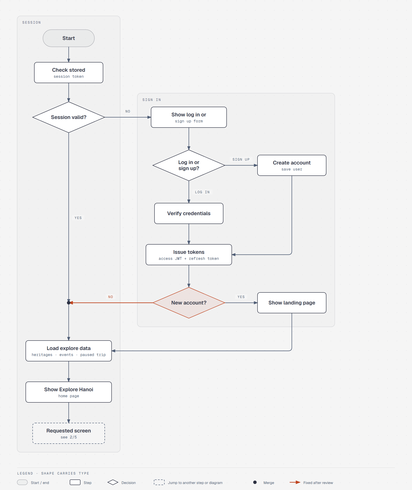
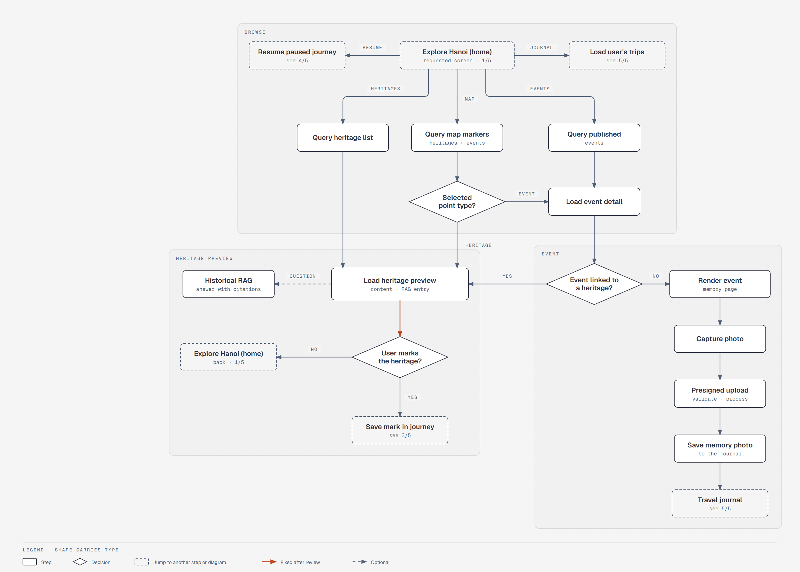
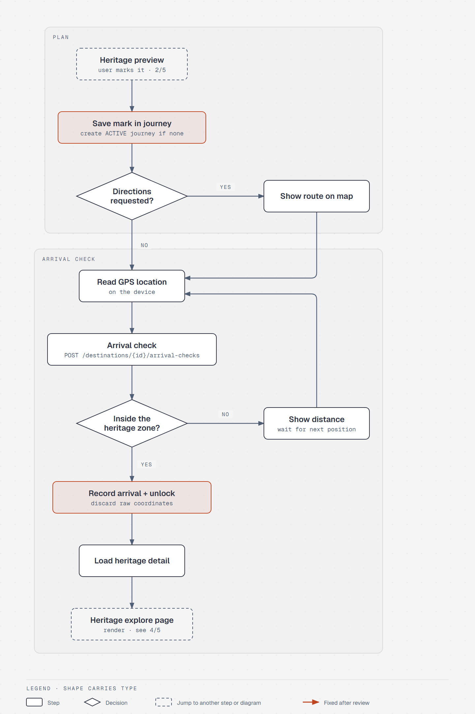
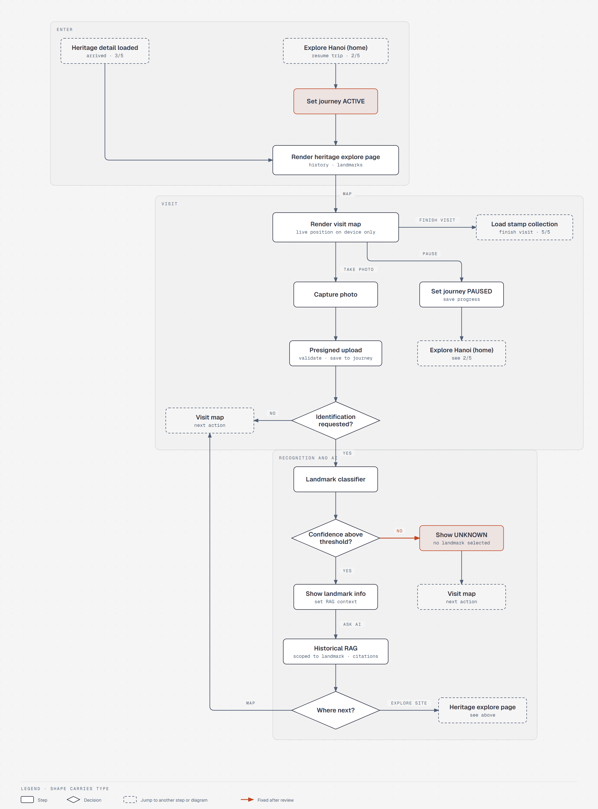
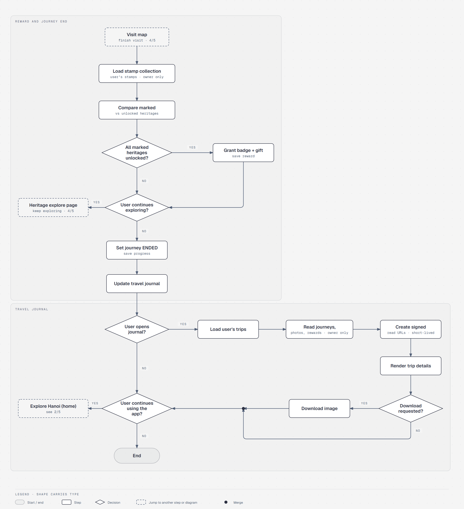
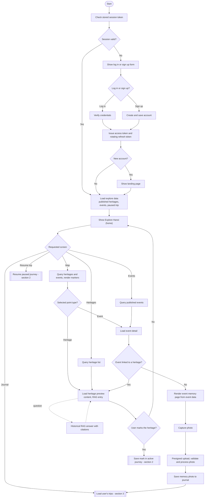
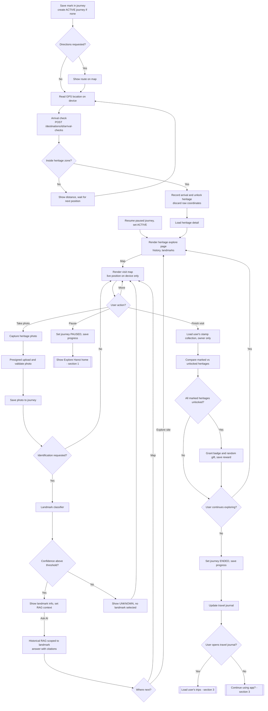
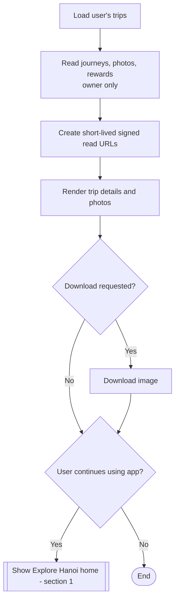

# Hanoi Lens System Flow

What the Android app and the Spring Boot backend do for each step of the [user flow](user-flow.md). All backend steps run inside the single Spring Modulith application ([ARCHITECTURE.md](../ARCHITECTURE.md)); endpoint names refer to the proposed contract in [API.md](../API.md).

Rules this flow encodes:

- Landing page only for **new** accounts; returning users go straight to the **Explore Hanoi (home)** page.
- Two explore pages: **Explore Hanoi (home)** is app-wide; the **Heritage explore page** belongs to the heritage the user is at. Unlock and resume open the Heritage explore page first, then the visit map. Pause returns home; "continue exploring" after the reward check stays on the Heritage explore page.
- Arrival check: coordinates are used once for the presence check, then discarded. The heritage is unlocked on arrival. Live position on the visit map stays **on the device** (BRIEF §6.2).
- Recognition below the confidence threshold returns `UNKNOWN`; nothing is unlocked or saved as a recognized landmark (ARCHITECTURE §9.2, ADR 008).
- Historical RAG is reachable from the heritage preview before travel; on site it is reached only from **landmark info** after a confident recognition, scoped to that landmark. It answers only with citations.
- Journey states follow API §7: `ACTIVE ⇄ PAUSED → ENDED`.
- Finishing a visit first loads the user's **stamp collection**, then compares marked vs unlocked heritages.

Rendered diagrams (diagram-design; source HTML next to each PNG, generator specs in `docs/Diagram/HTML/src/`):

| | |
|---|---|
| 1/5 Session and sign-in |  |
| 2/5 Discovery, preview and event memories |  |
| 3/5 Mark, arrive and unlock |  |
| 4/5 Visit map, photos and recognition |  |
| 5/5 Reward, journey end and travel journal |  |

## 1. Session, explore and discovery

## 2. Journey, arrival, visit and reward

## 3. Travel journal

## Changes from the reviewed diagrams (2026-10-22)

| # | Review comment | Fix |
|---|---|---|
| 1 | "Load heritage preview" had no outgoing path | `Load heritage preview → User marks the heritage?` |
| 2 | `UNKNOWN` still continued to "Save unlocked landmark" | Confidence decision: below threshold shows `UNKNOWN` and returns to the visit map; unlocking happens only on arrival |
| 3 | Returning users were sent to the landing page | `New account? — Yes → landing page, No → load explore data` |
| 4 | No marking step before "marked vs unlocked"; no pause/resume | `Save mark in journey` precedes arrival; `Pause` sets `PAUSED`, `Resume trip` sets `ACTIVE` and reopens the visit map |
| — | Unlabelled exits on "User continue exploring?" and "User continue using app?" | Every decision exit labelled Yes/No |
| — | Typos "Dowload", "Unknow", "User interesting the heritage?", "Question ask?" | Corrected wording |
| — | RAG reachable only after recognition | RAG answer available from the heritage preview, and on site after landmark info |
| — | Team request (2026-10-22), mirrored from the user flow | Explore Hanoi (home) vs Heritage explore page; unlock/resume → Heritage explore page → visit map; no direct Ask AI on the visit map (RAG after landmark info, then Map / Explore site); Finish visit → stamp collection → compare; continue exploring → Heritage explore page; static tips removed from the preview |
