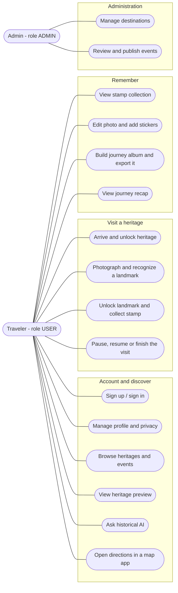

# Use case diagram

Actors and use cases of Hanoi Lens, taken from `docs/HANOI_LENS_PRODUCT_BRIEF.md`, `docs/API.md` and ADR 011/013 in `docs/ARCHITECTURE.md`. Rendered versions: `docs/Diagram/use-case.png` (+ `docs/Diagram/HTML/use-case.html`) and the StarUML model `docs/Diagram/HanoiLens-UseCase.mdj`.

## Use cases

| ID | Use case | Notes | Main API (proposed, `docs/API.md`) |
|---|---|---|---|
| UC1 | Sign up / sign in | Required before exploring | `POST /auth/register`, `/auth/login`, `/auth/refresh`, `/auth/logout` |
| UC2 | Manage profile and privacy | Locale, default location precision, automatic journey album | `GET`, `PATCH /me` |
| UC3 | Browse heritages and events | Explore Hanoi home: map, lists, nearby | `GET /destinations`, `/destinations/nearby`, `/events` |
| UC4 | View heritage preview | History plus the historical AI entry point | `GET /destinations/{id}` |
| UC5 | Ask historical AI | Cited RAG answers; on site scoped to the heritage and unlocked landmarks | `POST /ai/qa` |
| UC6 | Open directions in a map app | External map app (ADR 013); the app arms a 3 h on-device geofence | none (on device) |
| UC7 | Arrive and unlock heritage | Geofence arrival check, heritage stamp, visit starts; exact position discarded | `POST /destinations/{id}/arrival-checks`, `POST /visits` |
| UC8 | Photograph and recognize a landmark | Photo upload, classification, `UNKNOWN` is never guessed | `POST /media/uploads`, `POST /ai/recognize-landmark` |
| UC9 | Unlock landmark and collect stamp | Needs a `RECOGNIZED` photo (`recognitionId`) | `PUT /visits/{id}/landmarks/{landmarkId}`, `GET /me/stamps` |
| UC10 | Pause, resume or finish the visit | States `ACTIVE`, `PAUSED`, `ENDED` | `POST /visits/{id}/pause`, `/resume`, `/end` |
| UC11 | View stamp collection | Shown when a visit finishes and from the journal | `GET /me/stamps` |
| UC12 | Edit photo and add stickers | Colour presets, handwriting captions, stickers; original stays immutable | `POST /photos/{id}/edits`, `GET /stickers`, `GET /edit-presets` |
| UC13 | Build journey album and export it | User albums may mix heritages; EXIF stripped on export | `POST /albums`, `POST /albums/{id}/exports` |
| UC14 | View journey recap | Created automatically when a visit ends (if enabled) | `GET /recaps/{id}` |
| UC15 | Manage destinations | Admin only, audited | `/admin/destinations` |
| UC16 | Review and publish events | Imported events stay `PENDING_REVIEW` until published | `/admin/events/{id}/publish`, `/admin/event-imports/{id}` |

Out of scope on purpose: no badges, gifts or marked heritages (ADR 011), no photography tips, no in-app route (ADR 013), no real-time camera guidance.
