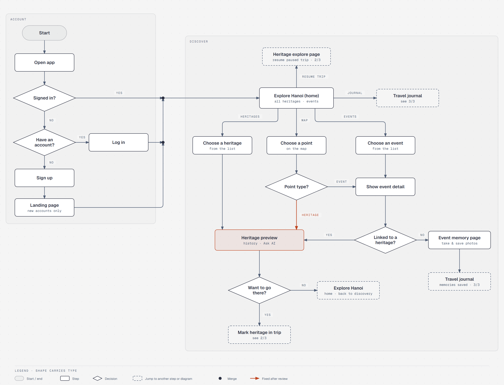
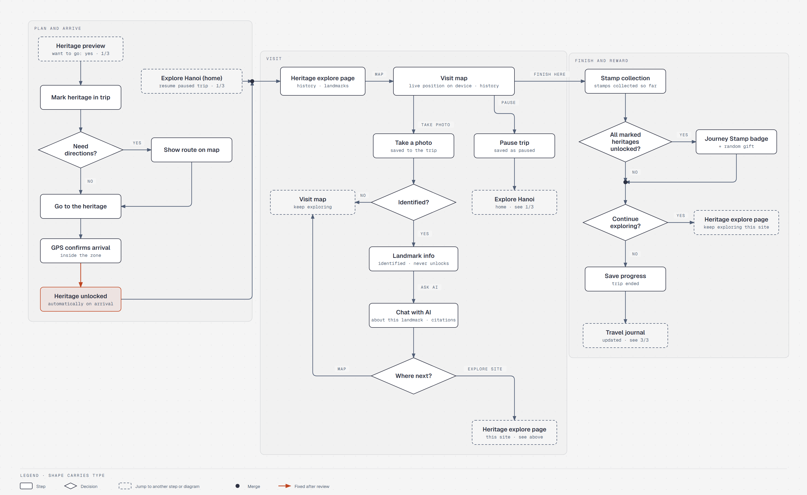
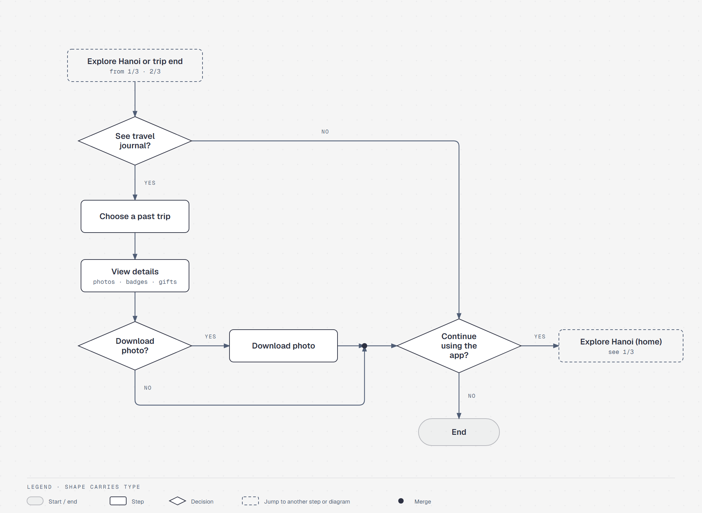
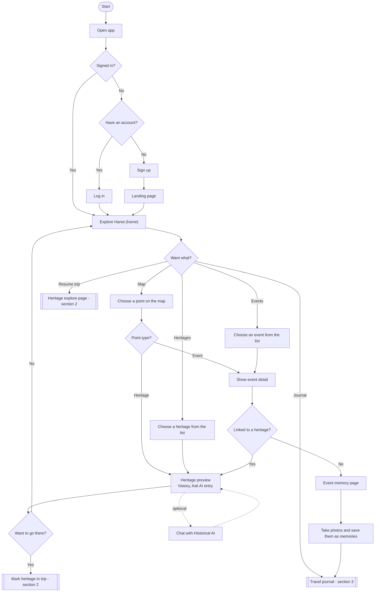
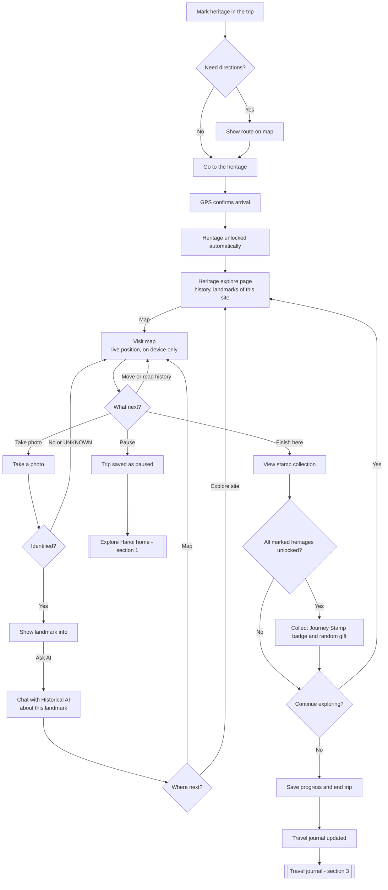
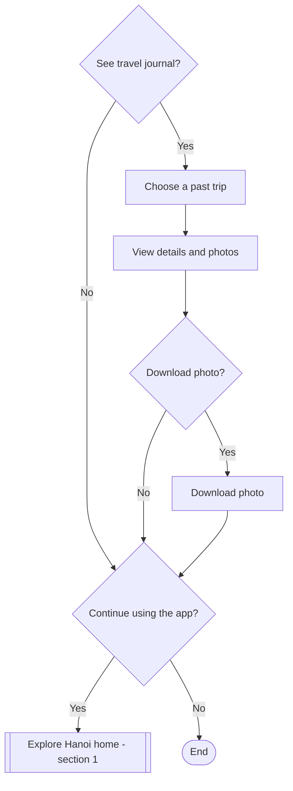

# Hanoi Lens User Flow

What the user sees and decides. The system-side counterpart is [system-flow.md](system-flow.md). Product rules come from [the product brief](../HANOI_LENS_PRODUCT_BRIEF.md) §5–§8; the StarUML source is `docs/Diagram/HanoiLens.mdj` (UserFlow) and the rendered images are in `docs/Diagram/`.

Rules this flow encodes:

- GPS arrival **unlocks** the marked heritage immediately (BRIEF §6.2). Landmark recognition is optional and never gates unlocking (BRIEF §6.4).
- The Historical RAG entry point is visible on the heritage preview **before** travel; on site, AI chat opens from landmark info after a photo is identified (BRIEF §6.1, §6.3).
- An event linked to a heritage continues as that heritage; an event without one opens the **event memory page** (BRIEF §6.7).
- A trip can be **paused** and resumed later from the Explore Hanoi home page (BRIEF §6.1, §6.8).
- Two different explore pages: **Explore Hanoi (home)** is the app-wide page shown after sign-in (all heritages, events, map, journal, resume trip); the **Heritage explore page** belongs to the heritage the user has arrived at (its history and landmarks) and is reached from the visit.

Rendered diagrams (diagram-design; source HTML next to each PNG, regenerate with `node docs/Diagram/HTML/src/gen.js docs/Diagram/HTML/src/u1.js <out.html>`):

| | |
|---|---|
| 1/3 Sign in and discover |  |
| 2/3 Trip: arrive, unlock, visit, reward |  |
| 3/3 Travel journal |  |

## 1. Sign in and discover

## 2. Trip: mark, arrive, unlock, visit, reward

## 3. Travel journal

## Changes from the reviewed diagrams (2026-10-22)

| # | Review comment | Fix |
|---|---|---|
| 1 | Typo "Continue exxploring" | "Continue exploring" (already fixed in `.mdj`, not in `UserFlow.jpg`) |
| 2 | Point type only had Event | Added the Heritage branch (already in `.mdj`, missing in the JPG) |
| 3 | GPS arrival did not unlock; unlocking depended on recognition | `GPS confirms arrival → Heritage unlocked automatically`; recognition is an optional step after "Take a photo" and loops back to the visit map |
| 3b | Typo "hisstotical" | "history" (already fixed in `.mdj`) |
| 4 | Event without heritage went to the heritage trip flow | `Linked to a heritage? — No → Event memory page → save memories to the journal` |
| 5 | No AI entry before arrival | Heritage preview carries history and the Ask AI entry; optional chat loop before deciding to go |
| 9 | No marking step; no pause/resume | `Mark heritage in the trip` precedes travel; `Pause` saves the trip and `Resume trip` on the explore page returns to the visit map |
| — | Recognition failure looped forever on "Take a photo" | Removed: `UNKNOWN` is shown and the user continues |
| — | Team request (2026-10-22): order of on-site pages | `Heritage unlocked → Heritage explore page → Visit map`; resuming a paused trip also opens the Heritage explore page; `Finish here → Stamp collection → All marked heritages unlocked?` |
| — | Team request (2026-10-22): "Explore page" meant two different pages | Renamed to **Explore Hanoi (home)** (after sign-in, after pause, journal) and **Heritage explore page** (on site: after unlock, "Where next? → Explore site", "Continue exploring? → Yes") |
| — | Team request (2026-10-22): on the visit map, AI chat is only reachable after a photo identifies a landmark | `Take photo → Identified? → Landmark info → Chat with AI → Where next? (Map / Explore site)`; the visit map no longer has a direct "Ask AI" branch. The heritage preview keeps its Ask AI entry |
